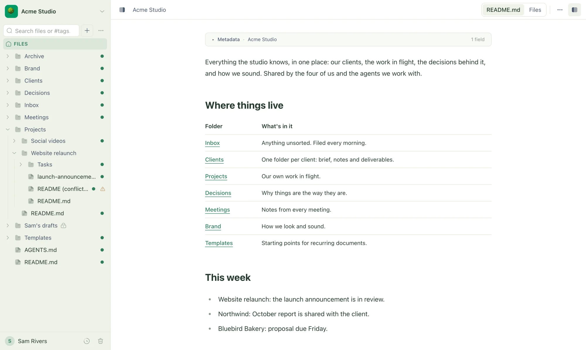
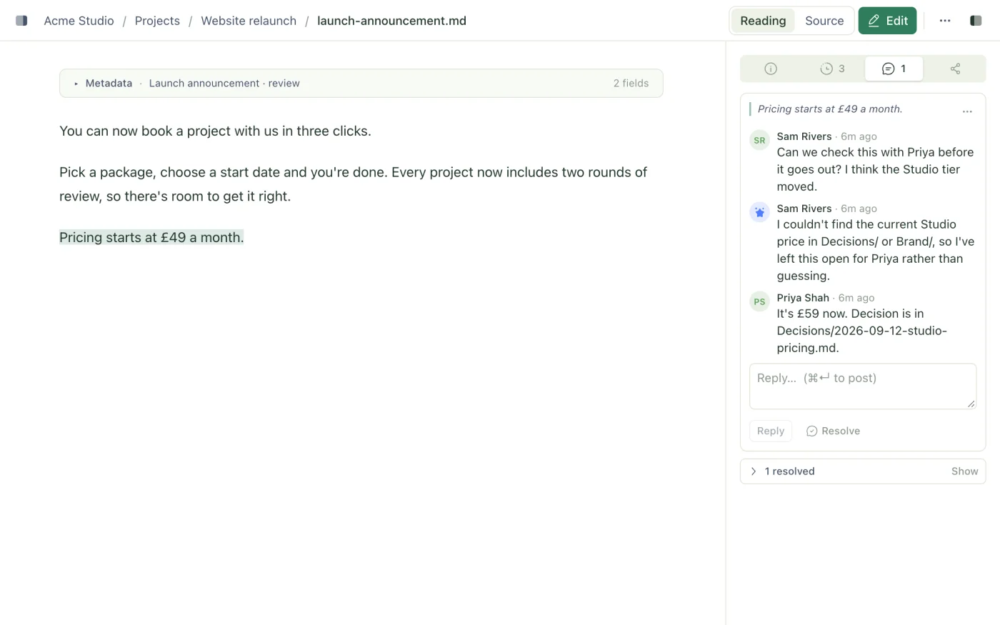
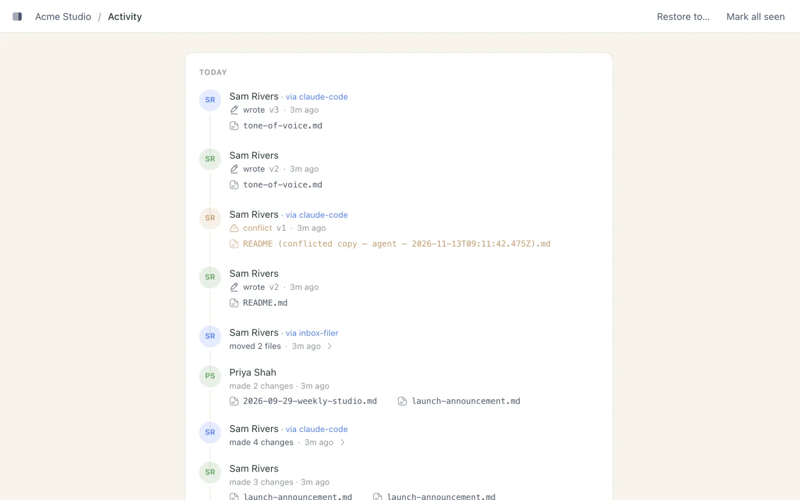
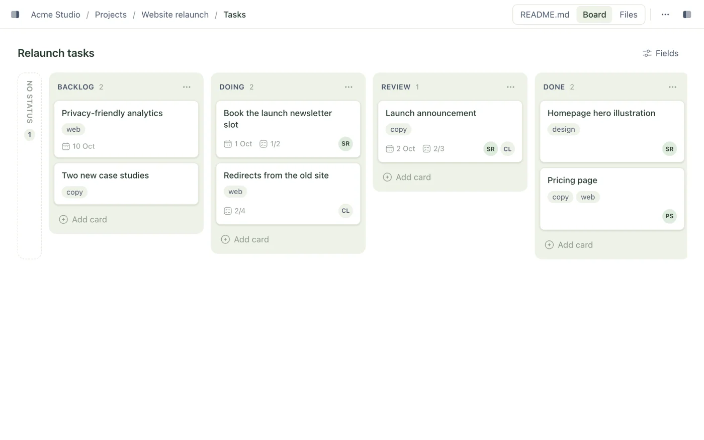
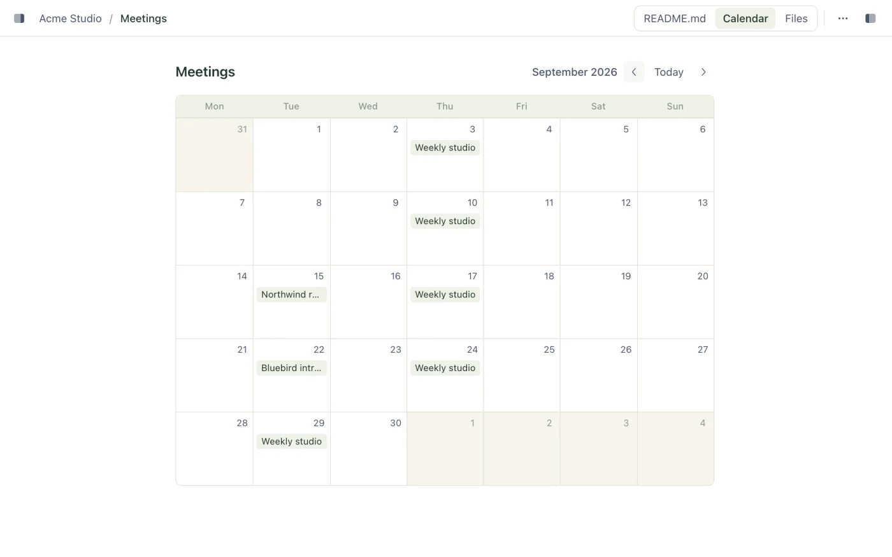

<p align="center">
  
</p>

<h1 align="center">Treehouse</h1>

<p align="center">
  <strong>A shared file workspace for people and their agents.</strong>
</p>

<p align="center">
  <a href="https://trytree.house">Website</a> ·
  <a href="https://trytree.house/docs">Docs</a> ·
  <a href="https://app.trytree.house">Hosted app</a> ·
  <a href="https://trytree.house/docs/self-hosting">Self-hosting</a>
</p>

<p align="center">
  <a href="./LICENSE"></a>
</p>



Agents are good at working with files. Teams are good at working together. Until
now you had to pick one: a folder on your laptop suits an agent but is hard to
share, and a wiki suits a team but gives an agent a clumsy API to fight.

Treehouse is both. A workspace is a set of plain files and folders, the kind your
agents already know how to use, with what a team needs built around them:
history, sharing, review and a record of who changed what.

## One workspace, three ways in

- **The web app**, for reading, writing, commenting and sharing from any browser.
- **A synced folder** on your computer, kept in step both ways by the desktop app
  or the `treehouse` CLI. Anything on your machine can use it, including coding
  agents like Claude Code or Codex.
- **The MCP server and REST API**, for agents that don't have your filesystem.
  Connecting one takes a single command:

  ```bash
  claude mcp add --transport http treehouse https://api.trytree.house/api/mcp
  ```

A change made in any of them shows up in the others within seconds.

## What it adds to a folder

- **Nothing is lost.** Every file keeps its full history, and any version can be
  restored. When two people (or a person and an agent) edit the same file at
  once, both versions are kept as a conflicted copy instead of one silently
  overwriting the other.
- **You can see who did what.** The activity feed shows every change and marks
  which came from a person and which from an agent.
- **Sharing is built in.** Invite teammates into a workspace, or share one file
  or folder with anyone by link, with an optional password.
- **Review happens in place.** Comment on a passage of a markdown file. Agents
  can read the comments, make the changes and reply.
- **Folders become pages.** A folder's `README.md` is its front page, a folder of
  dated notes opens as a calendar, and a folder of task files opens as a board.
- **Files are encrypted at rest**, with a key per workspace, so a leaked bucket or
  backup holds nothing readable.

Treehouse is where your team's work lives, not the thing that does the work. It
doesn't run agents or call AI models. You bring the agents and point them at
your workspace.

<table>
  <tr>
    <td width="50%"></td>
    <td width="50%"></td>
  </tr>
  <tr>
    <td align="center"><sub>Comments that people and agents both reply to</sub></td>
    <td align="center"><sub>Every change, attributed to a person or an agent</sub></td>
  </tr>
  <tr>
    <td width="50%"></td>
    <td width="50%"></td>
  </tr>
  <tr>
    <td align="center"><sub>A folder of task files, as a board</sub></td>
    <td align="center"><sub>A folder of dated notes, as a calendar</sub></td>
  </tr>
</table>

## Use it

- **Hosted:** sign up at [app.trytree.house](https://app.trytree.house). The
  [quickstart](https://trytree.house/docs/get-started/quickstart) takes about ten
  minutes and ends with an agent helping you set up your first workspace.
- **Self-hosted:** Treehouse runs on infrastructure you control. The
  [self-hosting guide](https://trytree.house/docs/self-hosting) covers the
  architecture and configuration, and [`DEPLOYMENT.md`](./DEPLOYMENT.md) walks
  through a reference setup on Cloudflare and Railway. Billing is off unless you
  configure it, so self-hosted workspaces have no plan limits unless you set some.

## How it's built

```
 Web app (Nuxt SPA) ─┐
 Desktop app / CLI ──┼──► API (Nitro) ──► PostgreSQL   metadata, versions, change feed
 Agents (MCP, REST) ─┘        │
                              └─────────► Blob storage  file bytes, encrypted (R2 or local disk)
```

Every write, from the web app, a synced folder or an agent, goes through one file
service in the API. It versions each file, keeps a conflicted copy when a write
is based on an old version, and records who made the change.

| Package                | What it is                                                                                                 |
| ---------------------- | ---------------------------------------------------------------------------------------------------------- |
| `packages/api`         | Nitro API: authentication ([better-auth](https://better-auth.com)), the file service, REST API, MCP server |
| `packages/app`         | Nuxt 4 single-page web app                                                                                 |
| `packages/desktop`     | Electron desktop app that keeps a workspace in sync with a local folder                                    |
| `packages/cli`         | `treehouse`, the two-way sync CLI                                                                          |
| `packages/db`          | Prisma 7 client and the database schema                                                                    |
| `packages/workers`     | BullMQ worker for background jobs                                                                          |
| `packages/blob-worker` | Cloudflare Worker that serves file bytes, with the code it shares with the API in `packages/blob-io`       |
| `packages/shared`      | Code shared across packages                                                                                |
| `packages/marketing`   | The website and the public docs at [trytree.house/docs](https://trytree.house/docs)                        |
| `packages/design`      | Brand tokens, fonts and logos (the spec is [`design.md`](./design.md))                                     |

## Run it locally

You need Node 22 (see [`.nvmrc`](./.nvmrc)), pnpm 11, Docker and
[Portless](https://portless.sh) (`npm install -g portless`).

```bash
git clone https://github.com/pixelhop/treehouse.git
cd treehouse
pnpm install
pnpm dev
```

`pnpm dev` starts Postgres in Docker, generates the `.env` files, runs the
migrations, and serves the app at `https://treehouse.localhost` and the API at
`https://api.treehouse.localhost`. The first run asks for your password once so
Portless can serve HTTPS on `.localhost`. Create an account and you land in your
own workspace.

To validate changes, run `vp check` (format, lint and typecheck) and `vp test`.
[`CONTRIBUTING.md`](./CONTRIBUTING.md) covers the tooling, the database schema,
parallel environments in git worktrees, and how the team works.

## Contributing

**We aren't accepting pull requests from people outside Pixelhop at the
moment.** Treehouse is still early and changing quickly, so please don't open
one.

**Issues are very welcome.** If you've found a bug or have an idea, please
[open an issue](https://github.com/pixelhop/treehouse/issues/new/choose).
[`CONTRIBUTING.md`](./CONTRIBUTING.md) has more on how to help.

To report a security vulnerability, follow [`SECURITY.md`](./SECURITY.md)
instead of opening a public issue.

## License

Treehouse is licensed under the [GNU Affero General Public License v3.0](./LICENSE)
(`AGPL-3.0-only`). That covers everything in this repository, including the
desktop app. The Treehouse name and logo are trademarks of Pixelhop and aren't
covered by the license: see [`TRADEMARK.md`](./TRADEMARK.md).

Made by [Pixelhop](https://pixelhop.io).