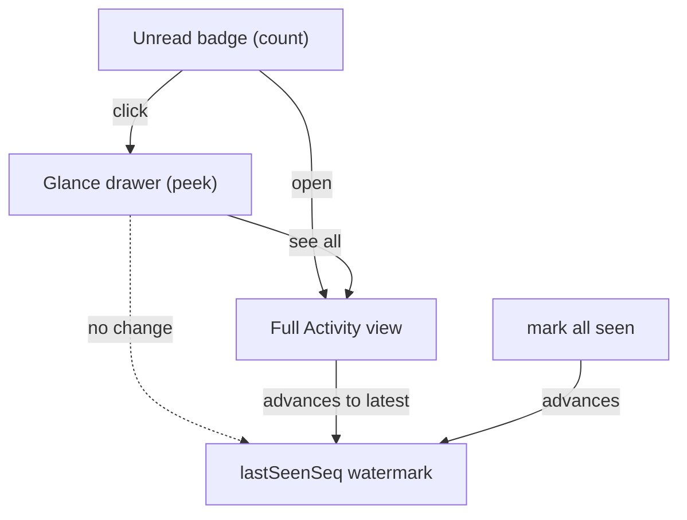

# Activity Feed (v1) — Requirements

## Summary

A workspace-wide activity feed that answers "what changed while you were away." An unread badge
opens a compact glance drawer; a full Activity view gives day-grouped scroll-back. Consecutive
events by the same actor collapse into one row, and a per-user watermark draws the "new since you
were here" line. v1 is a new read surface over the change log Treehouse already records — no
backend changes.

---

## Problem Frame

Treehouse already captures every change as an attributed, append-only `ChangeEvent` — but a human
can only see it one file at a time, in the per-file History tab of `FileInfoPanel.vue`. There is no
workspace-level view. So an agent that rewrites fourteen files overnight is invisible until you
happen to open each one; a human returning to a shared workspace has no way to ask "what happened
here while I was gone?"

This bites hardest in exactly the multi-principal workspaces the product is trying to grow: the
more an agent does, the more invisible work accumulates. The data to answer the question is already
there and reliably attributed — the gap is surfacing and catching up, not capture.

---

## Key Decisions

- **Surface an existing log, don't capture anything new.** v1 reuses `ChangeEvent`, the `/changes`
  API, and `utils/activity.ts`. No new write-path fields, no schema migration.
- **Both entry points: badge → glance drawer + full view.** A persistent unread badge opens a quick
  drawer for a peek; a dedicated Activity view gives room for day grouping and scroll-back.
- **Glance peeks, full view clears.** The drawer does not advance the watermark; only the full view
  (or an explicit "mark all seen") does. This keeps the unread count honest about what the user has
  actually reviewed.
- **Read-time clustering, not write-time run IDs.** Bursts group by actor + time gap when rendered.
  There is no single "run" concept to stamp at write time (the CLI sees a _sync flush_, not a
  semantic task), so v1 accepts fuzzy burst boundaries in exchange for zero schema/CLI change.
- **Conflicts get distinct-inline treatment, not a pinned strip.** Conflict/restore/delete events
  stand out by icon and color within the stream, without v1 having to model a "resolved" state.
- **Attribution as-is.** Use the existing `principal` (human/agent) and `actorLabel`. No
  author/committer split. CLI folder sync records as the human owner — an accepted tradeoff (see
  Dependencies / Assumptions).

---

## Actors

- A1. Returning human reader — the primary user. Opens the feed to catch up on what changed since
  they were last here.
- A2. Event producers — humans (web edits, CLI folder sync) and agents (MCP/API writes). They
  generate `ChangeEvent`s but do not read the feed in v1.

---

## Key Flows

- F1. Catch up after time away
  - **Trigger:** A2 produced events while A1 was gone; the badge shows an unread count.
  - **Steps:** A1 opens the full Activity view → sees the "new since you were here" divider →
    reviews clustered rows newest-first → the watermark advances to the latest event.
  - **Outcome:** A1 understands what changed; the badge resets, but the divider stays for this
    visit.
  - **Covered by:** R2, R4, R10, R11, R12.

- F2. Quick glance without losing the boundary
  - **Trigger:** A1 clicks the badge for a peek.
  - **Steps:** The glance drawer opens showing recent activity → the watermark does _not_ advance →
    A1 can click "see all" into the full view.
  - **Outcome:** A1 peeked; the unread count is unchanged.
  - **Covered by:** R3, R11.

- F3. Notice and act on a conflict
  - **Trigger:** A stale write produced a conflicted copy, emitting a `conflict` event.
  - **Steps:** The conflict row stands out by icon/color → A1 clicks it → navigates to the
    conflicted copy.
  - **Outcome:** A1 finds the conflicted copy without opening file histories one by one.
  - **Covered by:** R13, R14.

---

## Requirements

**Feed surface & navigation**

- R1. A workspace-wide activity feed shows `ChangeEvent` activity across all paths in the workspace,
  not scoped to a single file.
- R2. The feed is reachable from a persistent unread entry point (a badge) available across the
  workspace surfaces.
- R3. The entry point opens a compact glance drawer of the most recent activity, with a "see all"
  affordance into the full Activity view.
- R4. The full Activity view presents the timeline grouped by day, newest first, with scroll-back
  through older activity.

**Clustering & row anatomy**

- R5. Consecutive events by the same actor within a clustering window collapse into a single cluster
  row that summarizes the burst (e.g., "claude-bot wrote 14 files"). Mixed operations in one burst
  are summarized together.
- R6. A cluster row is expandable to reveal its constituent events. A single event renders as a
  normal, non-clustered row.
- R7. Each row shows the actor with a visual distinction between human and agent principals, an
  operation summary, affected file reference(s), and a relative timestamp.
- R8. Clicking a file reference navigates to that file (or its existing per-file history).

**Unread & watermark**

- R9. Each signed-in user has a per-workspace last-seen position (`lastSeenSeq`) that determines
  which events are unread.
- R10. The feed marks the boundary between seen and unread with a "new since you were here" divider,
  and the badge shows an unread count.
- R11. Opening the glance drawer does not advance the watermark. Opening the full Activity view
  advances the watermark to the latest event; an explicit "mark all seen" action also advances it.
- R12. When the watermark advances on opening the full view, the "new since you were here" divider
  remains visible for the current visit so the user can still see what was new.

**Conflicts & high-stakes events**

- R13. Conflict, restore, and delete events render inline in chronological order but with a distinct
  icon and color so they stand out from ordinary writes.
- R14. A conflict row links to the conflicted copy it created.

**Data & performance**

- R15. The feed is built on the existing `/changes` API and client activity helpers. v1 introduces
  no server-side filtering, no new write-path fields, and no realtime transport — polling is
  acceptable.
- R16. Older activity loads on demand via the existing cursor (scroll-back), rather than fetching
  the entire workspace history at once.

---

## Acceptance Examples

- AE1. Burst clustering
  - **Covers R5, R6.**
  - **Given** an agent wrote 14 files within the clustering window and nothing else happened around
    it, **when** the feed renders, **then** it shows one expandable row ("…wrote 14 files") that
    expands to the 14 individual events.

- AE2. Peek vs. clear
  - **Covers R11, R12.**
  - **Given** 3 unread events, **when** the user opens the glance drawer and closes it, **then** the
    badge still shows 3. **When** the user instead opens the full Activity view, **then** the badge
    clears and the "new since you were here" divider stays visible above those 3 events for the rest
    of the visit.

- AE3. Conflict visibility
  - **Covers R13, R14.**
  - **Given** a stale write created a conflicted copy, **when** the feed renders that event, **then**
    it appears inline with a distinct conflict icon/color and links to the conflicted copy.

---

## Scope Boundaries

Deferred for later (roadmap, explicitly out of v1):

- Live push / SSE and presence ("who's active now") — polling is acceptable for v1.
- Agents consuming the feed over MCP as situational-awareness input.
- Server-side filtering and saved/standing queries (path / principal / op).
- Digests and email summaries.
- Device-name provenance via per-device keys ("Joseph · MacBook Air").
- CLI sync-batch IDs / write-time run IDs for precise clustering.
- Time-travel scrubber / point-in-time workspace reconstruction (that's version history, a separate
  feature).

---

## Dependencies / Assumptions

- Builds on the existing, verified backend: the `ChangeEvent` model in
  `packages/db/prisma/schema.prisma`, the dual-cursor endpoint at
  `packages/api/server/routes/api/workspaces/[workspaceId]/changes.get.ts`, and the client helpers
  in `packages/app/app/utils/activity.ts`. The existing per-file history UI in
  `packages/app/app/components/FileInfoPanel.vue` is the surface this generalizes.
- **Metric consequence (accepted):** because folder-synced agent output records as the human owner,
  "agent writes per workspace/week" and "% multi-principal workspaces" will count only
  _Treehouse-native_ agents — those writing through MCP/API — not agents whose work arrives via a
  device sync. This is the intended definition for v1.
- Polling is acceptable for freshness; no realtime transport is introduced.

---

## Outstanding Questions

Deferred to planning:

- The clustering window value and exact grouping rule (gap threshold between events; how mixed
  operations summarize).
- Unread-count accuracy at scale: count from a recent fetched page capped at "9+" versus adding a
  lightweight count, given v1 does no server-side aggregation.
- Pagination page size and the glance drawer's item cap.
- The precise location of the badge entry point within the workspace chrome.

---

## Sources

- docs/ideation/2026-06-12-activity-feed-ideation.md — the grounded ideation this brainstorm seeds
  from (survivors, parked roadmap, discussion outcome).
- packages/db/prisma/schema.prisma — `ChangeEvent` shape (`op`, `principal`, `actorLabel`, `seq`, …).
- packages/api/server/routes/api/workspaces/[workspaceId]/changes.get.ts — the `/changes` API
  (dual cursor, `{ changes, head }`, no server-side filtering yet).
- packages/app/app/utils/activity.ts — client activity helpers (relative time, conflicted-copy
  pairing) to reuse.
- packages/app/app/components/FileInfoPanel.vue — existing per-file history UI to generalize.
- packages/app/app/composables/useChangeFeedPoll.ts — existing 5s edit-time poll; the polling basis
  for v1 freshness.