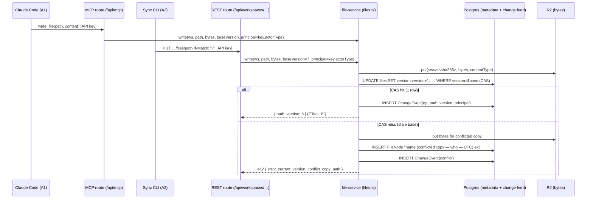

# feat: Treehouse MVP (dogfooding v0)

## Summary

Extend the existing monorepo into a working Treehouse v0: a cloud workspace of plain files exposed through a shared file-service (optimistic-concurrency writes, conflicted-copy on collision, a change feed), surfaced both as a REST HTTP API and an MCP server for Claude Code, with file bytes in R2 behind a storage adapter and metadata in Postgres. A new `packages/cli` does two-way folder sync, and the Nuxt app gains a read-only file browser. Sequenced so each unit is an atomic, independently-verifiable commit.

---

## Problem Frame

Pixelhop runs Claude Code on real client and internal documents but has no shared substrate where the agent and the team operate the _same_ files without giving up the files-on-disk workflow. The brainstorm (see `docs/brainstorms/treehouse-mvp-requirements.md`) resolved _what_ to build and _why_; this plan resolves _how_ to build it on the current template (Nitro/better-auth API, Nuxt SPA, Prisma 7/Postgres, BullMQ workers) within the Cloudflare-app / Railway-backend split.

---

## Requirements

Traced from the origin requirements doc. R-IDs match origin.

**Agent interface**

- R1. MCP server exposing filesystem-verb tools (read, write, move/rename, delete, list) over a workspace.
- R2. MCP is backed by an HTTP API that is the actual contract; MCP tools are clients of the same logic.
- R3. Every successful write/move/delete is recorded in a per-workspace change feed, attributed to agent vs human, sufficient to measure agent writes/workspace/week.
- R8. Claude Code connects to a workspace's MCP server with no bespoke glue beyond standard MCP config.

**Sync (human access)**

- R4. A CLI syncs a cloud workspace to a local folder two-way (pull remote down, push local up).
- R5. The CLI has a watch mode that keeps a local folder continuously reconciled.
- R6. Writes use optimistic concurrency: a write carries the base version it derived from; stale writes are special-cased.
- R7. On conflict, both existing and incoming content are preserved as distinct files (conflicted copy) — no silent loss.

**Storage & identity**

- R11. The cloud workspace is the single source of truth; agent and human changes reconcile against it.
- R12. Files are identified by path within a workspace for v0 (rename = delete + create).
- R13. Binary files sync as opaque blobs and round-trip intact through both the API and the CLI.

**Web view**

- R9. Signed-in team members browse a workspace's file tree on the web.
- R10. The web app renders text/markdown read-only; binaries are listed but not rendered inline.

**Workspace & access**

- R14. A workspace belongs to an organization (better-auth org); all org members can read/write its files. No per-file permissions in v0.

**Origin actors:** A1 (Agent / Claude Code), A2 (Team member), A3 (Treehouse service)
**Origin flows:** F1 (Agent does real work), F2 (Human + agent share files), F3 (Concurrent edit without loss), F4 (Read-only web visibility)
**Origin acceptance examples:** AE1 (covers R6, R7), AE2 (covers R3), AE3 (covers R4, R11), AE4 (covers R10, R13)

---

## Scope Boundaries

### Deferred for later

Carried from origin — product/version sequencing. Work that will happen eventually, not in v0.

- Client portals, the per-node auth menu (public / secret-link / password / account), and the viewer/client tier.
- Per-node ACLs and permission inheritance.
- Version history, content-addressed _versioning_ (history/restore), beyond the content-addressed _blob keys_ used internally for storage.
- Stable node IDs with move/rename detection (v0 uses path-based identity).
- A native desktop sync app (menu-bar/tray); v0 is CLI-only.
- Self-host / SQLite backend and multi-backend storage portability (keep the adapter seam, defer alternate backends).

### Outside this product's identity

Carried from origin — positioning rejections.

- GitHub-for-code semantics: branching, rebasing, cherry-picking.
- CRDT / operational-transform real-time co-editing.
- Syncing dependency folders, build caches, or full dev environments.
- Feature-for-feature parity with Fastio.

### Deferred to Follow-Up Work

Plan-local — implementation work intentionally not in this plan.

- CI workflow setup (`.github/workflows/` is empty today) — separate follow-up.
- Presigned / direct-to-R2 uploads and downloads — v0 proxies bytes through the API.
- Automatic conflict merging — v0 keeps both copies; resolution is manual.
- Rate limiting on API keys (the plugin supports it) — not enabled in v0.
- Background change-feed processing in `packages/workers` — only add if write-path latency demands it; v0 writes the feed synchronously.

---

## Context & Research

### Relevant Code and Patterns

- `packages/api/server/routes/api/me.get.ts` — protected-route pattern (`auth.api.getSession({ headers })` → `createError(401)`). Mirror for authenticated file/MCP routes.
- `packages/api/server/routes/api/auth/[...all].ts` — the Web-`Request`→h3 bridge (`auth.handler(toWebRequest(event))`). The MCP route mirrors this with `sendWebResponse`.
- `packages/api/server/utils/auth.ts` — `betterAuth({...})` with `plugins: [organization()]`; add the api-key plugin here. `export type Auth = typeof auth`.
- `packages/api/server/middleware/cors.ts` — credentialed, origin-specific CORS; the `Access-Control-Allow-Headers` list and methods must gain the version header used for optimistic concurrency.
- `packages/db/index.ts` — `usePrismaClient()` lazy singleton + `export * from "./generated/prisma/client"`. Canonical DB entry; new models go in `packages/db/prisma/schema.prisma`.
- `packages/db/prisma/schema.prisma` — better-auth + organization models; `Organization` is the workspace owner (R14). New Treehouse models append here.
- `packages/workers/server/utils/queues.ts` + `server/jobs/example/worker.ts` — `use*` factory + job pattern, if async work is ever needed.
- `packages/app/app/composables/useAuthClient.ts`, `app/middleware/auth.ts`, `app/pages/*.vue` — memoized auth client, page gating (`definePageMeta({ middleware: "auth" })`), credentialed `$fetch`. The read-only browser lives here.
- `use*` singleton convention (`usePrismaClient`, `useRedis`, `useQueue`) — mirror as `useStorage()` for the blob adapter.
- Auth-change workflow: edit `auth.ts` → `pnpm --filter api run auth:generate` (writes `../db/prisma/schema.prisma`) → `pnpm --filter db run prisma:migrate`.

### Institutional Learnings

- None — `docs/solutions/` does not exist (greenfield). Capture learnings post-landing (the cross-origin auth and split-deploy seams are the likely friction points) via `/ce-compound`.

### External References

Version-accurate, verified against installed packages (2026):

- **MCP SDK is `@modelcontextprotocol/sdk@1.x`** (single package, subpath imports with `.js`). **Transport caveat (verify at install — see U5/Risks):** sources disagree on whether the Fetch-standard `WebStandardStreamableHTTPServerTransport` ships in v1 or only in the v2 `@modelcontextprotocol/server` package; the v1 SDK definitely ships the Node `http`-based `StreamableHTTPServerTransport` (driven by `event.node.req/res`). Confirm against the installed package and pick the transport accordingly; do not assume the Fetch transport is present in v1 without checking. Tools via `registerTool(name, { inputSchema: <ZodRawShape> }, handler)`; per-call context via the handler's `extra.authInfo` (with `extra.authInfo.extra` carrying workspace scope), fed in through `transport.handleRequest(req, { authInfo })`. Claude Code connects via `claude mcp add --transport http <name> <url> --header "Authorization: Bearer …"`.
- **better-auth api-key plugin is a separate package `@better-auth/api-key@1.6.x`** (lockstep with `better-auth`). 1.6.x takes a single options object. Adds one `apikey` table. `enableSessionForAPIKeys: true` makes `auth.api.getSession({ headers })` work with the key header (default `x-api-key`) — keeps `me.get.ts`-style code identical. Associate a key with an org/workspace via `metadata` and/or `references`/`referenceId`. The `bearer` plugin is session-token-based (short-lived) — wrong for a long-lived agent/CLI credential.
- **R2 via the S3 API** (`@aws-sdk/client-s3`) from the Railway/Node host (not a Workers binding). Preserves `Content-Type` and bytes verbatim (no transforms). Pin a known-good SDK version and/or set `requestChecksumCalculation: "WHEN_REQUIRED"` to avoid the `x-amz-checksum-crc32` R2 incompatibility. Smoke-test a real PDF round-trip.
- **Optimistic concurrency**: per-file `version` integer = ETag; write guarded by `If-Match`; do the bump as a single CAS `UPDATE … WHERE version = $base` so concurrent same-base writers can't both win. Stale write → `412` with a body describing the conflict; missing precondition → `428`; new-file create → `If-None-Match: *`. Also store a `content_hash` (SHA-256) for no-op detection and dedupe.
- **Conflicted copy** (Dropbox/Syncthing/rclone model): keep the winner untouched; write incoming bytes to a new path `name (conflicted copy — who — UTC).ext` in the same folder (suffix before extension); make it collision-safe; the human resolves manually. Delete-vs-edit conflict: edit wins over a stale delete (resurrection over loss).
- **Two-way sync needs a third state**: a local index (SQLite) of last-synced `{version, hash, mtime, size}` per path distinguishes local vs remote changes. Detect via mtime/size then hash; debounced watcher (~10s) + periodic full scan; pull then push; write pulled files atomically (temp + rename); delay/cap deletes; ignore editor temp files (`*.swp`, `*~`, `.#*`, `*.tmp`, `4913`, `.DS_Store`); normalize unicode/case in paths. Let the server own conflict naming — the client just pulls the conflicted copy down.

---

## Key Technical Decisions

- **API-key auth for all non-cookie clients (agent + CLI)** via `@better-auth/api-key`, with `enableSessionForAPIKeys: true` so the existing `getSession({ headers })` pattern works unchanged. Keys carry workspace/org scope in `metadata`/`referenceId`. Rationale: long-lived, revocable, hashable credentials; the `bearer` plugin's token is a session token (wrong lifecycle). OAuth (better-auth `mcp` plugin) deferred — static header auth is far simpler for dogfooding.
- **One shared in-process file-service module** is the single source of write logic; REST routes expose it as the public HTTP contract (satisfying R2), and MCP tools call the same module directly (no internal HTTP hop). Rationale: one place for the CAS/conflict/change-feed invariants; avoids drift between two write paths.
- **Agent-vs-human attribution by credential, not channel**: each API key carries an `actorType` (`agent` | `human`) in its metadata, set at creation. The file-service takes a `principal` argument derived from the authenticated key's `actorType` (cookie-session web writes — none in v0, since the web app is read-only — would default to `human`). Rationale: the leading metric (agent writes/week) must stay correct even when an agent uses the HTTP API directly (which R2 allows) or a human connects a tool to MCP; tying attribution to the credential instead of the route makes the metric trustworthy regardless of channel. The route is no longer the source of truth for attribution.
- **Optimistic concurrency = integer `version` as ETag + `If-Match` CAS**; stale write → server creates a conflicted copy and returns `412`; never drops bytes. Store `content_hash` alongside for no-op/dedupe. Rationale: textbook lost-update prevention, data-safety-first (origin R6/R7, AE1).
- **Storage split behind an adapter**: metadata (path, version, hash, size, content-type, blob key, deleted) in Postgres; bytes in R2 via the S3 API behind a `BlobStore` interface with only an R2 driver shipped. Object keys are content-addressed (`<workspaceId>/<sha256>`) so objects are immutable and identical content dedupes. Rationale: binaries don't belong in Postgres; the seam keeps own-your-data/self-host viable later (strategy) without building alternate backends now.
- **MCP transport = stateless, mounted in a Nitro catch-all.** Prefer the Fetch-standard transport bridged via `toWebRequest`/`sendWebResponse` (exactly like the existing better-auth catch-all) _if_ it exists in the installed SDK package; otherwise use the Node `StreamableHTTPServerTransport` over `event.node.req/res`. Rationale: stateless suits horizontally-scaled Railway (no session pinning); keep the route thin so the transport is swappable. Verify the transport class at install (see Risks) and pin the package.
- **Workspace is its own entity owned by an `Organization`** (orgId FK); v0 auto-creates one workspace per org on first access. Rationale: files need a `workspaceId` anchor; modeling the entity now keeps N-workspaces-per-org open without committing to the UI for it.
- **CLI is a new `packages/cli`** with a local SQLite index for correct two-way reconcile. Rationale: matches the workspace-package convention; the index is non-negotiable for safe two-way sync.

---

## Open Questions

### Resolved During Planning

- Where the MCP server runs / how it authenticates a workspace: in `packages/api` (Railway), authenticated by an API key whose metadata scopes it to a workspace; scope flows into `authInfo.extra`. (origin: deferred-to-planning)
- Conflicted-copy naming convention: `name (conflicted copy — <who> — <UTC>).ext`, collision-safe, same folder. (origin)
- Blob storage choice + adapter shape: R2 via S3 API behind `BlobStore`; content-addressed keys. (origin)
- Change-feed storage + attribution: a Postgres `ChangeEvent` table written synchronously in the file-service; principal recorded from the authenticated key's `actorType` (by credential, not by route). (origin)
- CLI conflict-detection mechanics: local SQLite index (third state) + CAS push with `If-Match`; server arbitrates conflicts. (origin)

### Deferred to Implementation

- Exact `@modelcontextprotocol/sdk` / `@better-auth/api-key` / `@aws-sdk/client-s3` patch versions to pin — confirm latest-known-good at install time and verify against the v1-vs-v2 and checksum pitfalls noted above.
- Whether `auth:generate` preserves hand-added Treehouse models in `schema.prisma` or overwrites them — verify empirically (see Risks); sequence U1 before U2 regardless.
- File watcher library choice for the CLI (e.g. `chokidar` vs `@parcel/watcher`, the latter already in `onlyBuiltDependencies`) — decide during U6; periodic scan is the correctness backstop either way.
- Markdown rendering library for the web viewer — choose a Workers-safe renderer during U7.
- Whether MCP runs stateful (notifications/resumability) later — v0 is stateless; revisit if Claude Code needs streaming notifications for long agent tasks.
- Move/rename atomicity: run delete+create in one DB transaction; a move carries the source's base version (412 if stale); define the move-vs-concurrent-edit outcome (R12).
- Conflict-of-a-conflict: behavior when the conflicting path already matches the conflicted-copy pattern (normalize/strip suffix or cap nesting); resolution = human deletes the loser, and that delete must not resurrect it through the index (R7).
- Blob GC vs content-hash dedupe: needs reference-counting before any GC ships (shared-content blob must not be deleted while another node references it) (R11/R13).
- Path normalization (macOS NFD/case-insensitive vs Linux NFC/case-sensitive) on both CLI and the server's `(workspaceId, path)` unique constraint, to avoid phantom conflicts / undetectable divergence (R4/R12).
- CLI credential storage hardening (file permissions or OS keychain); plaintext config acceptable for v0 dogfooding — note the tradeoff (R4).
- [Strategic] The adapter seam covers file _bytes_ but not _metadata_ (Postgres); the strategy's own-your-data pillar and future D1-per-workspace shard model also concern the control plane — revisit the metadata boundary before self-host, not in v0.

---

## Output Structure

New and modified files (repo-relative). Per-unit `**Files:**` sections are authoritative.

    packages/
      api/
        server/
          utils/
            auth.ts                       # MODIFY: add apiKey plugin
            storage.ts                    # NEW: BlobStore interface + R2 driver + useStorage()
            workspace.ts                  # NEW: workspace resolve/bootstrap helpers
            files.ts                      # NEW: shared file-service (CAS write, conflict, change feed)
            mcp.ts                        # NEW: McpServer factory + filesystem-verb tools
          middleware/
            cors.ts                       # MODIFY: allow version header (If-Match/ETag)
          routes/api/
            workspaces/
              [workspaceId]/
                files/
                  [...path].get.ts        # NEW: read file / list dir
                  [...path].put.ts        # NEW: write file (If-Match)
                  [...path].delete.ts     # NEW: delete file
                move.post.ts              # NEW: move/rename
                changes.get.ts            # NEW: change feed read
            mcp/
              [...].ts                    # NEW: MCP streamable-HTTP catch-all
            keys/                         # NEW: API-key create/list/revoke (session-auth'd)
        .env.example                      # MODIFY: R2 + base URL vars
      db/
        prisma/
          schema.prisma                   # MODIFY: Workspace, FileNode, ChangeEvent (+ apikey via generate)
          migrations/                     # NEW migration(s)
      cli/                                # NEW PACKAGE: treehouse sync CLI
        package.json
        src/ (index, config, api-client, index-db, reconcile, watch)
        .env.example
      app/
        app/
          pages/
            workspace.vue                 # NEW: file browser + viewer
          composables/
            useTreehouseApi.ts            # NEW: credentialed API client
          components/                     # NEW: file tree + viewer components

---

## High-Level Technical Design

> _This illustrates the intended approach and is directional guidance for review, not implementation specification. The implementing agent should treat it as context, not code to reproduce._

Write path — one service, two channels, shared invariants:

Sync reconcile (CLI, per cycle) — the local index is the third state:

| Local vs index         | Remote vs index   | Action                                                                                                |
| ---------------------- | ----------------- | ----------------------------------------------------------------------------------------------------- |
| unchanged              | unchanged         | nothing                                                                                               |
| edited                 | unchanged         | push with `If-Match: last_synced_version`                                                             |
| unchanged              | edited            | pull, write atomically (temp+rename), update index                                                    |
| edited                 | edited            | push → server returns 412 → pull the server's conflicted copy                                         |
| deleted locally        | unchanged         | push delete (`If-Match`); on 412 the file was edited remotely → pull it back (resurrection over loss) |
| unchanged              | deleted remotely  | delete locally, update index                                                                          |
| edited locally         | deleted remotely  | keep the local edit, re-create it on the server (resurrection over loss)                              |
| deleted locally        | edited remotely   | pull the remote edit back (resurrection over loss)                                                    |
| deleted locally        | deleted remotely  | converge: drop from index, no error                                                                   |
| created (not in index) | created same path | push as create (`If-None-Match: *`); on conflict pull the server's conflicted copy                    |

Rule of thumb mirrored from the server: **an edit always beats a stale delete**; deletes propagate only when the other side didn't touch the file. Deletes are delayed/capped (see U6) so a rename-as-delete+create settles first.

---

## Implementation Units

- U1. **Enable API-key authentication**

**Goal:** Add non-cookie auth so the agent and CLI can authenticate; keys scope to a workspace/org.

**Requirements:** R8, R14 (and enables R1–R7)

**Dependencies:** None

**Files:**

- Modify: `packages/api/server/utils/auth.ts` (add `apiKey({ enableSessionForAPIKeys: true, … })` to `plugins`)
- Modify: `packages/api/package.json` (add `@better-auth/api-key`)
- Modify: `packages/db/prisma/schema.prisma` (regenerated `apikey` table via `auth:generate`)
- Create: migration under `packages/db/prisma/migrations/`
- Test: `packages/api/test/auth-api-key.test.ts`

**Approach:**

- Install `@better-auth/api-key` (pin to the `better-auth` version, 1.6.x). Configure the plugin with a single options object; enable session-for-api-keys so `getSession({ headers })` works with the key header.
- Run `pnpm --filter api run auth:generate` then `pnpm --filter db run prisma:migrate`. **Do this before U2** (see Risks — generate may overwrite hand-added models).
- Decide key→workspace association: `metadata.workspaceId` (+ org via `referenceId`). Also store `metadata.actorType` (`agent` | `human`) on each key — this drives change-feed attribution (see Key Technical Decisions), not the request route. Document the header (`x-api-key` default).
- Key create/list/revoke REST routes are defined in U4 (they need workspace resolution); U8 only adds the UI over them. U1's own test can mint a key directly via `auth.api.createApiKey`.

**Patterns to follow:** `packages/api/server/utils/auth.ts` plugin array; the documented `auth:generate → prisma:migrate` workflow.

**Test scenarios:**

- Happy path: a created API key authenticates a request — `getSession` with the key header returns the owning user/session.
- Covers AE2 (partial): the resolved session exposes the workspace/org scope stored in key metadata.
- Edge: a disabled/revoked key is rejected.
- Error: a malformed/unknown key yields no session (401 at the route layer).

**Verification:** A key minted in a test authenticates an otherwise-protected request; the `apikey` table exists post-migration.

---

- U2. **Treehouse domain data model**

**Goal:** Persist workspaces, file metadata, and the change feed.

**Requirements:** R11, R12, R14 (enables R3, R6, R13 — behavior lands in U4/U5/U6)

**Dependencies:** U1 (run auth:generate first)

**Files:**

- Modify: `packages/db/prisma/schema.prisma` (add `Workspace`, `FileNode`, `ChangeEvent`)
- Create: migration under `packages/db/prisma/migrations/`
- Test: `packages/db/test/schema.test.ts` (basic CRUD/constraint checks)

**Approach:**

- `Workspace`: id, `organizationId` (FK → `Organization`), name, timestamps. Unique-per-org default workspace.
- `FileNode`: id, `workspaceId`, `path`, `version` (int, default 1), `contentHash`, `size`, `contentType`, `blobKey`, `deleted` (bool), timestamps. Unique on `(workspaceId, path)`.
- `ChangeEvent`: id, `workspaceId`, `path`, `op` (write/move/delete/conflict), `version`, `principal` (agent/human — sourced from the authenticated key's `actorType`, not the route), `actorId`, `createdAt`. Index on `(workspaceId, createdAt)`.
- Path-based identity (R12): no node IDs; rename = delete + create rows.

**Patterns to follow:** existing `@@map`'d models in `schema.prisma`; `usePrismaClient()` for access.

**Test scenarios:**

- Happy path: create workspace + file node; read back by `(workspaceId, path)`.
- Edge: unique constraint on `(workspaceId, path)` rejects a duplicate active path.
- Edge: `version` defaults to 1 on insert.
- Integration: inserting a `ChangeEvent` references a real workspace/path.

**Verification:** Migration applies cleanly; constraints enforce one active node per path; change events insert.

---

- U3. **Blob storage adapter (R2)**

**Goal:** Store/retrieve file bytes in R2 behind a swappable interface; bytes round-trip intact.

**Requirements:** R11, R13

**Dependencies:** None (usable independently; integrated by U4)

**Files:**

- Create: `packages/api/server/utils/storage.ts` (`BlobStore` interface, `R2BlobStore`, `useStorage()`)
- Modify: `packages/api/package.json` (add `@aws-sdk/client-s3`)
- Modify: `packages/api/.env.example` (R2 endpoint, bucket, access key/secret)
- Test: `packages/api/test/storage.test.ts`

**Approach:**

- `BlobStore`: `put(key, body, contentType)`, `get(key)`, `delete(key)`. `R2BlobStore` uses the S3 client pointed at the R2 endpoint; `useStorage()` memoized singleton (mirror `usePrismaClient`).
- Content-addressed keys `<workspaceId>/<sha256>` (immutable objects). Set `requestChecksumCalculation: "WHEN_REQUIRED"` and/or pin SDK version to dodge the R2 checksum incompatibility.
- Preserve `Content-Type`; use binary bodies (no string round-tripping).

**Execution note:** Smoke-test a real binary (PDF/PNG) round-trip against an actual R2 bucket before wiring U4 — the checksum gotcha only shows against live R2.

**Patterns to follow:** `use*` singleton convention; env-driven config like `useRedis()`.

**Test scenarios:**

- Happy path: `put` then `get` returns identical bytes and content-type for a text file.
- Covers AE4 (partial): a binary (PNG/PDF) round-trips byte-for-byte (hash equal).
- Edge: `get` of a missing key surfaces a not-found error (not a silent empty).
- Edge: two `put`s of identical content produce the same key (dedupe).

**Verification:** Binary round-trip hash matches; content-type preserved; missing key errors clearly.

---

- U4. **File service + REST API**

**Goal:** The shared write/read/list/move/delete logic with optimistic concurrency, conflicted-copy, and change-feed writes — exposed as REST routes (the HTTP contract).

**Requirements:** R2, R3, R6, R7, R8, R11, R12, R13, R14

**Dependencies:** U1, U2, U3

**Files:**

- Create: `packages/api/server/utils/files.ts` (file-service: `read`, `list`, `write`, `move`, `delete`, taking a `principal`)
- Create: `packages/api/server/utils/workspace.ts` (resolve/auto-create the org's workspace; authorize member access)
- Create: `packages/api/server/routes/api/workspaces/[workspaceId]/files/[...path].get.ts` (read file or list dir)
- Create: `.../files/[...path].put.ts` (write; `If-Match`)
- Create: `.../files/[...path].delete.ts`
- Create: `.../move.post.ts` (move/rename)
- Create: `.../changes.get.ts` (change feed)
- Create: `packages/api/server/routes/api/keys/index.get.ts` (list), `index.post.ts` (create), `[id].delete.ts` (revoke) — session-auth'd, scoped to the member's workspace, key labelled with `actorType` (moved here from U8 so U4/U5 are testable and dogfoodable with a real key before any UI lands)
- Modify: `packages/api/server/utils/workspace.ts` is created here with full resolve **and auto-create** of the org's workspace (not a stub completed later) so all routes work against a blank DB
- Modify: `packages/api/server/middleware/cors.ts` (add `If-Match`/`If-None-Match` to `Access-Control-Allow-Headers`; add `Access-Control-Expose-Headers: ETag` so browser clients can read the version; add any new methods)
- Test: `packages/api/test/files-service.test.ts`, `packages/api/test/files-routes.test.ts`, `packages/api/test/keys-routes.test.ts`

**Approach:**

- **Durability ordering:** the R2 blob `put` must be fully acknowledged _before_ the CAS `UPDATE` runs, so a committed `FileNode` row never points at a blob that isn't there.
- Write = CAS `UPDATE FileNode SET version=version+1, blobKey, contentHash, size, contentType WHERE workspaceId AND path AND version=$base RETURNING version`. One row → write `ChangeEvent`, return `{ path, version }` + ETag. Zero rows → stale → conflict path.
- **Conflict path (collision-safe):** store the incoming bytes, then INSERT a conflicted-copy `FileNode` at `name (conflicted copy — <who> — <UTC>).ext` inside a loop that catches the `(workspaceId, path)` unique-violation and appends an incrementing counter (`… (2).ext`) until it succeeds — so two simultaneous stale writers produce two distinct copies, neither lost. Write a `conflict` `ChangeEvent`. Always return `412` with `{ error, current_version, conflict_copy_path }` — never a 500.
- Create (new path): `If-None-Match: *` semantics; missing `If-Match` on existing path → `428`.
- Delete-vs-edit: a stale delete loses to a concurrent edit (resurrection over loss).
- **Read contract (define explicitly so MCP and REST stay identical):** GET an unknown path → `404`; `list` of an empty/unknown prefix → `200` with an empty array (not 404); GET a `FileNode` whose `blobKey` is absent from R2 → `502`/`503` with a clear error (never a 200 with empty body).
- `read` streams bytes from `useStorage()`; `list` returns directory entries from `FileNode` rows (non-deleted) under a path prefix.
- **Authorization:** all routes authenticate via `getSession` (cookie or api-key) and then **assert the authenticated principal's workspace matches the `[workspaceId]` in the URL** (403 otherwise) and is an org member. Reject path traversal: normalize the joined `[...path]`, assert the resolved storage key stays within the workspace prefix, and reject `..` segments / null bytes before any R2 call. `principal` is taken from the key's `actorType` (defaults to `human` for cookie sessions).

**Patterns to follow:** `me.get.ts` auth; method-suffixed Nitro routes; `usePrismaClient()`.

**Test scenarios:**

- Happy path: PUT a new file → 201 + version 1 + ETag; GET returns bytes + ETag.
- Happy path: PUT with correct `If-Match` → version increments; change event recorded with `principal=human`.
- Covers AE1: two writers from the same base — first wins (v+1), second gets `412` and a conflicted copy exists with the second writer's bytes; neither set of bytes lost.
- Covers AE1 (collision): two _simultaneous_ stale writers with the same who+UTC produce two distinct conflicted copies (counter-suffixed), both returning `412`, neither a 500, neither lost.
- Covers AE2: a write records a `ChangeEvent` attributed to the key's `actorType` (an agent-typed key hitting REST is still recorded `agent`; a human-typed key hitting MCP is still `human`), visible via `changes.get`.
- Edge: write to existing path with no `If-Match` → `428`.
- Edge: create with `If-None-Match: *` when path exists → conflict, not overwrite.
- Edge: list returns nested entries under a prefix; deleted nodes excluded; `list` of an empty/unknown prefix → 200 empty array.
- Edge (read contract): GET unknown path → 404; GET a node whose blob is absent in R2 → 502/503, not an empty 200.
- Security: a `[...path]` containing `..` or a null byte is rejected before any R2 call; the resolved key cannot escape the workspace prefix.
- Security: a key scoped to workspace A requesting workspace B's URL → 403 (not just non-member 403 — the key/URL mismatch specifically).
- Error path: unauthorized (no session/key) → 401; non-member of the workspace → 403.
- Integration: move/rename = old path gone + new path present (delete+create), each emitting a change event.
- Keys routes: create returns the plaintext once + labels `actorType`; list shows masked entries; revoke disables the key (subsequent auth fails); a non-member cannot manage another workspace's keys.
- Covers AE4 (partial): GET a binary returns correct content-type and exact bytes.

**Verification:** Concurrent same-base writes never lose data (AE1); change feed reflects every mutation with correct attribution (AE2); stale/missing preconditions handled per contract.

---

- U5. **MCP server**

**Goal:** Expose the filesystem verbs to Claude Code over streamable-HTTP MCP, scoped to the authenticated workspace, attributing writes as agent.

**Requirements:** R1, R2, R3, R8

**Dependencies:** U1, U4

**Files:**

- Create: `packages/api/server/utils/mcp.ts` (`McpServer` factory; `registerTool` for read/write/move/delete/list delegating to `files.ts`)
- Create: `packages/api/server/routes/api/mcp/[...].ts` (catch-all: authenticate → build `authInfo` with workspace scope → stateless streamable-HTTP transport (Fetch or Node variant per the install-time check) → `handleRequest` → return the response)
- Modify: `packages/api/package.json` (add `@modelcontextprotocol/sdk`, pin v1)
- Test: `packages/api/test/mcp.test.ts`

**Approach:**

- Tools call the same `files.ts` service; `principal` and `workspaceId` both come from `authInfo.extra` (from the key's `actorType`/`workspaceId` metadata) — typical agent keys are `actorType=agent`, but attribution follows the key, not the fact that the call arrived via MCP.
- **Transport selection is verify-at-install** (see Risks / Open Questions): the plan's research and the doc-review disagree on whether `WebStandardStreamableHTTPServerTransport` (Fetch `Request`→`Response`, bridged via `toWebRequest`/`sendWebResponse`) ships in the v1 SDK or only in the v2 `@modelcontextprotocol/server` package. Before building U5, confirm against the actually-installed package which transport exists, then either (a) use the Fetch transport + h3 web bridge if present in the chosen package, or (b) fall back to the Node `StreamableHTTPServerTransport` driven by `event.node.req`/`event.node.res`. Keep the route thin so the transport is swappable. Use stateless mode (`sessionIdGenerator: undefined`) either way.
- Return 401 before constructing the transport when unauthenticated.
- Behavioral-parity requirement: the conflict/precondition outcomes (412-equivalent, 428-equivalent, conflict-copy path, current version) must come from `files.ts` return values so MCP tools surface the _same_ outcomes as the REST routes — add a parity test (an MCP stale write yields the same conflict result as a REST `412`).
- Document the `claude mcp add --transport http …` connection string for dogfooding.

**Patterns to follow:** the `auth/[...all].ts` Web-Request→h3 bridge; `me.get.ts` auth.

**Test scenarios:**

- Happy path: an MCP `write` tool call creates/updates a file via the service; the change event is attributed `principal=agent` (the metric path).
- Covers AE2: agent-channel writes are distinguishable from human-channel writes in the feed.
- Happy path: `list`/`read` tools return workspace contents scoped to the key's workspace.
- Edge: a tool call carrying a stale base surfaces the conflict outcome (mirrors U4).
- Error path: a request with no/invalid key → 401 before any tool runs.
- Integration: a tool call cannot read another workspace's files (scope enforced from `authInfo`).

**Verification:** Claude Code connects with a single `claude mcp add` and performs read/write/list/move/delete; agent writes show in the change feed as `agent`.

---

- U6. **Sync CLI (`packages/cli`)**

**Goal:** Two-way folder sync between a local directory and a cloud workspace, safe under concurrent edits.

**Requirements:** R4, R5, R6, R7, R11, R12, R13

**Dependencies:** U4

**Files:**

- Create: `packages/cli/package.json` (bin entry `treehouse`)
- Create: `packages/cli/src/index.ts` (CLI entry: `login`/config, `sync`, `--watch`)
- Create: `packages/cli/src/config.ts` (API base URL, API key, workspace id)
- Create: `packages/cli/src/api-client.ts` (REST client with `If-Match`)
- Create: `packages/cli/src/index-db.ts` (local SQLite last-synced index)
- Create: `packages/cli/src/reconcile.ts` (diff local/remote/index → push/pull/conflict)
- Create: `packages/cli/src/watch.ts` (debounced watcher + periodic scan)
- Create: `packages/cli/.env.example`
- Test: `packages/cli/test/reconcile.test.ts`, `packages/cli/test/index-db.test.ts`

**Approach:**

- Local SQLite index stores `{ path, last_synced_version, last_synced_hash, mtime, size, deleted }` (the third state).
- Cycle: pull remote changes first (atomic temp+rename; update index), then push local changes with `If-Match: last_synced_version`. A `412` push → pull the server's conflicted copy down.
- **Reconcile covers deletes and creates, not just edits** — implement the full decision table in High-Level Technical Design (edit/delete/create on both axes), honoring "an edit always beats a stale delete."
- Change detection: mtime/size filter → hash confirm. Ignore editor temp patterns; debounce (~10s); periodic full scan as the correctness backstop; delay deletes and apply a delete-safety cap (abort a cycle that would delete more than N% of files).
- **Surface conflicts to the human:** at the end of each cycle print a summary of any conflicted copies pulled (e.g. "1 conflict: proposal.md → proposal (conflicted copy …).md"), so a split file isn't silently dropped into the folder.
- Auth via API key from config; the server attributes writes by the key's `actorType` (a human's CLI key is `human`).

**Execution note:** Implement `reconcile.ts` test-first — the local/remote/index decision table is the correctness core and is pure/unit-testable without the network.

**Patterns to follow:** new-package convention (`workspace:*`, committed `.env.example`); keep it Node-only (Railway-side concerns don't apply — it's a local tool).

**Test scenarios:**

- Covers AE3: a file created in the cloud appears locally after `sync`; a local edit pushed shows up in the cloud.
- Happy path: unchanged-on-both → no-op (hash match, no network write).
- Edge: local-only change → push; remote-only change → pull; both unchanged → nothing (decision table).
- Edge: editor atomic-save (write temp + rename) is treated as a modify, not delete+create.
- Edge: a pulled file is written atomically (no torn file observable mid-write).
- Conflict: both sides changed → push returns 412 → client pulls the conflicted copy so both exist locally (R7).
- Delete interleavings: local-delete vs remote-edit → file resurrected (remote edit wins); local-edit vs remote-delete → local edit re-created on server; delete vs delete → converges with no error.
- Edge: a deleted-then-missing path is propagated as a delete only when present in the index; deletes beyond the safety cap abort the cycle.
- Edge: end-of-cycle summary lists any conflicted copies pulled this run.
- Covers AE4 (partial): a binary round-trips through the CLI intact.

**Verification:** Round-trip create/edit both directions (AE3); concurrent edits yield two local files, none lost; binaries intact; editor saves don't cause phantom delete/create.

---

- U7. **Read-only web file browser**

**Goal:** Signed-in members browse a workspace and view file contents on the web.

**Requirements:** R9, R10, R13

**Dependencies:** U4

**Files:**

- Create: `packages/app/app/pages/workspace.vue` (gated; tree + viewer)
- Create: `packages/app/app/composables/useTreehouseApi.ts` (credentialed `$fetch` client)
- Create: `packages/app/app/components/FileTree.vue`, `packages/app/app/components/FileViewer.vue`
- Test: `packages/app/test/workspace-view.test.ts` (component/util-level)

**Approach:**

- Gate with `definePageMeta({ middleware: "auth" })`; talk to the API via `NUXT_PUBLIC_API_URL` with `credentials: "include"`. No Prisma/server deps in the bundle (Workers constraint).
- Tree from `list`; viewer renders markdown/text read-only; binaries are listed (download/link) but not rendered inline. Choose a Workers-safe markdown renderer.
- **Surface conflicted copies:** files matching the conflicted-copy name pattern are visually flagged in the tree (icon/badge) so a human notices a split file needs resolving — the data-safety guarantee is only useful if the conflict is visible.
- Interaction states (tree/viewer loading, fetch errors, layout split-pane vs detail) are left to the implementer for this read-only v0; the empty-state is required (below).

**Patterns to follow:** `useAuthClient.ts` memoized client; `middleware/auth.ts`; existing page/layout structure; SFC order `<script setup>` → `<template>` → `<style>`.

**Test scenarios:**

- Covers AE4: given a workspace with `notes.md` and `logo.png`, the view renders `notes.md` as markdown/text and lists `logo.png` without inline rendering.
- Happy path: the tree reflects the workspace's directory structure from `list`.
- Edge: an empty workspace renders an empty-state, not an error.
- Error path: an unauthenticated visit redirects to sign-in (middleware).
- Edge: a large/unknown binary type is listed as non-previewable rather than attempting to render.

**Verification:** A member opens the workspace, navigates the tree, and reads a markdown file; binaries are listed but not rendered (AE4); no server deps leak into the Worker bundle.

---

- U8. **Workspace bootstrap + API-key management UI**

**Goal:** Make the system self-serve for dogfooding: a UI over the (already-built in U4) workspace + key-management backend, with copy-paste connection instructions. _Note: the backend keys routes and workspace auto-create moved to U4 so Phase 2 is testable/dogfoodable before this UI lands; U8 is now UI-only._

**Requirements:** R8, R14 (operationalizes R1–R7)

**Dependencies:** U1, U4, U7

**Files:**

- Create: `packages/app/app/components/ApiKeys.vue` + a section on `packages/app/app/pages/workspace.vue` (create/list/revoke keys over the U4 routes; show key once; label keys `actorType`)
- Create/modify: a nav entry point to the workspace page (so a member can find it without a direct URL)
- Test: `packages/app/test/api-keys.test.ts` (component/util-level)

**Approach:**

- **Key-display-once UX:** on create, show the plaintext key in a blocking modal with a copy button and an explicit acknowledge/dismiss; list entries thereafter are masked (last-N chars + name + created date + `actorType`).
- **Connection panel:** render the exact, copy-paste `claude mcp add --transport http <name> <url> --header "…"` snippet pre-populated with the workspace URL (and the just-created key where available), plus the CLI config values (API base, key, workspace id) — grouped (e.g. "Claude Code / MCP" and "CLI" tabs) so a member wires up without docs spelunking.
- **Revocation:** confirm before revoking ("this will break sessions using this key"); remove from the list on success.
- Workspace auto-create is already handled in U4; U8 just shows a brief "setting up…" state if the first load races it.

**Patterns to follow:** the org reactive stores in `useAuthClient.ts`; existing page/layout styling and `auth` middleware gating.

**Test scenarios:**

- Happy path: creating a key shows the plaintext once (modal, copy, acknowledge) and lists it masked thereafter with its `actorType`.
- Happy path: the connection panel renders a snippet containing the correct workspace URL and header.
- Edge: revoking a key prompts for confirmation, then removes it; subsequent auth with it fails (ties to U1/U4).
- Error path: a non-member cannot manage another workspace's keys (enforced by the U4 routes).

**Verification:** From the web app, a member finds the workspace via nav, creates a key, copies the MCP + CLI setup, wires up Claude Code and the CLI, and round-trips a file — the full dogfooding loop works end to end.

---

## System-Wide Impact

- **Interaction graph:** New write paths (MCP route, REST routes, CLI) all funnel through `files.ts`; CORS middleware gains a header. better-auth gains a plugin (new `apikey` table). No change to existing auth/org flows.
- **Error propagation:** Conflicts surface as `412` with a descriptive body (never a 500); missing precondition `428`; auth failures `401`/`403`. The CLI translates `412` into a local conflicted-copy pull, not an error.
- **State lifecycle risks:** Partial writes (mitigated by atomic temp+rename client-side and CAS server-side); the R2 put must be confirmed _before_ the CAS so a committed row never points at a missing blob, and a GET resolving a row whose blob is absent returns a defined error (not an empty 200); orphaned R2 blobs when a `FileNode` write fails after upload (acceptable in v0 — content-addressed keys are harmless to leave; GC later, but note the GC-vs-dedupe reference-counting tension below); index/DB divergence if the CLI crashes mid-cycle (persist index only after successful ops; keep prior index).
- **API surface parity:** MCP tools and REST routes must stay behaviorally identical because they share `files.ts` — the conflict/precondition outcomes live in the service's return values (not only the route layer), enforced by a parity test (U5).
- **Integration coverage:** Concurrent agent+human writes (AE1), end-to-end CLI round-trip (AE3), and agent-attributed change events (AE2) are cross-layer and need integration-level tests, not just unit mocks.
- **Unchanged invariants:** Existing better-auth email/password, social, organization flows, and cookie-session web auth are untouched; the web app remains a Worker-safe SPA with no server deps.

---

## Risks & Dependencies

| Risk                                                                                                                                                              | Mitigation                                                                                                                                                                                                                                                                                                                   |
| ----------------------------------------------------------------------------------------------------------------------------------------------------------------- | ---------------------------------------------------------------------------------------------------------------------------------------------------------------------------------------------------------------------------------------------------------------------------------------------------------------------------- |
| `auth:generate` overwrites hand-added Treehouse models in `schema.prisma`                                                                                         | Sequence U1 (generate) before U2 (hand-add models); after U2, verify whether re-running generate preserves custom models — if not, document a generate-then-reapply step or stop re-running it.                                                                                                                              |
| AWS SDK checksum header breaks R2 PutObject                                                                                                                       | Pin a known-good `@aws-sdk/client-s3`; set `requestChecksumCalculation: "WHEN_REQUIRED"`; smoke-test a real binary round-trip in U3 before integrating.                                                                                                                                                                      |
| MCP transport class location is uncertain (v1 vs v2 SDK) — research and the doc-review disagree on whether `WebStandardStreamableHTTPServerTransport` ships in v1 | **Verify at install** which transport the chosen package actually exports before building U5; keep the route thin/swappable; fall back to the Node `StreamableHTTPServerTransport` (`event.node.req/res`) if the Fetch transport isn't available in v1; confirm with a real `claude mcp add` smoke test and pin the package. |
| Two-way sync data loss (the core trust risk)                                                                                                                      | Local index third-state + server-side CAS + server-owned conflicted copies; full reconcile decision table (incl. delete/create interleavings) tested test-first; delete-safety cap; atomic writes; edit-beats-stale-delete rule on both client and server.                                                                   |
| Conflicted-copy creation itself collides under simultaneous stale writers → 500 + lost bytes                                                                      | Create the conflicted-copy row with retry-on-unique-violation + incrementing counter; always return 412; test two simultaneous stale writers.                                                                                                                                                                                |
| Agent-write metric mis-attributed (the leading metric)                                                                                                            | Attribute by the key's `actorType`, not the request route, so the metric holds regardless of which channel a writer uses.                                                                                                                                                                                                    |
| Cross-origin/auth friction between Cloudflare app and Railway API (greenfield, no prior art)                                                                      | Reuse the template's credentialed CORS + `trustedOrigins`; add only the version header; budget discovery time; capture a learning post-landing.                                                                                                                                                                              |
| Binary corruption through API/CLI                                                                                                                                 | Binary bodies end-to-end, content-type preserved, SHA-256 verified; AE4 + CLI binary round-trip tests.                                                                                                                                                                                                                       |

---

## Phased Delivery

- **Phase 1 — Substrate (U1, U2, U3):** auth, data model, storage. No user-visible behavior; everything downstream depends on it.
- **Phase 2 — The bet (U4, U5):** file service + REST API, then MCP. After this, Claude Code can do real work in a workspace and it's measurable (R1–R3, R8) — the core strategic proof.
- **Phase 3 — Human access (U6, U7):** sync CLI and read-only web view — humans and agent on the same files (R4–R5, R9–R10).
- **Phase 4 — Make it real (U8):** workspace bootstrap + key management so the full dogfooding loop is self-serve.

---

## Documentation / Operational Notes

- Update `README.md` / `AGENTS.md` with the new `packages/cli`, the MCP endpoint, the API-key workflow, and the R2 env vars once U1–U5 land.
- New env/config: R2 endpoint, bucket, access key/secret (api package); `BETTER_AUTH`/`APP_URL` already exist. Add R2 vars to Railway; the app needs no new vars.
- Operational: R2 bucket provisioning is a prerequisite for U3+ in any non-test environment.

---

## Sources & References

- **Origin document:** [docs/brainstorms/treehouse-mvp-requirements.md](docs/brainstorms/treehouse-mvp-requirements.md)
- Strategy: `STRATEGY.md` (agent interface + sync substrate tracks; "build the adapter seam, ship Cloudflare-only")
- Conventions: `AGENTS.md`, `packages/app/AGENTS.md`, `.agent/PLANS.md`
- Key existing patterns: `packages/api/server/routes/api/me.get.ts`, `packages/api/server/routes/api/auth/[...all].ts`, `packages/api/server/utils/auth.ts`, `packages/db/index.ts`
- External (verified 2026): `@modelcontextprotocol/sdk` v1 (WebStandard streamable-HTTP transport), `@better-auth/api-key` 1.6.x, `@aws-sdk/client-s3` + Cloudflare R2 S3 API, MDN `If-Match`/412, Dropbox/Syncthing/rclone conflicted-copy semantics.