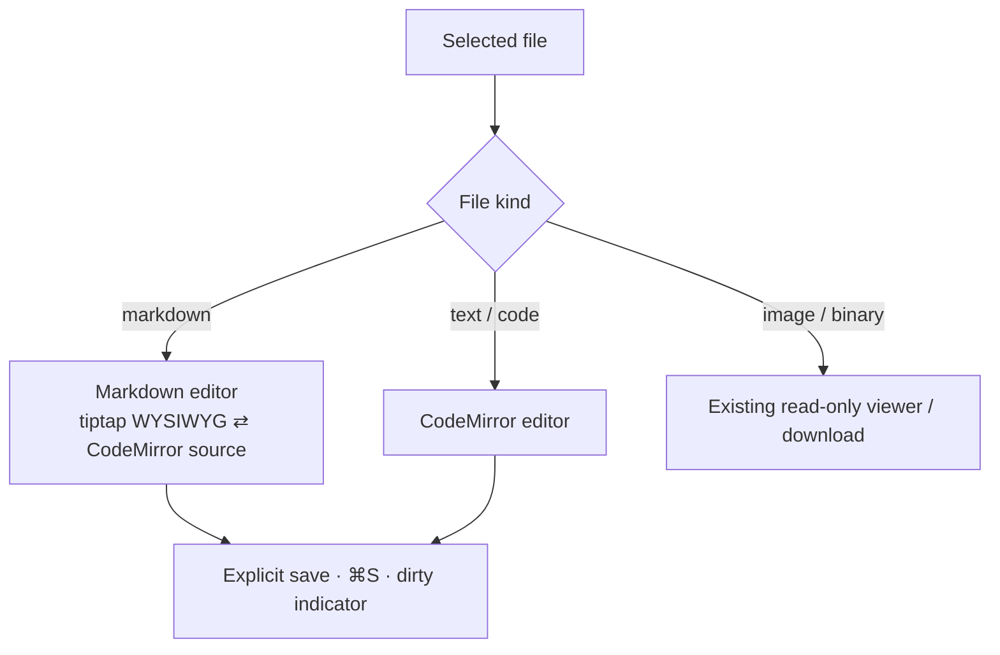
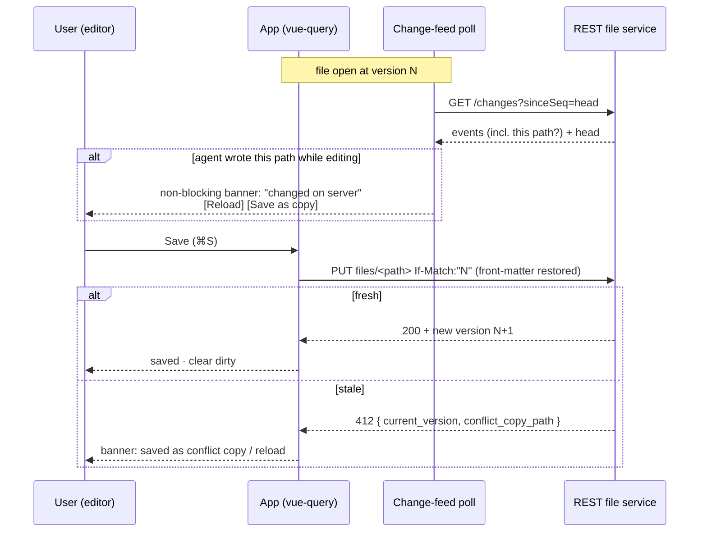
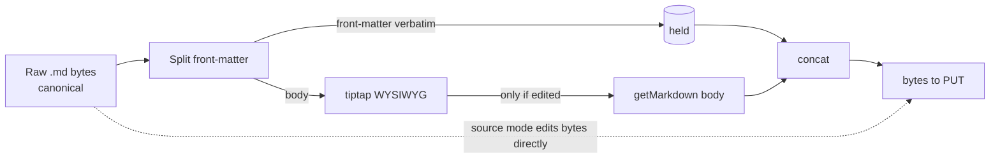

# feat: Web UI File Editing & Operations

## Summary

Bring the Treehouse human web UI (`packages/app`, Nuxt 4 SPA) up to parity with what agents already do via MCP: edit files and manage the file tree in the browser. Markdown opens in a tiptap WYSIWYG editor (styled after the Flux project) with a byte-faithful source toggle; plain-text/code opens in a CodeMirror 6 editor. Saving is explicit with live "changed on server" collision awareness. File operations — create, rename, delete, folders (via a `.keep` placeholder), and drag-and-drop multi-file upload — round out the feature. The `.keep` convention is made consistent across the CLI and agent listings.

The backend REST file service already supports read, write (per-file version CAS with collision-safe conflicted copies), delete, and move. **This plan is almost entirely frontend**, plus a small cross-package change so `.keep` is ignored by the CLI and MCP.

---

## Problem Frame

The web UI is read-only (`FileViewer.vue` renders; nothing writes). A human's only write path today is the local-sync CLI — they must leave the browser to change a file, while agents freely read/write/move/delete through MCP. This plan closes that gap. See origin: `docs/brainstorms/2026-06-08-web-file-editing-requirements.md`.

Three constraints shape the design:

1. **Markdown round-trips are not byte-faithful.** Any tiptap markdown serialization (official `@tiptap/markdown` included) normalizes formatting and _destroys YAML front-matter_. Files sync byte-for-byte to disk and are diffed by agents, so a careless round-trip produces noisy diffs or data loss.
2. **Folders are implicit.** `schema.prisma` has no folder row; `buildTree` synthesizes folders from file paths. Empty folders need a placeholder (`.keep`) to persist.
3. **Concurrent writers.** Agents can rewrite a file while a human edits it. The backend never loses data (stale writes become timestamped conflict copies), but the UI must detect and surface collisions rather than silently clobber.

---

## Key Technical Decisions

- **KTD1 — Markdown serialization: official `@tiptap/markdown` (v3.7+), not `marked`+`turndown`.** Flux holds HTML internally and converts with `marked`+`turndown`; since Flux was built, tiptap shipped an official markdown extension and the community lib is deprecated. We adopt the markdown-native path (`setContent(md, { contentType: 'markdown' })` / `editor.getMarkdown()`) for a single source of truth. Flux remains the reference for **styling, toolbar, and component shape** — only the serialization layer differs. (Decision made with user.)
- **KTD2 — Raw markdown string is canonical; WYSIWYG is a lossy lens.** We never serialize-on-open. The on-disk markdown is canonical; the source-mode editor edits those exact bytes; WYSIWYG re-serializes **only when the user actually edited in WYSIWYG**. This is the core fidelity guard and directly implements the brainstorm's "byte-faithful source toggle."
- **KTD3 — YAML front-matter is split off before tiptap sees it.** On load, peel a leading `---\n…\n---\n` block, keep it verbatim, feed only the body to tiptap, and re-concatenate the untouched front-matter on save. Do not rely on any extension to preserve it.
- **KTD4 — Code/source editor: CodeMirror 6, direct mount (no stale wrapper).** Monaco's ~72MB footprint and worker model fight the Cloudflare Workers static-SPA bundle. CodeMirror 6 is modular, browser-only, and tree-shakeable. We mount `EditorView` directly in a Vue component (`shallowRef`, `onMounted`/`onBeforeUnmount`) for byte-level control rather than depend on the 4-year-stale `vue-codemirror`. The same component powers markdown source mode.
- **KTD5 — Explicit save with version CAS; collision detection via the change feed.** Save sends `If-Match: "<loadedVersion>"`; a `412` response carries `{ current_version, conflict_copy_path }`. A new polling consumer of `GET /changes?sinceSeq=` drives a non-blocking "changed on server" banner while editing. (Decision made with user.)
- **KTD6 — `.keep` convention is cross-package.** The app hides `.keep`; the CLI ignores it for sync-noise/display; MCP `list_files` omits it from agent listings. (Decision made with user.)
- **KTD7 — Reuse existing app patterns.** `SourceToggle.vue` and the `WorkspaceView`-owns-`viewMode` pattern for the WYSIWYG⇄source control; the `ApiKeys.vue` `useMutation` + invalidate-on-success pattern for file ops; `useWorkspaceData.refresh()` to invalidate `["entries"]`/`["changes"]`; native HTML5 DnD (as in `FileTree.vue`) for upload; semantic `--th-*` utilities so the editor themes automatically.

---

## High-Level Technical Design

### File-type routing (read vs edit surface)

### Save + live collision flow

### Markdown fidelity pipeline

---

## Implementation Units

### U1. API client write methods

**Goal:** Add the missing write surface to the API client so every other unit has a typed call to use.
**Requirements:** Frontend API client gap (origin: Frontend API client).
**Dependencies:** none.
**Files:** `packages/app/app/composables/useTreehouseApi.ts`; test `packages/app/app/composables/useTreehouseApi.spec.ts` (or the repo's existing app test location/convention — mirror it).
**Approach:** Add `writeFile`, `createFile`, `createFolder`, `deleteFile`, `uploadFile`, and a `changesSince` variant, mirroring the existing `move` method's shape (`$fetch`, `credentials: "include"`, `encodePath`). Send **raw bodies** (string / `Uint8Array`), not JSON, with an explicit `Content-Type`.

- `writeFile(workspaceId, path, body, { baseVersion, contentType })` → `PUT files/<encodePath>` with `If-Match: "<baseVersion>"`. Surface `412` as a typed `{ conflict: true, currentVersion, conflictCopyPath }` result rather than throwing.
- `createFile(workspaceId, path, body="", contentType)` → same `PUT` with `If-None-Match: *` (create-only, `201`); map `428`/exists to a typed "already exists".
- `createFolder(workspaceId, folderPath)` → `createFile(`${folderPath}/.keep``, "")`.
- `deleteFile(workspaceId, path, baseVersion)` → `DELETE files/<encodePath>` with required `If-Match`; map `204` ok, `412` conflict.
- `uploadFile(workspaceId, path, bytes, contentType, { overwrite, baseVersion })` → `PUT`; create-only unless `overwrite`.
- `changesSince(workspaceId, sinceSeq)` → `GET changes?sinceSeq=` returning `{ events, head }`.
  **Patterns to follow:** existing `move`/`readFile` in the same file; `encodePath` from `shared`; content-type helper from `shared`.
  **Test scenarios:**
- `writeFile` sends `If-Match` header with the given base version and returns the new version on `200`.
- `writeFile` maps a `412` response to `{ conflict: true, currentVersion, conflictCopyPath }` without throwing.
- `createFile` sends `If-None-Match: *` and maps an existing-path response to a typed "already exists" error.
- `createFolder` issues a `PUT` to `<folder>/.keep` with an empty body.
- `deleteFile` without/with `If-Match`: omitting base version is a programming error guarded locally; with it, `204` resolves ok and `412` maps to conflict.
- `uploadFile` defaults to create-only and switches to overwrite (`If-Match`) when `overwrite` is set.
- `changesSince` passes `sinceSeq` and returns `{ events, head }`.

### U2. CodeMirror code/text editor component

**Goal:** A reusable client-only code editor for text/code files and for markdown source mode.
**Requirements:** Edit text/code (origin: Editing).
**Dependencies:** U1 (for the host save wiring, though the component itself is presentational).
**Files:** `packages/app/app/components/editors/CodeEditor.vue` (new); test `packages/app/app/components/editors/CodeEditor.spec.ts`. Add `codemirror`, `@codemirror/view`, `@codemirror/state`, `@codemirror/commands`, and language packages (`@codemirror/lang-javascript`, `-json`, `-yaml`, `-markdown`) to `packages/app/package.json`.
**Approach:** Direct `EditorView` mount in `onMounted`, destroyed in `onBeforeUnmount`; hold the view in a `shallowRef`. Props: `modelValue` (string), `language` (derived from file extension), `readonly`. Emit `update:modelValue` on doc changes and a `dirty`/`save` signal (or let the host own dirty state — see U4). Map extension → language extension via a small lookup (ts/tsx/js → javascript{typescript}, json, yaml/yml, md → markdown; unknown → plain). Theme via CodeMirror theme bound to `--th-*` tokens. Guard to client only (SPA; mirror the `.client` precedent for browser-only modules).
**Patterns to follow:** the `.client`-only browser-module convention (`packages/app/app/plugins/vue-query.client.ts`); semantic `--th-*` styling.
**Test scenarios:**

- Mounting with `modelValue` renders the text; editing emits `update:modelValue` with the new string (no transformation — byte-identical to keystrokes).
- `language` prop selects the right CodeMirror language extension per file extension; unknown extension falls back to plain text.
- `readonly` disables editing.
- Component destroys the `EditorView` on unmount (no leak / no duplicate views on re-mount).

### U3. Markdown WYSIWYG editor component (tiptap, Flux-styled)

**Goal:** A markdown editor with a WYSIWYG mode (tiptap) and a source mode (CodeMirror from U2), preserving fidelity.
**Requirements:** Edit markdown; WYSIWYG + source toggle; byte-faithful source (origin: Editing). Covers the fidelity decisions KTD2/KTD3.
**Dependencies:** U2.
**Files:** `packages/app/app/components/editors/MarkdownEditor.vue` (new); a front-matter helper `packages/app/app/utils/frontmatter.ts` (new); tests `packages/app/app/components/editors/MarkdownEditor.spec.ts`, `packages/app/app/utils/frontmatter.spec.ts`. Add `@tiptap/vue-3`, `@tiptap/core`, `@tiptap/pm`, `@tiptap/starter-kit`, `@tiptap/markdown`, and the extensions Flux uses (`@tiptap/extension-image`, `-link`, `-placeholder`, `-typography`) at a single matching version (markdown extension hard-pins the core version).
**Approach:** Mirror Flux's `DraftEditor.vue` toolbar (Bold/Italic/Strike/Code, H1–H3, lists, blockquote, hr, link dialog — no slash/bubble menus) and `.prose` styling, retargeted to `--th-*` utilities and `@tailwindcss/typography` (already a dep). Reuse `SourceToggle.vue` for the WYSIWYG⇄source control.

- **Load:** split front-matter (KTD3); set tiptap body via `contentType: 'markdown'`; remember the original body string.
- **Dirty tracking:** mark WYSIWYG dirty only on real `onUpdate` (user edit), never on programmatic `setContent`.
- **Serialize:** on save _from WYSIWYG_, `editor.getMarkdown()` for the body and re-concatenate the held front-matter; on save _from source mode_, write the source bytes verbatim. Switching WYSIWYG→source materializes current WYSIWYG markdown into the source buffer; switching source→WYSIWYG re-parses (guard against feedback loops by comparing against current `getMarkdown()`).
- Image button inserts `` references only (in-editor upload/embedding deferred — origin Out of Scope).
  **Patterns to follow:** Flux `packages/app/app/components/DraftEditor.vue` (toolbar markup, prose overrides, `useEditor`/`EditorContent`, feedback-loop guard); `SourceToggle.vue`; `--th-*` utilities.
  **Execution note:** Write the front-matter split/restore test-first — it is the data-loss-critical seam.
  **Test scenarios:**
- `frontmatter.ts`: splits a leading `---\n…\n---\n` block, returns `{ frontMatter, body }`; a file with no front-matter returns empty front-matter and the full body unchanged; a `---` that is a horizontal rule (not at file start) is not treated as front-matter.
- Round-trip with front-matter: load → save _without editing_ yields byte-identical output (no serialize-on-open).
- Editing the WYSIWYG body and saving re-attaches the original front-matter verbatim (front-matter never passes through tiptap).
- Source mode edits save byte-for-byte (no normalization).
- WYSIWYG dirty flag is set only by user edits, not by initial `setContent` or by a programmatic refresh.
- Toggling WYSIWYG→source→WYSIWYG without edits does not corrupt or reflow the body unexpectedly (and any reflow is confined to an actual WYSIWYG edit).

### U4. Editor shell, file-type routing & explicit-save model

**Goal:** Integrate the editors into the workspace page with explicit save, dirty state, and read/edit routing.
**Requirements:** Explicit save (button + ⌘/Ctrl-S); file-type routing (origin: Editing).
**Dependencies:** U1, U2, U3.
**Files:** `packages/app/app/components/WorkspaceView.vue`, `packages/app/app/components/FileViewer.vue` (route to editor vs read-only viewer by kind + an edit toggle), a new `packages/app/app/composables/useFileEditor.ts` (load/dirty/save state). Tests `packages/app/app/composables/useFileEditor.spec.ts`.
**Approach:** Lift an `editMode`/`viewMode` into `WorkspaceView` (mirrors the existing `viewMode` ownership; reset on `selectedPath` change). Route by file kind: markdown → `MarkdownEditor`, text/code → `CodeEditor`, image/binary → existing viewer. `useFileEditor` owns the loaded buffer, `loadedVersion`, `dirty`, and `save()`; `save()` calls `api.writeFile(..., { baseVersion: loadedVersion })`, updates `loadedVersion` on success, and routes `412` to the conflict handler (U7). Bind `⌘/Ctrl-S` to save and a Save button + unsaved indicator in the top bar. Warn on navigating away while dirty.
**Patterns to follow:** `WorkspaceView.vue` `viewMode` state + `SourceToggle` slot; `useWorkspaceData.refresh()` for cache invalidation after save.
**Test scenarios:**

- Selecting a markdown file routes to the markdown editor; a `.ts` file routes to the code editor; an image routes to the existing read-only viewer.
- Save calls `writeFile` with `If-Match` = loaded version and, on success, advances the loaded version and clears dirty.
- ⌘/Ctrl-S triggers save only when dirty.
- Navigating to another file while dirty prompts a confirm/guard.
- A `412` from save is handed to the conflict path (asserted via the conflict handler being invoked with `{ currentVersion, conflictCopyPath }`).
- Switching files resets edit mode and clears the buffer.

### U5. File operations UI — create, folder, rename, delete

**Goal:** Tree affordances for the non-upload file operations, wired to mutations, with `.keep` hidden.
**Requirements:** Create file, create folder, rename, delete (origin: File operations).
**Dependencies:** U1.
**Files:** `packages/app/app/components/FileTree.vue` (context menu / action buttons, inline rename, hide `.keep`), `packages/app/app/utils/treehouse.ts` (`buildTree` — filter `.keep` from displayed children while still treating the folder as existing), `packages/app/app/composables/useWorkspaceData.ts` (add `createFile`/`createFolder`/`deleteNode` mutations beside existing `moveNode`/`reorder`). A small `NewFileDialog`/confirm-delete dialog component if needed. Tests `packages/app/app/utils/treehouse.spec.ts`, `packages/app/app/composables/useWorkspaceData.spec.ts`.
**Approach:** Mutations follow the `ApiKeys.vue` `useMutation` + `onSuccess: invalidate` pattern; reuse `refresh()` (invalidates `["entries"]` + `["changes"]`). Rename reuses the existing `api.move`/`moveNode`. Create-folder calls `api.createFolder` (writes `.keep`). New-file dialog accepts a path so a file can be created into a new folder directly. Delete uses a confirmation and the loaded version (or the entry's current version) for `If-Match`. `buildTree` filters `.keep` from rendered children but keeps the folder node present.
**Patterns to follow:** `ApiKeys.vue` mutation pattern; existing `moveNode`/`reorder` in `useWorkspaceData.ts`; native context-menu/inline-edit conventions already in `FileTree.vue`.
**Test scenarios:**

- `buildTree` hides `.keep` from a folder's displayed children but still renders the (now empty-looking) folder.
- Create file at `reports/q3.md` creates the implied `reports` folder in the tree after invalidation.
- Create folder writes `<folder>/.keep` and the folder appears and persists.
- Rename invokes `move` from→to and invalidates entries/changes.
- Delete requires confirmation and sends the current version as `If-Match`; a `412` surfaces the conflict-copy/resurrection result rather than a silent success.
- Deleting the last real file in a folder that has no `.keep` removes the folder from the tree (expected); one with `.keep` persists.

### U6. Drag-and-drop multi-file upload

**Goal:** Upload one or more files (text + binary) by dragging onto a folder or via an Upload button.
**Requirements:** Drag-drop multi-file upload with progress and overwrite handling (origin: File operations).
**Dependencies:** U1, U5.
**Files:** a new `packages/app/app/components/UploadDropZone.vue` (or an external-file drop layer on the tree/viewer container), `packages/app/app/components/FileTree.vue` (Upload button + drop targets), `packages/app/app/composables/useWorkspaceData.ts` (`uploadFiles` mutation). Tests `packages/app/app/components/UploadDropZone.spec.ts`.
**Approach:** Add a **separate** external-file drop surface reading `dataTransfer.files` with `dragenter`/`dragleave`/`drop` — distinct from the existing internal-node DnD in `FileTree.vue`/`useFileTreeUi.ts` (which gates on `ui.drag.value`); mind the `.stop` modifiers on tree rows so external drops aren't swallowed. Resolve the target folder from the drop target (or current folder for the button). Detect content-type from the file; PUT bytes per file with bounded parallelism (mirror the CLI's `perf(cli): drain the sync queue with bounded parallelism` approach). Show per-file progress; on a name collision, prompt overwrite (→ `If-Match` write) vs skip vs keep-both. Invalidate `["entries"]`/`["changes"]` after.
**Patterns to follow:** native DnD in `FileTree.vue`; bounded-parallelism loop from the CLI sync queue; `ApiKeys.vue` mutation/error surfacing.
**Test scenarios:**

- Dropping N files onto a folder issues N PUTs into that folder path; per-file progress updates resolve to done.
- The external-file drop surface activates only for `dataTransfer.files`, not for internal node drags (no interference with reorder/move).
- Uploading a name that already exists prompts overwrite; choosing overwrite writes with `If-Match`, skip leaves the original, keep-both writes a non-colliding name.
- Binary (image/PDF) uploads with the correct content-type and is retrievable.
- Upload concurrency is bounded (not all-at-once) for a large batch.
- Upload button (no drag) uploads into the currently selected folder.

### U7. Live collision detection & conflict handling

**Goal:** Warn the user when an open file changes underneath them, and handle stale-save conflict copies gracefully.
**Requirements:** Live collision awareness; never silently clobber (origin: Editing — explicit save + live awareness).
**Dependencies:** U1, U4.
**Files:** a new `packages/app/app/composables/useChangeFeedPoll.ts` (polls `changesSince`, tracks `head`), `packages/app/app/composables/useFileEditor.ts` (consume the poll; expose `serverChanged`/conflict state), a `ConflictBanner.vue` component. Tests `useChangeFeedPoll.spec.ts`, `useFileEditor.spec.ts` (conflict paths).
**Approach:** Add the app's first change-feed **polling** consumer: a composable that calls `api.changesSince(workspaceId, head)` on a `refetchInterval`-style cadence and advances `head`. While a file is open, if an event for the open path bumps its version beyond `loadedVersion`, show a non-blocking banner offering **Reload** (re-fetch latest, replacing the buffer — guarded if dirty) and **Save as copy**. On save, a `412` `{ current_version, conflict_copy_path }` surfaces a banner telling the user their edit was kept as `conflict_copy_path` and offering to open it / reload. Keep cadence modest (the backend `sinceSeq`/`head` cursor is the reliable path; the time-based `order=desc` feed is legacy).
**Patterns to follow:** vue-query query + (new) `refetchInterval`; `FileActivity.vue` `changes` usage; the `seq`/`head` contract in `packages/api/server/routes/api/workspaces/[workspaceId]/changes.get.ts`.
**Test scenarios:**

- With a file open at version N, a polled change event for that path at version > N raises `serverChanged`.
- Change events for _other_ paths do not raise the banner.
- Reload replaces the buffer with the latest server content and resets `loadedVersion`; Reload while dirty confirms first.
- A `412` on save sets conflict state with the returned `conflictCopyPath` and does not mark the file as cleanly saved.
- Polling advances `head` monotonically and does not re-process already-seen events.

### U8. `.keep` cross-package consistency (CLI + MCP)

**Goal:** Make `.keep` invisible outside the app so the convention is coherent everywhere.
**Requirements:** `.keep` shared contract (origin: The `.keep` convention).
**Dependencies:** none (parallelizable; logically completes U5).
**Files:** `packages/cli` sync/list logic (ignore `.keep` for display/sync-noise; the file still syncs so the folder exists locally — confirm exact files during implementation), `packages/api/server/utils/mcp.ts` (`list_files` omits `.keep` from agent listings). Tests alongside each package's existing test convention.
**Approach:** Treat `.keep` as a hidden placeholder: the CLI should not surface it as user-facing churn, and MCP `list_files` should filter it so agents don't see noise. Keep filtering centralized/named (a shared constant for the `.keep` name) so app, CLI, and MCP agree. Do **not** filter it from the underlying file service (it must persist and sync).
**Patterns to follow:** existing list/sync code in `packages/cli`; `list_files` in `packages/api/server/utils/mcp.ts`; consider a shared constant in the `shared` package.
**Test scenarios:**

- MCP `list_files` output excludes `.keep` entries while the folder's other files remain.
- CLI listing/sync output does not present `.keep` as user-facing change while still materializing the folder on disk.
- The file service itself still stores and returns `.keep` (filtering is presentation-only).

---

## Scope Boundaries

### In scope

The eight units above: API write client, CodeMirror editor, tiptap markdown editor with source toggle and front-matter safety, editor shell + explicit save, file ops (create/folder/rename/delete), drag-drop multi-file upload, live collision detection, and `.keep` consistency across CLI/MCP.

### Deferred to follow-up work

- **In-editor image embedding** (paste/drop image into the tiptap editor → upload → embed). v1 uploads are tree-level; markdown references images by path. (Confirmed with user.)
- **Batch multi-select operations** (multi-delete / multi-move) beyond multi-file upload.

### Outside this product's identity (carried from origin)

- **Faithful partial-region markdown serialization** (diff-only WYSIWYG writes) — the source toggle + serialize-only-on-edit covers the fidelity need instead.
- **Real-time collaborative editing** (multiple humans live in one doc) — collision handling is detect-and-warn, not CRDT/OT merge.
- **New backend endpoints** — every op maps to existing routes; no server-side file API changes (the only backend touch is MCP `list_files` presentation).

---

## Risks & Dependencies

- **Markdown data loss (front-matter / normalization)** — highest risk. Mitigated by KTD2/KTD3 (canonical raw string, front-matter split, serialize-only-on-edit) and front-matter-first testing in U3. A real-world tiptap round-trip front-matter corruption is documented; do not regress this.
- **`.keep` visible if filtering is incomplete** — the convention spans app/CLI/MCP/`buildTree`; a missed spot leaks placeholder files. Centralize the `.keep` name as a shared constant (U8).
- **Bundle size on Cloudflare Workers** — tiptap + CodeMirror are browser-only and tree-shake, but keep CodeMirror imports modular (no kitchen-sink `codemirror` meta-import where avoidable) and lazy-load editors so read-only viewing stays light.
- **Collision-detection cadence** — first polling consumer in the app; too-frequent polling adds load, too-slow misses under-edit changes. Use the reliable `sinceSeq`/`head` cursor and a modest interval; pause polling when no file is being edited.
- **Deployment-environment gotchas (from `docs/solutions/developer-experience/railway-cloudflare-deploy-gotchas-2026-06-08.md`)** — verify R2 is wired (not the silent ephemeral-disk fallback) before trusting upload tests; `NUXT_PUBLIC_API_URL` is build-time-baked; save/poll/upload are credentialed cross-origin calls that fail silently if the cross-subdomain cookie/CORS setup drops auth. These can make a correct editor look broken in previews.

---

## Sources & Research

- Origin requirements: `docs/brainstorms/2026-06-08-web-file-editing-requirements.md`.
- Flux reference implementation (the Flux project, a separate local repo; read-only): its `packages/app/app/components/DraftEditor.vue` (toolbar, prose styling, `useEditor` + feedback-loop guard), `DraftPanel.vue` (markdown conversion + view-mode toggle). Tiptap 3 + StarterKit/Image/Link/Placeholder/Typography, CSS-variable theming, debounced autosave. We mirror styling/toolbar/component shape; we diverge on serialization (KTD1).
- External (verified 2026-06-08): official `@tiptap/markdown` (3.7+) supersedes the deprecated community `tiptap-markdown`; markdown round-trips normalize and destroy front-matter (DesktopCommanderMCP #440 documents real corruption) → KTD2/KTD3. CodeMirror 6 over Monaco for the Workers SPA bundle → KTD4. `@codemirror/lang-*` cover ts/json/yaml/markdown; CSV → plain text is acceptable.
- Repo grounding: existing read-only file UI (`WorkspaceView.vue`, `FileViewer.vue`, `FileTree.vue`, `useWorkspaceData.ts`, `useTreehouseApi.ts`, `useFileTreeUi.ts`, `viewers/SourceToggle.vue`), Tailwind v4 `--th-*` tokens, `ApiKeys.vue` mutation pattern, native DnD, `changes.get.ts` `sinceSeq`/`head` contract. No prior `docs/solutions/` learnings cover this feature — strong `/ce-compound` candidate once it lands.