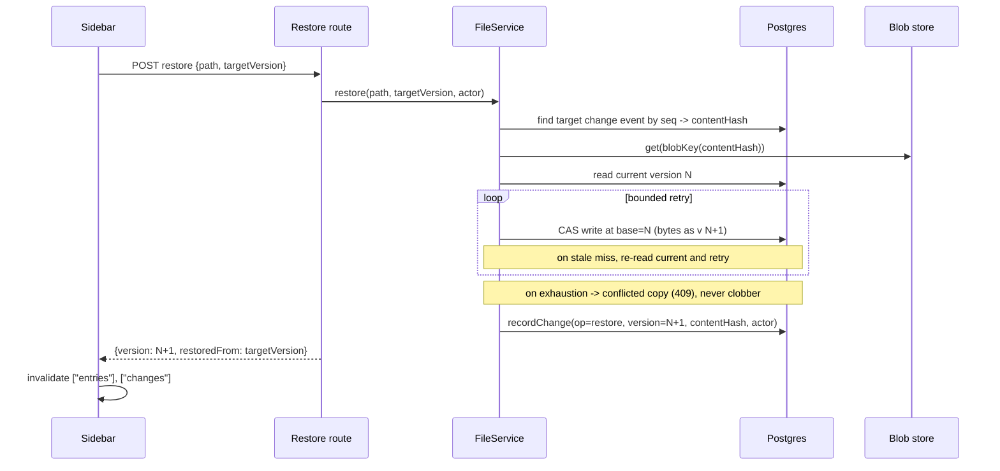

# feat: File-info sidebar redesign — attribution, version history, restore

> **Milestone 1 of 2.** This plan covers the sidebar redesign (attribution, version
> history, restore, conflicted copies, metadata). The sharing subsystem (member + public
> links, passwords, folder sharing) is a separate, dependent milestone:
> `docs/plans/2026-06-08-003-feat-file-folder-sharing-plan.md`. Ship this first — it
> delivers the origin-validated value on its own.

## Summary

Rebuild the workspace right-hand file-info sidebar around a single change **timeline** that
attributes each change to a human and their named agent ("Alex · via 'Claude Code'"), lets
users view and non-destructively restore previous versions, surfaces conflicted copies, and
presents dense, consistent file metadata.

## Problem Frame

The current sidebar (`packages/app/app/components/FileMeta.vue`, `FileActivity.vue`) is two
thin, near-duplicate panels with mixed typography and a coarse `agent`/`human` badge. It
can't say _which_ teammate or which of their agents touched a file, and it offers no way to
view or recover a prior version even though every version's bytes are durably retained. For
Treehouse's core scenario — teams where each person runs agents against a shared workspace —
the recurring question "who (or whose agent) did this, and can I get the previous version
back?" is unanswerable today.

Research confirmed the data is most of the way there: `recordChange`
(`packages/api/server/utils/files.ts`) already records `actorId` (the human owner) on
writes, but the agent's own identity is never captured, the app can't resolve a `userId` to
a name, and change events store no content pointer to locate a past version's bytes.

---

## Requirements

Requirements R1–R17 are carried from the origin requirements doc
(see origin: `docs/brainstorms/2026-06-08-file-info-sidebar-requirements.md`). The origin's
sharing requirements (R18–R24) are planned in the separate sharing milestone.

### Timeline & attribution

- R1. A single timeline of a file's change events (newest first) replaces the separate
  metadata-activity and version-history lists.
- R2. Each entry shows operation (write / move / delete / conflict / restore), version where
  applicable, the actor, and relative + exact timestamps.
- R3. Each entry attributes the change to a human; agent-made changes also name the agent
  ("Alex · via 'Claude Code'") and are visually distinguished.
- R4. Events predating this feature, or any event lacking recorded identity, fall back to the
  coarse `agent`/`human` label with no person.
- R5. The timeline handles no-change, single-version, and long-history files without layout
  breakage.

### Version history & restore

- R6. A user can view a previous version's contents from its timeline entry.
- R7. Restore writes a previous version's bytes back as a new version at the head of the
  timeline and records a new attributed event; it never overwrites history.
- R8. Restore is offered only for versions whose content can be located; versions written
  before this feature are shown but not restorable.
- R9. Restore lands as a new version on top of current, even if the file changed between panel
  open and confirm — never a silent clobber (under extreme contention it may land as a
  conflicted copy; see KTD2).

### Conflicted copies

- R10. The sidebar surfaces the presence and count of a file's conflicted copies.
- R11. A user can navigate from the surfaced conflict to the conflicted copy to compare and
  resolve.

### Metadata, stats & quick actions

- R12. The metadata header uses one consistent typographic system; monospace is reserved for
  path/identifier values.
- R13. The header shows core metadata densely: name, path, type, size, current version.
- R14. The header includes richer stats where cheaply available: created date and original
  author, line/word count for text and markdown, image dimensions/preview.
- R15. The header surfaces a last-synced/last-changed signal so users can see file freshness
  at a glance.
- R16. Quick actions on the selected file: copy path, and download (current version, and a
  historical version from its timeline entry).

### Visual design

- R17. The panel reads as one intentional design — consistent spacing, hierarchy, and
  theme-token usage — across the existing theme set.

---

## Key Technical Decisions

- KTD1. **Version→content map via a content pointer on change events.** Record `contentHash`
  on write/move/restore events; a version's bytes are located by the existing
  content-addressed key (`blobKeyFor(workspaceId, contentHash)`). **Address by change-event
  `seq`, not the bare version integer** — version numbers are reused (a deleted-then-
  resurrected path restarts at v1, so a path can have two distinct v1 write events with
  different bytes). `readVersion`/restore resolve a specific change event (and thus
  `contentHash`) by `seq`, mapping the user-facing version number to the most recent event of
  the current incarnation. Forward-only: pre-feature events have no pointer, so they are not
  restorable/viewable (R8). **Move resets restorable lineage** — a move records the source
  `contentHash` on the destination at v1; pre-move versions remain only under the old path's
  now-orphaned change events. The timeline notes "history begins at move" for moved files
  rather than silently showing nothing.

- KTD2. **Non-destructive restore through the existing write path.** Restore reads the target
  version's bytes (via its content pointer) and writes them as a new version using the same
  `useFileService().write` CAS path, with a bounded retry against the _current_ version so it
  normally lands on top (R9). On retry exhaustion under sustained contention it falls through
  to the standard conflicted-copy path and returns a 409-with-copy result rather than erroring
  or clobbering. Reusing the shared service gives MCP parity for free.

- KTD3. **Snapshot the agent label onto change events at write time.** Capture the acting
  key's id and a display label on each event (new columns), rather than resolving live.
  History stays immutable and correct after a key is renamed or revoked. The human is already
  recorded as `actorId`; the app resolves it via a new members endpoint. **The agent-vs-human
  distinction is driven by `principal`, never by the presence of `actorKeyId`** — human users
  can hold CLI keys minted with `actorType: "human"`, so a non-null `actorKeyId` does not mean
  the change was agent-made. The agent label renders only when `principal === "agent"`. Agent
  name is forward-only; human attribution is partly retroactive (existing events carry
  `actorId`).

- KTD4. **The timeline is a client-side reshape of the existing change feed**, filtered
  per path and enriched with resolved identities — no new activity/history split and no
  per-file history table. `op: restore` events render as restore entries.

- KTD5. **Conflicted copies are surfaced by filtering the existing file list** with
  `isConflictedCopy()` from `shared` — no backend change. The copy's principal and timestamp
  are parsed from its name.

- KTD6. **Schema changes follow the hand-maintained Treehouse-model convention.** Edit
  `schema.prisma` below the auth section and migrate with `prisma migrate`; never run
  `auth:generate` (it regenerates the whole file and deletes these models). Migrations apply
  via the existing pre-deploy `prisma migrate deploy` step.

- KTD7. **Deploy ordering: migrate before code.** `prisma migrate deploy` must complete before
  the new API image serves traffic, so new code never queries a missing column during a
  rollout (the file-service write path is shared by REST and MCP — a transient break is
  high-blast-radius). New columns are nullable so old rows are fine; confirm the migrate step
  gates the API rollout on Railway.

---

## High-Level Technical Design

### Restore flow (R7, R9)

---

## Implementation Units

### Phase A — Backend: attribution, version pointer, restore

### U1. Change-event schema: content pointer, agent identity, restore op

- **Goal:** Add the columns that make versions locatable and agents identifiable.
- **Requirements:** R1, R3, R4, R6, R7 (data foundation)
- **Dependencies:** none
- **Files:** `packages/db/prisma/schema.prisma`,
  `packages/db/prisma/migrations/<generated>/migration.sql`
- **Approach:** On `ChangeEvent` add `contentHash String?` (content pointer for
  write/move/restore), `actorKeyId String?` (acting API key id, null for cookie/human-direct),
  and `actorLabel String?` (snapshot display label of the agent/key). Extend the `op` comment
  to include `restore`. Hand-edit below the auth section per KTD6; generate the migration with
  `prisma migrate` (deploys via the pre-deploy migrate step, KTD7).
- **Patterns to follow:** existing `ChangeEvent`/`FileNode` block in `schema.prisma`;
  migration files already under `packages/db/prisma/migrations`.
- **Test scenarios:** `Test expectation: none — schema/migration only; behavior is covered by
  U2/U3 tests.` Verify `prisma migrate` applies cleanly and the client regenerates with the
  new optional fields.
- **Verification:** migration applies on a fresh DB; generated client types expose the new
  optional fields.

### U2. Thread agent identity + content pointer through the write path

- **Goal:** Populate the new columns on every recorded change.
- **Requirements:** R3, R4
- **Dependencies:** U1
- **Files:** `packages/api/server/utils/workspace.ts`,
  `packages/api/server/utils/files.ts`,
  `packages/api/server/routes/api/workspaces/[workspaceId]/files/[...path].put.ts`,
  `packages/api/server/routes/api/workspaces/[workspaceId]/files/[...path].delete.ts`,
  `packages/api/server/routes/api/workspaces/[workspaceId]/move.post.ts`,
  `packages/api/server/utils/mcp.ts`, `packages/api/test/files-service.test.ts`
- **Approach:** Extend `authenticate()` to also return `keyId` and `keyName` from
  `verifyApiKey` (`verified.key.id`, `verified.key.name`). Extend the `Actor` interface with
  `actorKeyId?` and `actorLabel?`. Have `recordChange` write `actorKeyId`, `actorLabel`, and
  `contentHash` (passed from `write`/`move`; null elsewhere). Update every call site that
  builds an actor to also pass the key id/label. Cookie/human-direct events leave key fields
  null. Note: `actorKeyId` is orthogonal to agent-vs-human — a human CLI key
  (`actorType: "human"`) produces `principal: human` with a non-null `actorKeyId`. Consumers
  key the agent distinction on `principal` (KTD3), never on `actorKeyId` presence.
- **Patterns to follow:** existing `actor: { principal: ctx.principal, actorId: ctx.userId }`
  construction in the file routes and `mcp.ts`; `recordChange` in `files.ts`.
- **Test scenarios:**
  - Covers AE2. An agent-key write records `principal: agent`, `actorId` = owner user id,
    `actorKeyId` = key id, `actorLabel` = key name.
  - A cookie-session write records `principal: human`, `actorId` = session user, key fields null.
  - A write records `contentHash` = sha256 of the bytes; a move records the source content
    hash on the destination event.
  - A human-`actorType` CLI key write records `principal: human` with a non-null `actorKeyId`
    (guards the U7 agent-vs-human gate).
  - Conflicted-copy events still record actor fields (no regression).
- **Verification:** file-service tests assert the new fields across agent, human, and conflict
  paths.

### U3. File-service restore + historical-version read

- **Goal:** Locate and restore a prior version's bytes; read a prior version's bytes.
- **Requirements:** R6, R7, R8, R9
- **Dependencies:** U1, U2
- **Files:** `packages/api/server/utils/files.ts`,
  `packages/api/test/files-service.test.ts`
- **Approach:** Add `readVersion({ workspaceId, path, version })` that locates the change event
  for that path+version across `op IN (write, move, restore)` (any op carrying a
  `contentHash`), resolving the **current incarnation's** event by `seq` to avoid
  version-number reuse ambiguity (KTD1), then returns the blob (or `version_not_found` when the
  event predates the pointer, or `blob_missing`). Add
  `restore({ workspaceId, path, targetVersion, actor, nowIso })` that reads the target bytes via
  `readVersion`, then writes them as a new version: read current version N, CAS-write at base
  N, on a stale miss re-read and retry (bounded, e.g. 5 attempts) so the restore normally lands
  on top (R9); on retry exhaustion fall through to `resolveWriteMiss` and return a
  `conflict`-shaped result (KTD2) rather than erroring. Record `op: restore` with the restored
  content pointer. Return `{ version, restoredFrom }`.
- **Execution note:** Implement restore test-first — the CAS-retry-on-top behavior (R9) is the
  subtle part and benefits from a failing test that simulates a concurrent bump.
- **Patterns to follow:** the CAS `updateMany` + deterministic `baseVersion + 1` logic in
  `write`; `recordChange`; the result-union return style used by `read`/`remove`/`move`.
- **Test scenarios:**
  - Covers AE3. File at v5, restore v3 → new v6 with v3's bytes; v4/v5 remain; a `restore`
    event records `restoredFrom`.
  - Covers AE4. Current advances v5→v6 between read-current and write → restore lands as v7 on
    top, not a conflicted copy.
  - Covers AE6. Restoring an image (binary) version returns and rewrites the bytes with no text
    handling.
  - Create file, delete, recreate (both land v1 with different bytes) → `readVersion`/restore of
    "v1" resolves the current incarnation, not the pre-delete one (KTD1).
  - A version produced by a move is viewable/restorable (the `move` op carries a pointer).
  - Restore under sustained concurrent writes that exhausts retries returns a `conflict` result
    (a conflicted copy), not an error or a clobber (KTD2).
  - `readVersion` for a pre-pointer version returns `version_not_found` (R8).
  - `readVersion`/`restore` for a missing path returns `not_found`.
- **Verification:** file-service tests cover restore, retry-on-top, binary, and the
  not-restorable pre-feature case.

### U4. REST routes: restore, version read, members

- **Goal:** Expose restore, historical read, and member-name resolution over HTTP.
- **Requirements:** R3, R6, R7
- **Dependencies:** U3
- **Files:**
  `packages/api/server/routes/api/workspaces/[workspaceId]/files/[...path].restore.post.ts`,
  `packages/api/server/routes/api/workspaces/[workspaceId]/files/[...path].version.get.ts`,
  `packages/api/server/routes/api/workspaces/[workspaceId]/members.get.ts`,
  `packages/api/test/files-routes.test.ts`
- **Approach:** Restore route reads `{ targetVersion }` and delegates to `svc.restore`, mapping
  result unions to status codes (200 / 404 / 412). Version-read route serves bytes for
  `?version=N` via `svc.readVersion` with the right content-type. Members route returns org
  members via `db.member.findMany({ where: { organizationId }, include: { user: { select:
  { id, name, image } } } })` — identity fields live on the related `User`, not `Member`, and
  the response is keyed by `user.id` (what `actorId` holds). `email` is omitted (the timeline
  needs name + avatar only; returning org-wide emails to any member/key is needless exposure).
  All wrapped in `fileRoute` + `requireWorkspaceFromRoute`.
- **Patterns to follow:** `changes.get.ts`, `files/[...path].put.ts` (status mapping),
  `requireWorkspaceFromRoute`.
- **Test scenarios:**
  - PUT v1, PUT v2, POST restore {targetVersion:1} → 200, `version:3`, `restoredFrom:1`.
  - GET `?version=1` returns v1 bytes and content-type.
  - Members route returns the caller's org members keyed by user id; a non-member key is
    rejected (403 via `authorizeWorkspace`); no `email` in the payload.
  - Restore on an unknown path → 404.
- **Verification:** route smoke tests (HTTP) cover restore, version read, and members.

### U5. MCP parity: restore + read-historical-version tools

- **Goal:** Give agents the same restore/view-version capability as the UI.
- **Requirements:** R7 (agent-native parity)
- **Dependencies:** U3
- **Files:** `packages/api/server/utils/mcp.ts`, `packages/api/test/` (MCP tool test)
- **Approach:** Register `restore_file` (args: path, targetVersion) and `read_file_version`
  (args: path, version, encoding) tools that call `svc.restore` / `svc.readVersion` with the
  closure `actor`. Mirror the existing `write_file` guard/result shape (base64 encoding parity
  for binary). Open: `read_file_version` may instead fold into the existing `read_file` via a
  `version` param (see Open Questions) — either preserves parity.
- **Patterns to follow:** `buildMcpServer` tool registration and `guard()` in `mcp.ts`;
  existing `read_file`/`write_file` base64 handling.
- **Test scenarios:**
  - `restore_file` produces a new version and a `restore` change event.
  - `read_file_version` returns prior bytes (base64 for binary).
  - Both reject paths outside the key's workspace scope.
- **Verification:** MCP tool tests pass; tools appear in the server tool list.

### Phase B — Frontend: timeline, metadata, conflicts

### U6. Frontend data layer: API methods, members composable, identity map

- **Goal:** Fetch restore/version/members data and build an `actorId`→identity map.
- **Requirements:** R3, R6, R7
- **Dependencies:** U4
- **Files:** `packages/app/app/composables/useTreehouseApi.ts`,
  `packages/app/app/composables/useWorkspaceMembers.ts` (new),
  `packages/app/app/composables/useWorkspaceData.ts`
- **Approach:** Add `restoreFile`, `readFileVersion`, and `getMembers` to the API composable
  (credentialed, cross-origin per existing convention). Add `useWorkspaceMembers(workspaceId)`
  returning a reactive `Map<userId, {name,image}>` via TanStack Query (`["members",
  workspaceId]`). Extend `refresh()`/invalidation to cover changes after a restore. (If a
  second consumer never appears, this map may be inlined into `useWorkspaceData` — a minor
  simplification left to implementation.)
- **Patterns to follow:** existing methods + `useQuery` keys in `useTreehouseApi.ts`,
  `useWorkspaceData.ts`.
- **Test scenarios:** `Test expectation: none — thin data wrappers; behavior covered by U7
  component tests and U4 route tests.`
- **Verification:** timeline (U7) renders resolved names using the map.

### U7. Unified timeline component (view, restore, conflicts)

- **Goal:** Replace `FileActivity` with the attributed, restorable timeline and surface
  conflicted copies.
- **Requirements:** R1, R2, R3, R4, R5, R6, R7, R8, R9, R10, R11
- **Dependencies:** U6
- **Files:** `packages/app/app/components/FileTimeline.vue` (new, replaces
  `FileActivity.vue`), `packages/app/app/utils/activity.ts`,
  `packages/app/app/components/RightPanel.vue`, `packages/app/app/test/` (component test)
- **Approach:** Render the per-path change feed newest-first: op icon, version chip, resolved
  actor, relative + exact (title/hover) time. The agent label renders only when
  `principal === "agent"` (NOT when `actorKeyId` is present — human CLI keys carry a key id
  too, KTD3); an agent entry leads with the agent/human pairing ("Alex · via 'Claude Code'") as
  one unit since that distinction is the primary signal. Restore/view actions on entries that
  carry a content pointer (hide on pre-feature entries, R8). Compute conflicted copies for the
  file by filtering the entries list with `isConflictedCopy()`.
  - **Interaction states:** loading → 2-3 skeleton rows; fetch error → message + retry; empty /
    single / long (100+) histories per R5.
  - **View a version (R6):** opens a read-only sheet/overlay (not inline in the 320px panel)
    headed by version, date, actor, with a "Restore this version" CTA; images show the bytes,
    text shows content.
  - **Restore (R7, R9):** two-step inline confirm (Restore → a confirm row naming the target
    version → Confirm/Cancel); in-flight disables the confirm with a spinner; on success the
    timeline refreshes to the new restore entry at head; on error an inline message + retry.
    Restore calls `restoreFile` then invalidates `["entries"]`/`["changes"]`.
  - **Conflicted copies (R10, R11):** a dismissible banner between the metadata header and the
    timeline showing the count; clicking a copy selects it in the workspace tree (replacing the
    panel's file); list up to 3 names then "+N more".
- **Patterns to follow:** existing `FileActivity.vue` query + `fileActivity()` filter,
  `relativeTime()`, theme-token classes (`text-fg`, `bg-agent/15`, etc.).
- **Test scenarios:**
  - Covers AE1. A pre-feature entry shows the coarse label, no person, and no restore action.
  - Covers AE2. An agent entry shows the human + agent label and an agent marker.
  - A human-`actorType` CLI key entry renders as human with no agent marker (KTD3).
  - Covers AE5. A file with conflicted copies shows the count and a link to them.
  - Restore confirm flow: confirm row appears, in-flight disables, success refreshes head,
    error shows inline retry.
  - Loading skeleton and fetch-error retry states render.
  - Empty / single-version / 100-entry histories render without breakage (R5).
- **Verification:** component tests cover attribution variants, restore, conflict surfacing, and
  the empty/long states.

### U8. Metadata header redesign + richer stats + quick actions + panel composition

- **Goal:** One typographic system, denser stats, non-share quick actions, and a coherent
  whole-panel composition.
- **Requirements:** R12, R13, R14, R15, R16, R17
- **Dependencies:** U6, U7 (composes the timeline into the panel)
- **Files:** `packages/app/app/components/FileMeta.vue`,
  `packages/app/app/components/RightPanel.vue`,
  `packages/app/app/utils/format.ts`, `packages/app/app/utils/treehouse.ts`
- **Approach:** Rebuild the header on a single label/value system (monospace only for
  path/identifier values). Show name, path, type, size, version (R13); created date + original
  author and last-changed derived from the change feed (R14, R15); line/word count for
  text/markdown computed from already-loaded content; image dimensions/preview from a blob URL.
  Quick actions: copy path, download current, download a historical version (via
  `readFileVersion`). **Own R17 (whole-panel coherence):** compose `RightPanel.vue` so metadata
  header (fixed, top), conflicted-copy banner (conditional), and timeline (fills, scrolls) read
  as one design with shared spacing/hierarchy/tokens across themes; only the timeline scrolls.
  Define the no-file-selected empty state. (The sharing milestone adds its own collapsed
  section at the bottom of this panel — leave room for it.)
- **Patterns to follow:** current `FileMeta.vue` definition-list structure and theme tokens;
  `prettyBytes`/`baseContentType` in utils.
- **Test scenarios:**
  - Header renders core metadata for a text file with consistent markup.
  - Line/word count computed for markdown; skipped for binary.
  - Image file shows dimensions/preview.
  - Copy-path and download actions invoke the expected handlers.
  - The assembled panel renders header + timeline as one design and handles no-selection.
- **Verification:** component test covers text, markdown, and image metadata variants and the
  composed panel.

---

## Acceptance Examples

- AE1. **Pre-feature change.** A change event recorded before this feature shows the coarse
  `agent`/`human` label with no person and offers no restore. (R4, R8)
- AE2. **Agent attribution.** An agent wrote using Alex's named key → the entry shows Alex +
  the agent label, marked agent-made; a human-`actorType` CLI key write shows as human. (R3)
- AE3. **Non-destructive restore.** File at v5, restore v3 → v6 with v3's bytes; v4/v5 remain;
  a restore entry at the head is attributed to the actor. (R7)
- AE4. **Restore under concurrent change.** Panel opened at v5, file advances to v6 before
  confirm → restore lands as v7 on top, not a silent clobber. (R9)
- AE5. **Conflicted copies present.** A file with 2 conflicted copies shows the count and a way
  to reach them. (R10, R11)
- AE6. **Binary restore.** Image at v2, restore v1 → previous image bytes restored as a new
  version with no text diff. (R6, R7)

---

## Scope Boundaries

- In scope: the unified timeline, human+agent attribution, view/restore, conflicted-copy
  surfacing, metadata redesign, quick actions, whole-panel coherence.

### Deferred to a separate milestone

- **Sharing** (member + public links, passwords, folder sharing, public viewer) —
  `docs/plans/2026-06-08-003-feat-file-folder-sharing-plan.md`. It depends on this plan's
  content pointer (U1) and `readVersion`/restore (U3) for version permalinks.

### Deferred for later

- **Version diff preview** — what changed between two versions (origin defers this).
- **Backfilling** historical agent identity or version→content pointers for pre-feature events.

### Outside this pass's shape

- **Tabbed sidebar (Info/History split)** — the unified timeline replaces it.
- **Conflicted-copy auto-merge** — surfacing and navigation only.

### Deferred to Follow-Up Work

- Documenting the file-service write path, CAS/conflicted-copy semantics, and attribution in
  `docs/solutions/` (via `/ce-compound`) — this area is currently undocumented.

---

## Risks & Dependencies

- **Restore/permalink durability gate.** Restore reads historical blobs, which survive only if
  R2 is wired (`useBlobStore()` silently falls back to an ephemeral `BLOB_DIR` wiped per
  Railway deploy). Treat confirmed R2 wiring as a precondition for exposing the restore UI, and
  define the user-facing "version unavailable" state so the promise never silently breaks.
  (Source: `docs/solutions/developer-experience/railway-cloudflare-deploy-gotchas-2026-06-08.md`.)
- **Deploy ordering.** `prisma migrate deploy` must complete before the new API serves traffic
  (KTD7) — the file-service write path is shared by REST and MCP, so a missing-column window is
  high-blast-radius. New columns are nullable.
- **Schema convention.** Treehouse models are hand-maintained below the auth section; never run
  `auth:generate`. (KTD6)
- **Cross-origin credentialed fetch** for the new member/restore/version endpoints, per the
  existing app convention. (Source: deploy gotchas runbook.)
- **`actorId` coverage.** Human attribution is recorded today on writes; verify all
  write/move/delete paths pass the actor (U2) so no path silently drops identity.

---

## Open Questions

### Resolved during this planning pass (from doc review)

- **Members route shape** — query `User` via `Member.include`, return name + image only.
- **Version addressing** — address by change-event `seq`, not the version integer
  (delete/resurrect reuses version numbers).

### Resolve during implementation

- **Agent label source of truth** (U2): snapshot the key `name` as `actorLabel` (current plan),
  and whether to also surface a per-agent display name distinct from the key name. Snapshot is
  the decision; a richer agent-naming scheme is out of scope unless trivial.
- **MCP shape** (U5): keep a dedicated `read_file_version` tool or fold version reads into
  `read_file` via a `version` param. Either preserves agent parity.

---

## Sources / Research

- File service + change feed: `packages/api/server/utils/files.ts` (`write`, `move`, `remove`,
  `recordChange`, `resolveWriteMiss`, conflicted-copy logic).
- Auth/actor resolution: `packages/api/server/utils/workspace.ts` (`authenticate`,
  `requireWorkspaceFromRoute`, `mintWorkspaceKey`).
- Data model: `packages/db/prisma/schema.prisma` (`FileNode`, `ChangeEvent`, `Apikey`, `Member`).
- Change feed API: `packages/api/server/routes/api/workspaces/[workspaceId]/changes.get.ts`.
- MCP write path + base64 parity: `packages/api/server/utils/mcp.ts`,
  `packages/api/server/routes/api/mcp/index.ts`.
- Frontend data + components: `packages/app/app/composables/useTreehouseApi.ts`,
  `useWorkspaceData.ts`, `useChangeFeedPoll.ts`; `components/RightPanel.vue`, `FileMeta.vue`,
  `FileActivity.vue`; `utils/activity.ts`, `utils/format.ts`.
- Conflicted-copy helpers: `shared` (`conflictedCopyName`, `isConflictedCopy`, `contentTypeFor`).
- Test patterns: `packages/api/test/files-service.test.ts`, `files-routes.test.ts`.
- Deploy/infra constraints: `docs/solutions/developer-experience/railway-cloudflare-deploy-gotchas-2026-06-08.md`.