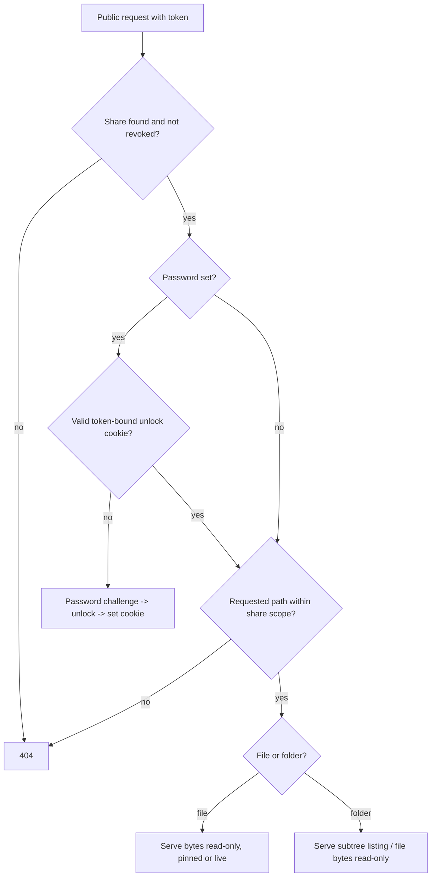

# feat: File & folder sharing — member + public links

> **Milestone 2 of 2.** Depends on the sidebar redesign:
> `docs/plans/2026-06-08-002-feat-file-sidebar-redesign-plan.md`. Specifically it needs that
> plan's `ChangeEvent.contentHash` pointer (its U1) and `readVersion` (its U3) for version
> permalinks. Do not deploy the public-read surface here before that milestone has shipped.

## Summary

Add a sharing subsystem to the workspace: member deep links plus opt-in, revocable public
links (optionally password-protected) for individual files or whole folders, with live or
version-pinned targets, managed from the file-info sidebar and rendered on a read-only public
viewer page.

## Problem Frame

Treehouse today has no way to share a file or folder outside the workspace — content is
reachable only by authenticated org members through the app. Teams want to hand a file or a
whole directory to someone without an account (a client, a reviewer), sometimes behind a
password, and sometimes pinned to a specific version so the link is stable. This milestone
builds that path. It is security-load-bearing: it introduces Treehouse's first unauthenticated
read surface, so the token, password, scope, and revocation mechanics must hold.

This is a deliberate positioning choice (see Scope Boundaries → Strategic posture): public
sharing makes Treehouse an unauthenticated content host, with the standing maintenance
commitment that implies, not just a closed agent+human workspace.

---

## Requirements

R18–R24 are carried from the origin requirements doc (see origin:
`docs/brainstorms/2026-06-08-file-info-sidebar-requirements.md`); the numbering is preserved
for traceability (R1–R17 belong to the sidebar milestone).

- R18. A member deep link is available for the selected file or folder: it points at the item
  in the app and requires a logged-in workspace-org member. Reuses existing auth; no new
  access surface.
- R19. An opt-in public link can be minted for a file or a folder — read-only, unguessable,
  and revocable, granting access without login.
- R20. A public link can optionally be password-protected; the opener must supply the password
  before any shared content is served.
- R21. A file link target is selectable — live (always latest) or a version permalink pinned to
  a timeline entry. Folder and public links resolve live.
- R22. Shares are manageable from the sidebar — create, list, revoke — for the selected file or
  folder.
- R23. Public read is strictly scoped to the shared item (single file, or folder and its
  subtree) and is read-only; it never exposes content outside the shared path.
- R24. Agent parity: agents can create member links and list/revoke shares via MCP. Minting
  public or password-protected links requires a human cookie session (see KTD4).

---

## Key Technical Decisions

- KTD1. **Sharing is a new `Share` entity** with two access models (member deep link vs public
  token), file-or-folder scope (a folder share matches by path prefix), an optional version pin
  for file links, and an optional password hash. Public reads are served by a **separate,
  unauthenticated, strictly path-scoped, read-only** route set distinct from the member API.

- KTD2. **Passwords hashed with `node:crypto` scrypt** (salt + timing-safe compare) — no new
  dependency. A correct password challenge issues a short-lived signed cookie so the opener
  isn't re-prompted per file within a shared folder. The cookie is **bound to the specific
  share token** (a signed/HMAC value over the token, keyed by a `SHARE_COOKIE_SECRET` env var
  added to `.env.example`) so unlocking share A never admits reads on share B. Attributes:
  `HttpOnly`, `Secure`, short `Max-Age`, and `SameSite=None` because the Cloudflare viewer
  calls the Railway API cross-site — the viewer fetches with `credentials: "include"` and the
  API trusts the viewer origin. `passwordHash` is never returned in any API response.

- KTD3. **Link targets:** member deep links reuse the app route (`/w/[workspaceId]/...`);
  folder and public links resolve live. A file permalink **pins to a stable handle** — the
  change-event `seq` plus a `contentHash` snapshot on the `Share` row at creation — not the
  bare version integer, so it stays immune to version-number reuse after a delete/resurrect
  cycle and serves exactly the bytes pinned (or a clear "version no longer available" when the
  blob is genuinely gone).

- KTD4. **Public/password share creation requires a cookie session**, mirroring key management
  (`requireCookieUser`) — a leaked agent/CLI key must not mint unauthenticated public access.
  Agents may still create member links and list/revoke shares (R24).

- KTD5. **Strict, sibling-prefix-safe scoping.** `isWithinShare` admits a folder path only via
  `requestedPath === sharePath || requestedPath.startsWith(sharePath + "/")` (the trailing
  slash mirrors `list()` and prevents a `dir` share leaking `dir2/secret`); a file share is
  exact-match only; traversal is rejected via `normalizePath`. Tokens carry ≥128 bits of
  entropy. Public routes are method-specific (`.get.ts`/`.post.ts`) so write verbs are rejected
  at the routing layer.

- KTD6. **Schema + deploy convention.** The `Share` model is hand-maintained below the auth
  section of `schema.prisma`; never run `auth:generate`. Migrate with `prisma migrate`;
  `prisma migrate deploy` runs pre-deploy and must complete before the new API serves traffic.

- KTD7. **Cross-plan dependency.** Version permalinks reuse the sidebar milestone's
  `readVersion` and the `ChangeEvent.contentHash` pointer. This milestone's service calls into
  the shared file service rather than re-implementing version lookup.

---

## High-Level Technical Design

### Public share resolution (R19, R20, R23)

---

## Implementation Units

### U1. Share data model + migration

- **Goal:** Persist shares for files and folders, member and public.
- **Requirements:** R18, R19, R20, R21, R23
- **Dependencies:** the sidebar milestone's `ChangeEvent.contentHash` (its U1) must exist for
  pinned permalinks; the schema work itself is otherwise independent.
- **Files:** `packages/db/prisma/schema.prisma`,
  `packages/db/prisma/migrations/<generated>/migration.sql`
- **Approach:** Add a `Share` model: `id`, `workspaceId`, `path`, `kind` (`file`|`folder`),
  `access` (`member`|`public`), `token String? @unique` (public only), `passwordHash String?`,
  `pinnedSeq BigInt?` and `pinnedContentHash String?` (file permalink, KTD3), `createdBy`,
  `createdAt`, `revokedAt DateTime?`. Index `[workspaceId, path]` and the unique `token`.
  Hand-edit per KTD6; generate the migration (deploys via the pre-deploy migrate step).
- **Patterns to follow:** existing Treehouse models + `@@map` naming in `schema.prisma`.
- **Test scenarios:** `Test expectation: none — schema/migration only; covered by U2.`
- **Verification:** migration applies; client exposes the `Share` model.

### U2. Share service: tokens, passwords, scope resolution

- **Goal:** Create/list/revoke shares and resolve a token to a scoped, read-only grant.
- **Requirements:** R19, R20, R21, R23
- **Dependencies:** U1; sidebar milestone's `readVersion` (its U3) for pinned file permalinks
- **Files:** `packages/api/server/utils/shares.ts` (new), `packages/api/test/shares.test.ts`
- **Approach:** `createShare`, `listShares(path)`, `revokeShare(id)`. Token = ≥128 bits of
  entropy (`crypto.randomBytes(16).toString("base64url")`); document the bit-length. Password
  hashing via `node:crypto` scrypt (salt-prefixed, timing-safe verify). `resolveShare(token)`
  returns the active share or null (rejects revoked). `isWithinShare(share, requestedPath)` is
  the load-bearing scope check (KTD5): folder admits only the exact path or `sharePath + "/"`
  prefix; file is exact-match; traversal rejected via `normalizePath`. A folder share lists via
  `svc.list(workspaceId, sharePath)`; a file share serves bytes (pinned via `svc.readVersion`
  on `pinnedSeq`/`pinnedContentHash` when set, else `svc.read`). **`passwordHash` is never
  included in any returned share object** (explicit `select`/response mapping).
- **Execution note:** Test-first for `isWithinShare` and password verify — these are the
  security-load-bearing functions.
- **Patterns to follow:** result-union return style and `normalizePath` in `files.ts`.
- **Test scenarios:**
  - Create member/public/password shares for a file and a folder.
  - `resolveShare` rejects revoked and unknown tokens.
  - Password verify accepts the correct password, rejects wrong, and is timing-safe.
  - `isWithinShare`: a folder share on `dir` admits `dir/a.md` and `dir/sub/b.md`; rejects
    `dir2/secret.md` (sibling sharing the prefix), `../escape`, and exact-file shares for any
    other path.
  - A pinned file share resolves the pinned bytes via its stable handle, and still resolves
    correctly after the live file advances or is deleted/resurrected.
  - No returned share object (create/list) contains `passwordHash`.
- **Verification:** share-service tests cover scoping, sibling-prefix rejection, password, hash
  non-exposure, and revocation.

### U3. Authenticated share-management routes

- **Goal:** Create/list/revoke shares from authorized callers.
- **Requirements:** R22, R24, KTD4
- **Dependencies:** U2
- **Files:**
  `packages/api/server/routes/api/workspaces/[workspaceId]/shares.get.ts`,
  `packages/api/server/routes/api/workspaces/[workspaceId]/shares.post.ts`,
  `packages/api/server/routes/api/workspaces/[workspaceId]/shares/[shareId].delete.ts`,
  `packages/api/test/shares-routes.test.ts`
- **Approach:** GET lists shares for a path; POST creates; DELETE revokes. All require
  workspace authorization (`requireWorkspaceFromRoute`). Enforce KTD4: creating a `public` or
  password-protected share requires a cookie session — reject API-key callers for that case
  (reuse the `requireCookieUser` guard pattern) while allowing member-link creation and
  list/revoke via key.
- **Patterns to follow:** `requireWorkspaceFromRoute`, `requireCookieUser`, the `/api/keys`
  route shape.
- **Test scenarios:**
  - Member can create a member link via cookie and via key.
  - Public/password share creation succeeds via cookie, is rejected (403) via API key.
  - List returns a path's shares; revoke marks `revokedAt` and removes it from active lists.
  - The list/create response never contains `passwordHash`.
  - Non-member is rejected (403).
- **Verification:** route tests cover the cookie-vs-key matrix, hash non-exposure, and revoke.

### U4. Public unauthenticated read endpoints

- **Goal:** Serve shared files/folders read-only, with password gating, outside auth.
- **Requirements:** R19, R20, R23
- **Dependencies:** U2
- **Files:**
  `packages/api/server/routes/api/share/[token]/meta.get.ts`,
  `packages/api/server/routes/api/share/[token]/unlock.post.ts`,
  `packages/api/server/routes/api/share/[token]/file.get.ts`,
  `packages/api/server/routes/api/share/[token]/list.get.ts`,
  `packages/api/test/share-public-routes.test.ts`
- **Approach:** A separate route group that does NOT call `authenticate()`, using only
  method-specific Nitro handlers so write verbs are rejected at the routing layer (KTD5).
  `meta` returns share kind + whether a password is required (no content). `unlock` verifies
  the password and sets the token-bound signed cookie (KTD2). `file`/`list` **re-resolve the
  share on every request** (reject if revoked — a still-valid unlock cookie must not outlive
  revocation), enforce the share cookie matches this token when a password is set, enforce
  `isWithinShare` on the requested sub-path, and serve read-only bytes (pinned or live) or a
  subtree listing.
  - **Rate limiting (committed, not deferred):** `unlock` enforces a per-token attempt throttle
    (e.g. 10 attempts / 15-min window, 429 on exceed) — the unauthenticated boundary must not
    allow unbounded brute force. (The better-auth apikey limiter is globally disabled in
    `auth.ts`, so there is no existing primitive to reuse.)
- **Execution note:** Characterization/security tests first — this is the unauthenticated
  boundary; prove scope-escape, cross-share cookie reuse, and password/throttle bypass are
  impossible before wiring the UI.
- **Patterns to follow:** `fileRoute` error mapping (without the auth step); `read`/`list`
  result handling in `files.ts`; base64 content parity from `mcp.ts`.
- **Test scenarios:**
  - File share serves bytes without login; folder share lists its subtree.
  - Password share: content blocked until `unlock` with the correct password; wrong password
    rejected; unlocked cookie then admits reads.
  - An unlock cookie for share A does NOT admit reads on password-protected share B.
  - Revoking a share blocks reads even when a previously-issued unlock cookie is still valid.
  - Repeated wrong-password attempts hit the throttle (429).
  - Requesting a path outside the share scope (sibling file, parent dir, `..`) → 404/403.
  - Revoked token → 404. A pinned file permalink serves the pinned bytes.
  - Any write/delete/move verb on a share route is rejected (no handler exists).
- **Verification:** public-route tests cover read, password gate, scope escape, revocation, and
  read-only enforcement.

### U5. MCP parity for share management

- **Goal:** Let agents create member links and list/revoke shares.
- **Requirements:** R24
- **Dependencies:** U2
- **Files:** `packages/api/server/utils/mcp.ts`, `packages/api/test/` (MCP share test)
- **Approach:** Register `create_share` (member-link only for key callers, per KTD4),
  `list_shares`, and `revoke_share` tools calling the share service with the closure actor.
  Public/password creation via MCP is refused with a clear message.
- **Patterns to follow:** `buildMcpServer` registration + `guard()`.
- **Test scenarios:**
  - `create_share` mints a member link; `list_shares`/`revoke_share` round-trip.
  - A public/password `create_share` request via MCP is refused.
- **Verification:** MCP share tools pass and respect KTD4.

### U6. Share management UI in the sidebar

- **Goal:** Create/copy/revoke shares for the selected file or folder.
- **Requirements:** R18, R19, R20, R21, R22
- **Dependencies:** U3; the sidebar milestone's panel composition (its U8) and API composable
  (its U6)
- **Files:** `packages/app/app/components/FileShare.vue` (new),
  `packages/app/app/components/RightPanel.vue`,
  `packages/app/app/composables/useTreehouseApi.ts`, `packages/app/app/test/`
- **Approach:** A collapsed-by-default sidebar section (bottom of the panel, replacing
  `ShareStub`) for the selected file/folder: copy member link; create a public link with an
  optional password field (conditionally revealed) and, for files, a live-vs-version target
  choice; list existing shares with copy/revoke. Add `getShares`/`createShare`/`revokeShare` to
  the API composable. Version permalink copy is also offered from timeline entries (the sidebar
  milestone's U7).
  - **Interaction states:** create button shows an in-flight disabled state; on success the
    form collapses and the new share appears in the list with its URL already copied; revoke is
    an inline confirm ("Revoke — can't be undone"), not an immediate destructive action; a
    failed create/revoke shows an inline error.
- **Patterns to follow:** existing `ShareStub` placement in `RightPanel.vue`; theme tokens;
  TanStack mutation + invalidation pattern.
- **Test scenarios:**
  - Copy member link yields the app deep-link URL for a file and a folder.
  - Create public link (no password) surfaces a copyable token URL; create with password sends
    the password; revoke removes it from the list.
  - Version permalink copy from a timeline entry encodes the pinned handle.
- **Verification:** component test covers member/public/password creation and revoke.

### U7. Public viewer page

- **Goal:** An unauthenticated, read-only page that renders a shared file or folder.
- **Requirements:** R19, R20, R21, R23
- **Dependencies:** U4
- **Files:** `packages/app/app/pages/s/[token].vue` (new),
  `packages/app/app/composables/usePublicShare.ts` (new), `packages/app/app/test/`
- **Approach:** A route outside the authed workspace shell (must NOT include the `auth` page
  middleware and must use `credentials: "include"` so the unlock cookie flows). Fetch share
  `meta`; if a password is required show the unlock gate. Render a single file read-only or a
  folder as a read-only browser. **Prerequisite check:** confirm the existing file-viewer
  components can render from passed-in content/props outside the authed workspace context; if
  they fetch via authed composables, refactor them to accept content as props (size this unit
  accordingly — this is the assumption the whole viewer rests on).
  - **Password gate UX:** a full-screen centered card (not an overlay over content) with a
    password field, submit (in-flight state), and an inline "Incorrect password" error; skip
    the gate when a valid unlock cookie already exists.
  - **Folder navigation:** drill-down list with breadcrumbs; sub-path encoded in the URL (e.g.
    `/s/[token]/path/to/file`) so deep links into a shared folder work; define empty-subfolder
    and binary-file states. Pinned version honored when set.
  - **Post-unlock edge:** a revoked/expired token after the cookie is set surfaces a clear
    "this link is no longer available" state, not a blank screen.
  - No edit/move/delete affordances.
- **Patterns to follow:** existing file viewer components used by `WorkspaceView.vue`; routing
  under `packages/app/app/pages`; per-page `definePageMeta` (omit the auth middleware here).
- **Test scenarios:**
  - File share renders content without login.
  - Password share shows the full-screen gate; renders content after a correct password; shows
    an inline error on a wrong one.
  - Folder share renders a navigable read-only tree scoped to the share, with working deep-link
    sub-paths.
  - A revoked token after unlock shows the unavailable state.
  - No mutation controls are present.
- **Verification:** component/e2e test covers file, folder, and password-gated rendering.

---

## Acceptance Examples

- AE1. **Member link.** A member-link opener who is logged in and in the org sees the file; a
  non-member is denied. (R18)
- AE2. **Public folder share.** A public folder link lets a logged-out opener browse that folder
  and its subtree read-only, and nothing outside it. (R19, R23)
- AE3. **Password gate.** A password-protected public link serves no content until the correct
  password is supplied; a wrong password is rejected and throttled after repeated attempts.
  (R20)
- AE4. **Version permalink.** A file permalink pinned to v3 renders v3's bytes even after the
  file advances, and a "version unavailable" state if the blob is gone. (R21)

---

## Scope Boundaries

- In scope: member deep links and opt-in public links (read-only, revocable), optional password
  protection, file and folder/subtree scope, live and version-pinned file targets, sidebar
  management UI, public viewer page, and agent parity for member links + list/revoke.

**Strategic posture (deliberate).** Public sharing makes Treehouse an unauthenticated content
host, not just a closed agent+human workspace. That is a positioning choice the user made
explicitly, and it carries a standing maintenance commitment (token entropy, password
brute-force protection, scope-escape safety, revocation) for as long as the feature exists.

### Deferred for later

- **Share link expiry / time-bounded links** — revocation is in scope; auto-expiry is not.
- **Auto-revoke on member departure** — the schema carries `createdBy`, so a
  `revokeAllSharesForUser` query is possible when a member leaves; the trigger is not wired in
  this pass.
- **Step-up (re-)authentication** for minting public/password links beyond a cookie session.

### Deferred to Follow-Up Work

- Documenting the sharing trust boundary (token, password, scope, revocation) in
  `docs/solutions/` (via `/ce-compound`).

---

## Risks & Dependencies

- **This is a security boundary.** Unauthenticated read, ≥128-bit token entropy, scrypt password
  hashing with a committed brute-force throttle, token-bound unlock cookies, sibling-prefix-safe
  path scoping, revocation that beats live cookies, and read-only routing must all hold. U4 is
  the highest-risk unit and is specified test-/characterization-first.
- **Cross-plan dependency.** Needs the sidebar milestone's `ChangeEvent.contentHash` (its U1)
  and `readVersion` (its U3) for pinned permalinks. Do not deploy the public-read surface before
  that milestone ships.
- **Cross-origin credentialed fetch.** The public viewer (Cloudflare) calls the share routes
  (Railway) cross-site; the unlock cookie needs `SameSite=None; Secure` and credentialed
  fetches with the API trusting the viewer origin. Works locally (same-origin) and breaks only
  in prod if misconfigured. (Source:
  `docs/solutions/developer-experience/railway-cloudflare-deploy-gotchas-2026-06-08.md`.)
- **Deploy ordering.** `prisma migrate deploy` must complete before the new API serves traffic
  (KTD6).
- **Schema convention.** The `Share` model is hand-maintained below the auth section; never run
  `auth:generate`. (KTD6)

---

## Open Questions

### Resolved during this planning pass (from doc review)

- **Password-attempt rate limiting** — a committed per-token throttle in U4 (the apikey limiter
  is globally disabled, so there is nothing to reuse).
- **Path scoping** — exact predicate with a trailing-slash anchor to prevent sibling-prefix
  escape (KTD5).
- **Permalink stability** — pin to change-event `seq` + `contentHash` snapshot, not the version
  integer (KTD3).

### Resolve during implementation

- Whether the public viewer can reuse the authed file-viewer components directly or needs them
  refactored to accept content as props (U7) — affects U7 sizing.

---

## Sources / Research

- Auth/authz + cookie-gate pattern: `packages/api/server/utils/workspace.ts` (`authenticate`,
  `requireCookieUser`, `authorizeWorkspace`).
- File service (read/list, `normalizePath`, content-addressed blobs): `packages/api/server/utils/files.ts`.
- Data model: `packages/db/prisma/schema.prisma` (Treehouse models below the auth section).
- MCP registration + base64 parity: `packages/api/server/utils/mcp.ts`.
- Frontend data + routing: `packages/app/app/composables/useTreehouseApi.ts`;
  `components/RightPanel.vue` (`ShareStub`); `packages/app/app/pages`.
- Cross-origin cookie / CORS constraints + globally-disabled apikey rate limiting:
  `docs/solutions/developer-experience/railway-cloudflare-deploy-gotchas-2026-06-08.md`,
  `packages/api/server/utils/auth.ts`.
- Sidebar milestone (cross-plan dependency):
  `docs/plans/2026-06-08-002-feat-file-sidebar-redesign-plan.md`.