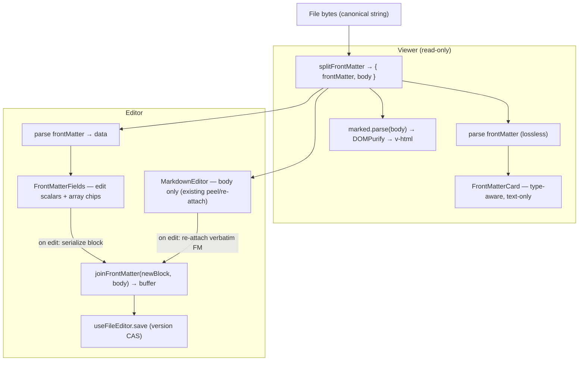

# feat: Markdown front matter as first-class metadata

## Summary

Treat YAML front matter as first-class metadata instead of letting it leak into
the rendered body. The read-only markdown viewer parses the leading front-matter
block and renders it as a generic, type-aware **card** above the content, and the
editor gains a dedicated **fields surface** for editing those values outside the
WYSIWYG body. Reading is lossless; an untouched file stays byte-verbatim, and the
block is only re-serialized when a human edits a field. Source mode remains the
raw escape hatch.

---

## Problem Frame

The read-only viewer (`packages/app/app/components/viewers/MarkdownViewer.vue`)
feeds the entire raw file — front matter included — straight into `marked.parse`.
Markdown has no concept of front matter, so a leading `---` block is parsed as a
thematic break followed by a setext heading: the YAML keys collapse into one large,
garbled `<h2>` at the top of every markdown file that carries front matter
(see origin: `docs/brainstorms/2026-06-09-markdown-front-matter-requirements.md`).

The editor already solves the _corruption_ half of this problem —
`packages/app/app/utils/frontmatter.ts` peels the block off as an opaque verbatim
string so tiptap can't mangle it — but it does so by making the metadata
_invisible_, surfaced only by flipping to raw source mode. So today the metadata is
either ugly (viewer) or hidden (editor), and never editable except as hand-typed
YAML. This matters most for Treehouse's core scenario: agents write structured
front matter into shared files, and humans need to read and adjust it without
touching raw YAML.

---

## Requirements

Carried from the origin requirements doc.

### Viewer card

- R1. The read-only markdown viewer must not render the leading front-matter block as body content; the rendered body begins at the first real line of content.
- R2. When front matter is present, the viewer renders it as a card above the body. When absent, no card renders and the body is unchanged.
- R3. The card renders generically over whatever top-level keys exist — nothing silently dropped. Rendering is type-aware: scalars as label/value, arrays as chips, booleans and dates formatted for reading.
- R4. Card keys and values both render as text, never HTML — neither a value nor a key written by an agent or compromised account can inject markup or script through the card (a YAML key can be attacker-controlled too).
- R5. Reading/parsing for the card is lossless and never rewrites the file; viewing leaves bytes untouched.

### Editing front matter

- R6. The editor provides a dedicated fields surface for front-matter values, separate from the WYSIWYG body editor, so a human can change values without hand-editing YAML.
- R7. Editing a value re-serializes the front-matter block on save; values are preserved, while key order/quoting may normalize and YAML comments may drop (accepted — see KTD3).
- R8. A file whose front matter is never edited keeps its bytes verbatim, exactly as today; re-serialization happens only when a human actually edits a field.
- R9. Source mode remains available and continues to edit the exact canonical bytes (front matter included), serving as the escape hatch for cases the fields surface does not cover.

---

## Key Technical Decisions

- **KTD1. Parse/serialize logic lives in a unit-tested util; components stay untested.**
  All YAML parsing, top-level value-type classification, and block serialization go
  into `packages/app/app/utils/` modules with sibling tests in `packages/app/test/`,
  mirroring the existing `frontmatter.ts` + `test/frontmatter.test.ts` pattern. The
  Vue components are presentational and follow the codebase convention (no component
  tests exist; logic-in-utils is the proven shape).

- **KTD2. `yaml` (eemeli) as a direct app dependency.** Robust type-aware parsing
  plus reformat-on-edit serialization warrants a real parser over a hand-rolled one.
  `yaml` is pure-JS and Cloudflare-Workers-safe, and is already present transitively
  in the lockfile. Adding it as a direct dependency in `packages/app/package.json`
  requires a `pnpm-lock.yaml` refresh (the shared Railway build fails on a stale
  frozen lockfile — see Risks).

- **KTD3. Reformat-on-edit over strict byte-fidelity.** Editing a field re-serializes
  the whole block rather than surgically patching one line. Values agents rely on are
  always preserved; the cost is that formatting and comments may not survive an edit.
  Untouched front matter is never reformatted — the existing opaque-string preservation
  in `frontmatter.ts` already guarantees this, and the re-serialize path only fires on
  a real field edit (R8). Note R5 ("reading is lossless") governs the _read_ path only;
  the reformat tolerance here is scoped to the _edit_ path. Scalar values are parsed and
  re-emitted as strings (no YAML timestamp/number coercion), so a `date: 2026-06-09`
  round-trips as `2026-06-09` rather than an ISO instant — this keeps an edited file's
  _unchanged_ fields textually stable (see KTD7, U1).

- **KTD7. Parse scalars as strings; sanitize keys against prototype pollution.** Front
  matter is attacker-controllable, so `parseFrontMatter` (a) configures `yaml` to keep
  scalars as strings rather than coercing timestamps/numbers into JS types that
  re-serialize differently, and (b) rejects or strips dangerous keys (`__proto__`,
  `constructor`, `prototype`) — e.g. via `mapAsMap` then a null-prototype object — so a
  crafted key cannot pollute `Object.prototype` for the page. Display formatting of
  dates/booleans for reading happens at render time from the string value, not by
  changing the stored value.

- **KTD4. Editor field scope is bounded; complex cases defer to source mode.** The
  fields surface edits scalar values (text inputs) and arrays of scalars (chip
  add/remove). Nested objects, mixed/complex arrays, and adding/removing top-level
  keys are shown read-only (or not at all) with a pointer to source mode, rather than
  building a nested-object or dynamic-key form. This keeps v1 bounded and aligns with
  the "complex → source mode" philosophy (see origin outstanding questions).

- **KTD5. Keys and values render as text, never `v-html`.** All front-matter content —
  keys, scalar values, array items, and stringified complex values — is untrusted
  (documented trust-boundary learning:
  `docs/solutions/architecture-patterns/public-share-trust-boundary.md`). The card and
  fields surface bind every string into text nodes / input values only (Vue text
  interpolation or `:textContent`), never `v-html`/`innerHTML` — including the `<pre>`
  used for complex values. The existing DOMPurify boundary in `MarkdownViewer.vue` still
  governs only the rendered markdown body.

- **KTD6. The canonical buffer is the single source of truth for the editor.** Both
  the WYSIWYG body (`MarkdownEditor.vue`) and the new fields surface read and write
  `useFileEditor`'s `buffer` (the full-file string). The fields surface replaces only
  the front-matter region of the buffer on edit; `MarkdownEditor`'s existing
  `splitFrontMatter`/`joinFrontMatter` + echo-guard logic continues to own the body
  region. This keeps dirty-tracking, conflict detection, and save unchanged.

---

## High-Level Technical Design

The front-matter block flows through a parse layer for display and a
serialize layer for edits. The viewer is read-only (parse only, never writes);
the editor round-trips edits back into the canonical buffer.

Read path (R1–R5) is independent and lossless. Edit path (R6–R9) re-serializes the
block only when a field actually changes (KTD3), and both edit surfaces converge on
one buffer (KTD6).

---

## Implementation Units

### U1. Front-matter data layer (parse, classify, serialize) + dependency

**Goal:** Pure, tested helpers to parse a front-matter block into data, classify
each top-level value's display type, and serialize data back into a `---`-delimited
block. Add the `yaml` dependency.

**Requirements:** R3, R5, R7, R8 (foundation); enables R1, R2, R4, R6.

**Dependencies:** none.

**Files:**

- `packages/app/app/utils/frontmatter.ts` (extend) or new `packages/app/app/utils/frontmatterData.ts` — add `parseFrontMatter(block: string): Record<string, unknown> | null` and `serializeFrontMatter(data: Record<string, unknown>): string` (returns the full `---\n…\n---\n` block including trailing newline, matching `joinFrontMatter`'s contract). Keep the existing string-level `splitFrontMatter`/`joinFrontMatter` untouched.
- `packages/app/app/utils/frontmatter.ts` (or sibling) — add a value-classification helper, e.g. `frontMatterFieldKind(value): "scalar" | "array" | "boolean" | "date" | "complex"`, used by both display and edit surfaces.
- `packages/app/test/frontmatterData.test.ts` (new) — unit tests.
- `packages/app/package.json` — add `yaml` to dependencies; refresh `pnpm-lock.yaml`.

**Approach:** Parse with `yaml`, configured to keep scalars as strings (no timestamp/
number coercion) so values round-trip textually (KTD7). `parseFrontMatter` returns
`null` when the block is empty, malformed, or parses to a non-map (front matter is
conventionally a mapping) — callers treat `null` as "unparseable, fall back" (R1 still
holds: the block is never dumped into the body). Guard against prototype pollution:
parse via `mapAsMap` (or equivalent) and build the returned object on a null prototype,
stripping/rejecting `__proto__`/`constructor`/`prototype` keys (KTD7). `serializeFrontMatter`
round-trips a plain data object to a block; it is only ever called on the edit path
(KTD3). Classification distinguishes scalars, scalar arrays, booleans, and dates (by
string shape) from `complex` (nested objects, mixed or nested arrays) so the edit
surface can bound itself (KTD4).

**Patterns to follow:** `packages/app/app/utils/frontmatter.ts` (module shape,
verbatim-block contract); `packages/app/test/frontmatter.test.ts` (`vite-plus/test`
imports, `describe`/`it`, exact-equality assertions).

**Test scenarios:**

- `parseFrontMatter` returns a data object for a well-formed block (scalars, arrays, booleans, dates).
- Returns `null` for: empty block, malformed YAML, and a block that parses to a non-map (scalar or top-level list).
- Prototype-pollution: `parseFrontMatter("__proto__:\n  polluted: true\n")` does not set `({}).polluted` (key rejected/stripped or landed on a null-prototype object).
- Dates round-trip as strings: a `date: 2026-06-09` value parses to the string `"2026-06-09"` and `serializeFrontMatter` re-emits `2026-06-09`, not an ISO instant.
- `serializeFrontMatter` produces a valid `---`-delimited block (leading/closing fences + trailing newline) that `splitFrontMatter` round-trips back out as one block.
- Round-trip preserves values: `parseFrontMatter(serializeFrontMatter(data))` deep-equals `data` for scalar/array/boolean/date inputs.
- Reformat behavior (R7) is asserted, not just tolerated: serializing a parsed block drops YAML comments and may normalize key order/quoting — a test documents this with an input that has a `# comment` and confirms it is absent from the output while all values survive.
- `frontMatterFieldKind` classifies scalar, scalar-array, boolean, date, and nested-object/mixed-array (`complex`) correctly.

**Verification:** `vp test` passes; new util importable with no Node-only APIs; `vp check` clean.

### U2. Read-only front-matter card component

**Goal:** A presentational component that renders parsed front-matter data as a
type-aware card.

**Requirements:** R2, R3, R4.

**Dependencies:** U1.

**Files:**

- `packages/app/app/components/viewers/FrontMatterCard.vue` (new).

**Approach:** Props `{ data: Record<string, unknown> }`. Render a `<dl>` of rows
mirroring `FileInfoPanel.vue`'s metadata pattern (`flex justify-between`,
`dt.text-fg-subtle` / `dd.text-fg`). Per `frontMatterFieldKind`: scalars as
label/value text; arrays as chip rows (token-styled pills); booleans and dates
formatted for reading; `complex` values shown compactly read-only as a muted `<pre>`
bound with text interpolation (stringified, e.g. `JSON.stringify`) — never expanded
into a form. Both the key label (`dt`) and every value/chip/`<pre>` are bound as text
nodes, never `v-html` (KTD5). Card styled as a bordered block (`border-border`,
`bg-surface`/`bg-surface-2`) sized to sit above the reading column.

**Display states (decide once here, not per-implementer guess):** long scalar values
clamp to ~2 lines with an expand affordance (avoid one `description` value dominating
the card); arrays wrap to multiple chip rows rather than truncating; a card with many
keys renders fully but the whole card is collapsible (collapsed-by-default once it
exceeds a small threshold, e.g. ~6 keys) so it never buries the reading column. These
are sensible defaults — the implementer may refine, but should not ship an
always-expanded unbounded card.

**Patterns to follow:** `packages/app/app/components/FileInfoPanel.vue` (`<dl>` rows,
chip/badge styling, `--th-*` semantic tokens); `<script setup lang="ts">` +
`defineProps<{}>()`; flat component naming (referenced as `<FrontMatterCard>`).

**Test scenarios:** Test expectation: none — presentational component; the codebase
has no component tests and all logic lives in U1's tested helpers. Visual correctness
verified in U3.

**Verification:** Renders scalars, arrays (as chips), booleans/dates, and a complex
value without errors; no `v-html` usage; `vp check`/`vp lint` clean.

### U3. Wire the card into the read-only viewer

**Goal:** Peel front matter before `marked.parse` and render the card above the body.

**Requirements:** R1, R2, R5.

**Dependencies:** U1, U2.

**Files:**

- `packages/app/app/components/viewers/MarkdownViewer.vue` (modify).

**Approach:** In rendered mode, `splitFrontMatter(props.source)`; feed only `body`
into `marked.parse` (→ DOMPurify → `v-html`, unchanged). When `frontMatter` is
non-empty, `parseFrontMatter` it; if it parses, render `<FrontMatterCard :data>`
above the article. If the block is present but unparseable (`null`), peel it anyway
(R1) and render a small, muted "metadata couldn't be parsed — view in source mode"
note instead of the card. Source mode is unchanged (raw bytes, front matter
included). No write path is introduced (R5).

**Patterns to follow:** existing `MarkdownViewer.vue` computed-render + DOMPurify
boundary; `FileViewer.vue` reading-column layout.

**Test scenarios:** Test expectation: none at the component level — the split/parse
logic is covered in U1. Manual verification below.

**Verification:** A markdown file with front matter shows a clean body (no garbled
heading) plus the card; a file without front matter renders exactly as before; an
unparseable block shows the fallback note, not raw YAML in the body; source mode
still shows the full raw bytes.

### U4. Editable front-matter fields surface

**Goal:** A component that edits scalar values and scalar-array items, deferring
complex cases to source mode.

**Requirements:** R6, R4 (text-only inputs), R7 (emits serialized changes).

**Dependencies:** U1.

**Files:**

- `packages/app/app/components/editors/FrontMatterFields.vue` (new).

**Approach:** Props `{ data: Record<string, unknown> }`, emits
`update:data` (or an `edit` event) with the next data object. Scalars render as text
inputs; scalar arrays render as removable chips plus an add-item input committed on
Enter (and on blur of a non-empty input); booleans as a toggle; dates as a text input
with a format hint (kept simple — no date picker in v1; an unrecognized date string is
left as-is, not rejected). An existing key with an empty/`null` value renders the input
with a visible placeholder so "field present but empty" is distinguishable from "no such
key" (key add/remove is deferred — KTD4). `complex` values and the option to add/remove
top-level keys are shown read-only with an inline "edit in source mode" affordance
(KTD4). Inputs bind value as text only (KTD5). The component is controlled — it does not
own canonical state; it reflects `data` and emits edits (serialization happens in U5 via
U1's helper).

**Source-mode affordance + visibility:** the "edit in source mode" hint and the
unparseable-disabled state both render as an inline text button that switches the editor
to source mode (consistent across viewer note and editor surface). The fields surface
stays visible above the body in WYSIWYG sub-mode; when the editor is switched to source
sub-mode it hides (source mode already shows the raw front matter, so showing both would
duplicate the edit path). Because both round-trip through the buffer (U5), no state is
lost across the toggle.

**Patterns to follow:** `MarkdownEditor.vue` toolbar/control styling and
`SourceToggle.vue` for segmented/token-styled controls; `FileInfoPanel.vue` chip
styling for array items; `--th-*` tokens.

**Test scenarios:** Test expectation: none at the component level — value transforms
that need testing (serialize round-trip) live in U1. Behavior verified in U5.

**Verification:** Editing a scalar emits updated data; adding/removing an array chip
emits updated data; a complex field shows the read-only source-mode hint and offers no
editing affordance; no `v-html`.

### U5. Wire the fields surface into the editor (buffer round-trip)

**Goal:** Render the fields surface above the body editor and round-trip edits through
the canonical buffer with reformat-on-edit fidelity.

**Requirements:** R6, R7, R8, R9.

**Dependencies:** U1, U4.

**Files:**

- `packages/app/app/components/FileEditor.vue` (modify) — for the markdown kind, render `<FrontMatterFields>` above `<MarkdownEditor>`, both bound to `fe.buffer`.

**Approach:** Derive the parsed front matter from `fe.buffer`:
`splitFrontMatter(buffer)` → `parseFrontMatter(frontMatter)`. Render
`<FrontMatterFields :data>` when it parses; when the block is unparseable or absent,
render a disabled state pointing to source mode (R9). On a fields edit: take the
edited data, `serializeFrontMatter` it (KTD3), `joinFrontMatter(newBlock, currentBody)`
where `currentBody` comes from re-splitting the _current_ buffer (so a concurrent body
edit is not clobbered), and write the result back to `fe.buffer`. Untouched front matter
is never serialized — the fields edit handler is the only new write path, so R8 holds.

**Coordinate with `MarkdownEditor`'s buffer watch (important).** `MarkdownEditor`'s
`modelValue` watch fires on _any_ external buffer change, not just its own echoes —
so a fields edit that rewrites the front-matter region will trigger
`loadIntoWysiwyg` → `ed.commands.setContent(...)`, a full re-parse of the body. This is
not an echo loop (it's guarded by `applyingExternal`/`emitUpdate:false`), but
re-running `setContent` on every field keystroke resets tiptap document state and can
jump the cursor/selection. Mitigate: debounce the fields-edit write to the buffer, and
have `MarkdownEditor` skip the reload when the incoming value's `body` region is
unchanged (only the front-matter region differs). Note the residual edge: the re-split
reads the body at MarkdownEditor's last _emitted_ state, so a field edit landing between
un-emitted body keystrokes rejoins against a one-emit-stale body — acceptable given
near-simultaneous two-surface edits are rare, but the implementer should be aware.

**Fields-surface visibility needs the editor's sub-mode.** Hiding the fields surface in
source sub-mode (U4) requires `FileEditor` to know `MarkdownEditor`'s current mode —
lift the WYSIWYG/source mode state up (or expose it via the existing `SourceToggle`
wiring) so `FileEditor` can drive both the body editor's mode and the fields surface's
visibility, and the "edit in source mode" affordance can switch it.

Document the invariant: source mode and the fields surface both round-trip through
`fe.buffer`, so editing raw YAML in source mode re-parses into the fields, and a field
edit reformats the block (expected per KTD3).

**Patterns to follow:** `packages/app/app/components/FileEditor.vue` (kind dispatch,
Save toolbar, dirty/conflict UI); `packages/app/app/composables/useFileEditor.ts`
(`buffer` as canonical source, `dirty`, version-CAS `save`); `MarkdownEditor.vue`
echo-guard (`lastValue`/`applyingExternal`) for how external buffer changes are
absorbed without re-emitting.

**Test scenarios:** Test expectation: none at the component level (consistent with the
codebase). The load-bearing transforms — serialize, join, and round-trip — are tested
in U1. Manual/integration verification below.

**Verification:**

- Editing a field updates the file; saving persists the change; reopening shows it.
- An unedited file's bytes are unchanged after open/close (no reformat) — confirm front matter is byte-identical (R8).
- Editing a field reformats only the front-matter block; the body is preserved exactly, including when the body was edited in the same session (R7, KTD6).
- A body edit followed by a field edit (and vice versa) does not lose either change.
- Source mode still edits the full raw bytes; raw YAML edits in source mode re-parse into the fields surface (R9).
- Malformed front matter disables the fields surface with a source-mode pointer rather than erroring.

---

## Scope Boundaries

In scope: the read-only viewer card and the editor fields surface for markdown files,
backed by a tested parse/serialize util.

Out of scope (from origin):

- Public-share markdown rendering — the share page renders markdown as plain monospace text, so the card does not apply there.
- Using front matter to drive file-list columns, search, filtering, or sorting.
- Any schema definition, validation, or required-field enforcement — the app stays agnostic about what keys mean.
- Backfill or migration of existing files; behavior is forward-only.

### Deferred to Follow-Up Work

- Editing nested/complex YAML values and adding/removing top-level keys via the fields UI (v1 defers these to source mode — KTD4). A future nested/dynamic-key editor could lift this boundary.
- Sidebar treatment of front matter (the brainstorm's fallback) — only pursued if the header card doesn't work out in practice.

---

## Risks & Dependencies

- **Lockfile drift breaks the shared build.** Adding `yaml` without refreshing
  `pnpm-lock.yaml` fails the Railway frozen-lockfile build
  (`docs/solutions/developer-experience/railway-cloudflare-deploy-gotchas-2026-06-08.md`).
  Mitigation: add via `vp install` and commit the refreshed lockfile in U1.
- **Workers-runtime compatibility.** The app ships to Cloudflare Workers; the parser
  must stay pure-JS with no Node-only imports. `yaml` qualifies. Mitigation: verify
  the bundle builds (`vp check` / app build) after U1.
- **Untrusted keys and values (XSS).** Front-matter keys _and_ values are
  attacker-controllable. Mitigation: text-only binding everywhere — keys, values, chips,
  and the complex-value `<pre>` (KTD5); never route any of them through `v-html`.
- **Prototype pollution via parsed keys.** A crafted `__proto__`/`constructor` key in
  front matter can poison the page's object graph through `yaml.parse`. Mitigation:
  `parseFrontMatter` strips/rejects those keys / uses a null-prototype object (KTD7, U1),
  with a regression test.
- **Date/scalar reformatting.** `yaml` would otherwise coerce `date:`/numeric scalars to
  JS types that re-serialize differently (e.g. ISO timestamps), silently rewriting
  unchanged fields on the first edit. Mitigation: parse scalars as strings (KTD7) so
  values round-trip textually.
- **Two edit surfaces over one buffer.** The fields surface and the body editor both
  mutate `fe.buffer`. Mitigation: re-split the current buffer on each fields edit so a
  concurrent body edit is never clobbered (U5), and lean on `MarkdownEditor`'s existing
  echo-guard.

---

## Sources & Research

- Origin requirements: `docs/brainstorms/2026-06-09-markdown-front-matter-requirements.md`
- Trust boundary / sanitization principle: `docs/solutions/architecture-patterns/public-share-trust-boundary.md`
- Deploy/lockfile constraint: `docs/solutions/developer-experience/railway-cloudflare-deploy-gotchas-2026-06-08.md`
- Existing front-matter contract: `packages/app/app/utils/frontmatter.ts`, `packages/app/test/frontmatter.test.ts`