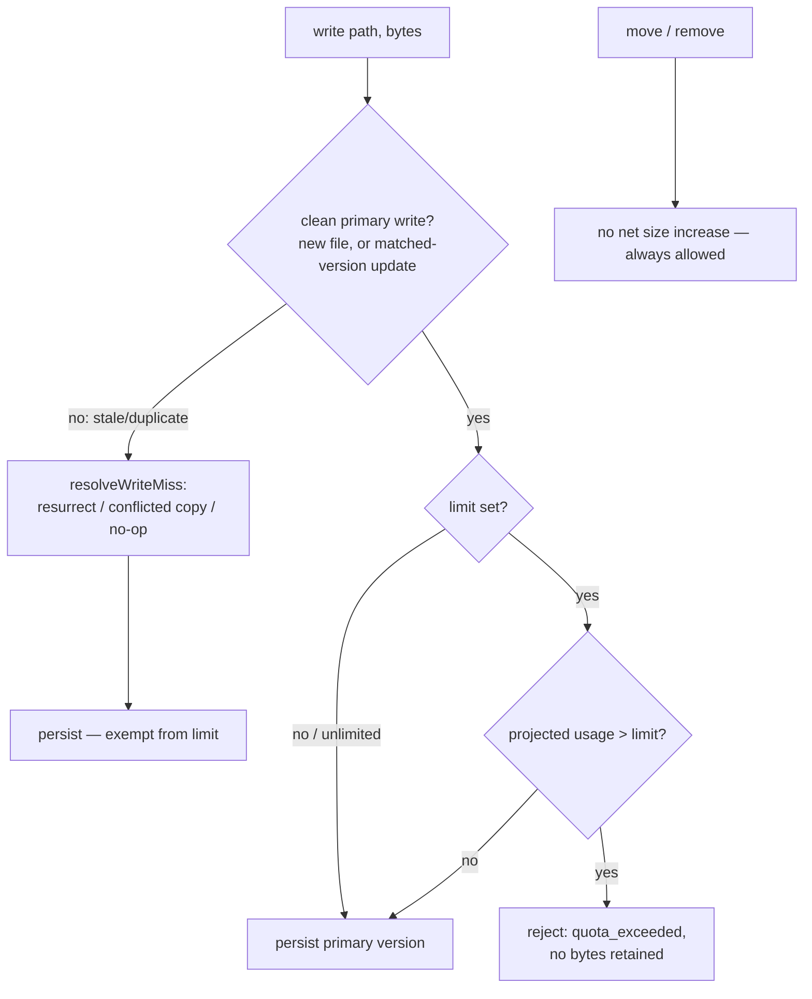

# feat: Workspace storage usage tracking and limit scaffolding

## Summary

Surface per-workspace storage usage (the sum of live file sizes) through the
REST API, the MCP server, and the workspace UI, and build a dormant limit
mechanism at the shared file-service write path. The limit value comes from a
single resolver seam that reads an env default and treats an unset value as
unlimited, so enforcement is fully built and tested but blocks no one until a
value is deliberately set — or until a future billing effort wires the resolver
to subscription plans.

## Problem Frame

Storage is currently untracked and uncapped. Every live file records its byte
count (`FileNode.size`), but nothing aggregates it, so neither operators nor
users can see how much a workspace consumes, and an agent in a write loop can
grow a workspace without bound. The near-term need is visibility plus the
_mechanism_ to limit — not a billing system. Plan tiers and subscriptions are a
later effort; this work must leave a clean seam for them rather than invent
them now (see origin: docs/brainstorms/2026-06-09-workspace-storage-limits-requirements.md).

---

## Requirements

### Usage measurement and visibility

- R1. A workspace's current storage usage is the sum of the sizes of its live
  files; hard-deleted files do not count.
- R2. Usage and the effective limit are queryable via the REST API.
- R3. Usage and the effective limit are exposed to agents via an MCP tool.
- R4. The workspace UI shows current usage, and the limit when one is set.
- R5. When a limit is set and usage crosses a warning threshold below it, the
  usage payload flags the warning so every consumer (UI, agents) reads one
  server-computed signal.

### Limit mechanism

- R6. The effective limit for a workspace is produced by a single resolver; v1
  returns an env-configured default and treats an unset value as unlimited.
- R7. When a limit is set, an ordinary write that would take usage above it is
  rejected, and no bytes from the rejected write are retained.
- R8. Enforcement lives at the shared file-service write path, so REST and MCP
  writes are gated by the same rule.
- R9. Reads, moves, and deletes are always permitted regardless of limit state.
- R10. Data-preservation writes (conflicted copies and resurrects from
  stale-write handling) are exempt and may exceed the limit.
- R11. A rejected write returns a machine-readable error an agent or the CLI can
  recognize, distinct from the existing version-conflict response.

---

## Key Technical Decisions

- **Usage is computed on demand from Postgres, never the blob store.** A Prisma
  `_sum` aggregate over `FileNode.size` is the source of truth. The blob store
  silently degrades to ephemeral local disk when `R2_*` env is absent, so it is
  not a reliable basis for accounting. No denormalized counter in v1 — a cached
  counter is a deferred perf follow-up if aggregation ever gets hot.
- **The limit comes from a resolver seam, not a plan field.** A single
  `quotaForWorkspace(...)` resolver returns the effective limit. v1 reads an env
  default; `null` means unlimited (no enforcement). This is the one place future
  billing work attaches per-plan values — no `plan`/`tier`/subscription state is
  introduced now, keeping the auth-managed `Organization` model untouched.
- **Enforcement gates only clean primary writes at the service `write()`
  chokepoint.** Both REST and MCP call `useFileService().write(...)`, so a check
  there covers both channels. It applies to the two size-increasing primary
  outcomes — a new live file, or a matched-version update — and is bypassed by
  the data-preservation fallbacks (`resolveWriteMiss`, `makeConflictCopy`,
  resurrect, no-op) and by `move`/`remove`, which never grow total live size.
- **Quota-exceeded is a distinct write-result discriminator, not a thrown
  error.** The service returns a structured quota-exceeded result carrying its
  own marker (e.g. a `quotaExceeded: true` field or a dedicated `status`
  variant) — _not_ a bare `ok: false`, which the existing consumers already
  treat as a version conflict. Every `write()` caller (the PUT route and both
  MCP `write_file` handlers) must test the quota case _before_ the existing
  `if (!result.ok)` conflict branch, which early-returns. The REST route maps it
  to a non-2xx JSON body and the MCP handlers to a structured non-throwing
  result, keeping agent and CLI handling pattern-matchable.

---

## High-Level Technical Design

The enforcement decision sits inside `write()`, before a primary version is
persisted. The projected usage for an incoming write to `path` is the sum of all
live file sizes _except_ the current row at `path`, plus the incoming byte
length — so it is correct for both a fresh create (nothing excluded) and a
version update (old size excluded). Conflict and resurrect outcomes never reach
the gate.

Usage reads share one helper so the REST endpoint, the MCP tool, and the
enforcement gate compute the figure identically.

---

## Implementation Units

### U1. Usage aggregation helper

- **Goal:** One helper that returns a workspace's live-file byte total, reused by
  the read endpoints and the enforcement gate.
- **Requirements:** R1
- **Dependencies:** none
- **Files:**
  - `packages/api/server/utils/files.ts` (add a `usage(workspaceId)` method to
    the file service, or a sibling helper) — modify
  - `packages/api/server/utils/files.test.ts` (or the existing service test
    location) — test
- **Approach:** `db.fileNode.aggregate({ where: { workspaceId }, _sum: { size: true } })`,
  coalescing a null sum (empty workspace) to `0`. Follow the existing
  `db.changeEvent.aggregate` precedent in `changes.get.ts`. Add an
  optional `excludePath` argument used by the enforcement gate to compute an
  update delta correctly.
- **Patterns to follow:** the `useFileService()` method shape in
  `packages/api/server/utils/files.ts`; the aggregate call in
  `packages/api/server/routes/api/workspaces/[workspaceId]/changes.get.ts`.
- **Test scenarios:**
  - Covers R1. Workspace with three live files returns the exact sum of their
    sizes.
  - Empty workspace (no live files) returns `0`, not null.
  - After a hard delete, the deleted file's bytes no longer count.
  - With `excludePath` set to an existing file, that file's size is excluded
    from the total.
- **Verification:** Helper returns correct totals across populated, empty, and
  post-delete states.

### U2. Limit resolver and configuration

- **Goal:** A single seam that produces a workspace's effective limit and the
  warning threshold, configured by env, with unset meaning unlimited.
- **Requirements:** R5, R6
- **Dependencies:** none
- **Files:**
  - `packages/api/server/utils/quota.ts` — create
  - `packages/api/server/utils/quota.test.ts` — create
  - `packages/api/.env.example` — modify (document the new vars)
- **Approach:** Export `quotaForWorkspace(ws)` returning `number | null`
  (`null` = unlimited). v1 reads a default via the typed-env-accessor convention
  in `packages/api/server/utils/device.ts` (e.g. `DEFAULT_WORKSPACE_QUOTA_BYTES`,
  unset → `null`). Export a `quotaStatus({ usedBytes, limitBytes })` helper that
  returns `{ usedBytes, limitBytes, remainingBytes, warning }`, where `warning`
  is `true` only when a limit is set and `usedBytes / limitBytes` meets a fixed
  ratio held as a module constant (`0.9`) — not a configurable env var, since no
  operator can act on a warn ratio while limits are dormant; make it configurable
  in the billing follow-up if needed. The resolver takes the `workspaceId` that
  `write()` already holds; v1 reads the env default with no DB query, so `write()`
  can call it inline without re-fetching the workspace. Future per-plan resolution
  fetches org/plan state here (cached) without changing callers.
- **Patterns to follow:** the env-default accessor in
  `packages/api/server/utils/device.ts`; memoized `use*()` utils in
  `packages/api/server/utils/storage.ts`.
- **Test scenarios:**
  - Covers R6. With the default env unset, `quotaForWorkspace` returns `null`
    (unlimited).
  - With `DEFAULT_WORKSPACE_QUOTA_BYTES` set, the resolver returns that value.
  - Covers R5. `quotaStatus` reports `warning: false` when unlimited regardless
    of usage.
  - Covers R5. With a limit set and usage at/above the warn ratio, `warning` is
    `true`; just below, `false`.
  - `remainingBytes` is `null` when unlimited and `limit - used` (floored at 0)
    when limited.
- **Verification:** Resolver and status helper behave correctly across unset,
  set-under-threshold, set-over-threshold, and over-limit inputs.

### U3. Enforcement at the write path

- **Goal:** Reject clean primary writes that would exceed a set limit, while
  exempting data-preservation paths and non-growing operations.
- **Requirements:** R7, R8, R9, R10, R11
- **Dependencies:** U1, U2
- **Files:**
  - `packages/api/server/utils/files.ts` — modify (`write` only)
  - `packages/api/server/utils/files.test.ts` — test
- **Approach:** In `write()`, determine whether the incoming write is a clean
  primary outcome — a create where `path` does not yet exist, or a CAS update
  whose `baseVersion` matches the current version. For that case only, compute
  projected usage via `usage(workspaceId, { excludePath: path })` + `body.byteLength`;
  if `quotaForWorkspace(workspaceId)` is non-null and projected exceeds it,
  return a `quota_exceeded` result (the discriminator from the KTD) without
  persisting. Leave `resolveWriteMiss` / `makeConflictCopy` / the resurrect and
  no-op branches untouched so stale and duplicate writes still preserve data over
  the limit. `restore` is **exempt** — it recovers a user's own prior version and
  falls through to `resolveWriteMiss` on contention, so gating it would block
  legitimate recovery on a full workspace, contradicting R9/R10; do not modify
  it. `move` and `remove` are unchanged.
- **Concurrency note:** The gate reads usage then writes without a transactional
  guard, so two concurrent under-limit writes can jointly cross the limit — the
  limit is soft, with bounded over-commit of about one write. Acceptable for a
  dormant limit; the deferred counter would be the place to tighten it.
- **Execution note:** Add the over-limit and conflicted-copy-over-limit
  integration tests first — they pin the R10 invariant that is easiest to break.
- **Test scenarios:**
  - Covers R7. Limit set; a create whose bytes exceed the limit is rejected and
    no `FileNode` row is written.
  - Covers R7. Limit set; a matched-version update that would exceed the limit
    is rejected; the existing version is unchanged.
  - Update that _replaces_ a large file with a smaller one stays under the limit
    and succeeds (delta uses `excludePath`).
  - Covers R9. Over-limit workspace still serves reads, `move`, and `remove`;
    a delete brings usage back under and the next write succeeds.
  - Covers AE4 / R10. Workspace at the limit; a stale-version write triggers a
    conflicted copy — the conflicted copy is written even though usage now
    exceeds the limit; the next clean write is rejected.
  - Covers R6. With the limit unset (unlimited), a large write that would exceed
    any nominal cap still succeeds.
- **Verification:** Clean over-limit writes are blocked with bytes retained
  nowhere; conflicted copies, moves, deletes, and reads are never blocked;
  unlimited mode never blocks.

### U4. REST usage endpoint and write error contract

- **Goal:** Expose usage/limit over REST and return a recognizable quota error
  from the write route; handle it gracefully in the CLI.
- **Requirements:** R2, R11
- **Dependencies:** `usage.get.ts` depends on U1, U2 only and can ship in the
  same pass as them; the PUT route quota-error mapping and the CLI branch depend
  on U3.
- **Files:**
  - `packages/api/server/routes/api/workspaces/[workspaceId]/usage.get.ts` — create
  - `packages/api/server/routes/api/workspaces/[workspaceId]/files/[...path].put.ts` — modify
  - `packages/cli/src/api-client.ts` — modify (`put` quota-error branch)
  - test files alongside the route and the CLI client — test
- **Approach:** New `usage.get.ts` mirrors `changes.get.ts`: resolve via
  `requireWorkspaceFromRoute`, call `usage(...)` + `quotaStatus(...)`, return
  `{ usedBytes, limitBytes, remainingBytes, warning }`. In the PUT route, map the
  `quota_exceeded` write result to a non-2xx JSON body with an `error`
  discriminator (e.g. `{ error: "quota_exceeded", usedBytes, limitBytes }`),
  following the existing `version_conflict` / `setResponseStatus` pattern. In the
  CLI `put`, add a branch on that status/discriminator so it surfaces a clear
  over-limit message instead of a generic `put failed: <status>`.
- **Patterns to follow:**
  `packages/api/server/routes/api/workspaces/[workspaceId]/changes.get.ts`
  (read endpoint), `.../files/[...path].put.ts` lines around the
  `version_conflict` return (error shape), `packages/cli/src/api-client.ts`
  `put` status branching.
- **Test scenarios:**
  - Covers R2. `GET usage` returns correct usedBytes and limit for a populated
    workspace; reflects unlimited (null limit) when env unset.
  - Auth: a workspace-scoped key whose `keyWorkspaceId` differs from the route
    workspace is rejected 403 (mismatched key).
  - Auth: a cookie-session user who is not a member of the workspace's org is
    rejected (404/403), mirroring sibling routes.
  - Covers R11. An over-limit PUT returns the quota-exceeded discriminator and
    status, distinct from the 412 version-conflict response.
  - CLI surfaces a readable over-limit error rather than a generic failure.
- **Verification:** Usage endpoint returns the server-computed figures with
  correct auth; over-limit writes produce a distinct, parseable error end to end.

### U5. MCP usage tool and write result

- **Goal:** Let agents read usage/limit and recognize an over-limit write.
- **Requirements:** R3, R11
- **Dependencies:** U1, U2, U3
- **Files:**
  - `packages/api/server/utils/mcp.ts` — modify (both `buildMcpServer` and
    `buildUserMcpServer`)
  - MCP test location — test
- **Approach:** Register a `get_usage` tool in both server builders returning
  `okData(...)` with an `outputSchema` of `{ usedBytes, limitBytes,
  remainingBytes, warning }`. In `buildMcpServer` (workspace-scoped key),
  `get_usage` takes **no** `workspaceId` input and uses the closure-captured
  workspace, matching `list_files`/`read_file` in that builder — accepting a
  `workspaceId` input here would let an agent read another workspace's usage. In
  `buildUserMcpServer` (user-scoped key), it takes a `workspaceId` input
  authorized through the existing `ws()` helper, like the other user-scoped
  tools. Extend the `write_file` handlers (both builders) so a `quota_exceeded`
  service result returns a structured non-throwing result carrying the distinct
  marker (e.g. `quotaExceeded: true, usedBytes, limitBytes`) added to the
  `write_file` `outputSchema`, tested before the existing conflict branch.
- **Patterns to follow:** `okData` / `outputSchema` usage and the `write_file`
  conflict result in `packages/api/server/utils/mcp.ts`; the duplicated
  registration across both builders.
- **Test scenarios:**
  - Covers R3. `get_usage` returns the correct structured figures for a
    workspace-scoped key and (via the user-scoped builder) for a per-call
    workspace.
  - Covers R11. An over-limit `write_file` returns the structured
    quota-exceeded result with `isError` unset (non-throwing), not a generic
    error.
  - The tool and result are present in both builders (no drift between
    workspace-scoped and user-scoped servers).
- **Verification:** Both MCP servers expose usage and a machine-readable
  over-limit signal identically.

### U6. Workspace UI usage display

- **Goal:** Show current usage, and the limit and warning when set, on the
  workspace page.
- **Requirements:** R4, R5
- **Dependencies:** U4
- **Files:**
  - `packages/app/app/` workspace page/components (the existing workspace view
    and its data composable) — modify
  - component test location — test
- **Approach:** Fetch the usage endpoint from the workspace view (its own query,
  alongside the existing workspace/entries queries) and render used bytes in the
  workspace info panel, plus a used/limit indicator when `limitBytes` is
  non-null. Reflect the server `warning` flag visually (an at-risk state on the
  indicator) — the warning is informational only: a color/icon change, no dismiss
  action and no upgrade CTA (upgrade belongs to the billing follow-up). When
  unlimited, show usage only — no limit bar, no warning. Reuse the existing
  byte-formatting helper (`prettyBytes`) and data-fetch conventions; do not
  compute the warning client-side. If the usage fetch fails, suppress the widget
  rather than propagating to the top-level workspace error state — it is a
  non-blocking secondary fetch. Invalidate the usage query when file mutations
  (upload, delete) complete so the indicator reflects freed space promptly.
- **Patterns to follow:** the existing workspace page data fetching and
  API-client usage in `packages/app/app/`.
- **Test scenarios:**
  - Covers R4. Renders used bytes for a populated workspace.
  - Covers R4. With a limit set, renders the used/limit indicator.
  - Covers R5. With the server `warning` flag true, renders the at-risk state;
    false renders normal.
  - Unlimited workspace renders usage with no limit indicator.
  - A failed usage fetch suppresses the widget without erroring the workspace
    view.
- **Verification:** The workspace page shows usage in all three states
  (unlimited, within limit, warning) driven by the server payload.

---

## Scope Boundaries

In scope: usage measurement, usage/limit surfacing across REST + MCP + UI, the
write-path limit mechanism with its resolver seam, and the warning signal.

### Deferred to Follow-Up Work

- Plan tiers, subscriptions, billing, and upgrade flows — the future effort that
  wires real per-plan limit values into `quotaForWorkspace`.
- A denormalized usage counter on the workspace as a perf optimization, should
  the on-demand aggregate become hot.
- Per-file maximum size as a separate limit from the workspace total.
- A backfill or admin path for workspaces already over a limit at the moment one
  is first configured (no live limits ship, so nothing is over-limit on day one).

---

## Open Questions

Deferred to implementation:

- Exact units and labels for the env config (bytes vs. a human-friendly
  suffix) — settle when adding the `device.ts`-style accessor.
- Whether the `usage` figure should also ride along on the existing workspace
  metadata endpoint (`index.get.ts`) in addition to the dedicated `usage.get.ts`,
  decided once the UI fetch shape is known.

---

## Risks & Dependencies

- **Conflicted-copy exemption is the fragile invariant.** A naive "check at the
  top of `write` and throw" would block stale writes before they become
  conflicted copies, silently losing the incoming edit. The gate must apply only
  to clean primary outcomes; U3's AE4 test exists to guard this. (origin:
  docs/brainstorms/2026-06-09-workspace-storage-limits-requirements.md, R7/R10)
- **Schema caution.** No migration is required (usage is on-demand; no `plan`
  field is added). If a future change does touch the schema, the Treehouse models
  are hand-maintained — apply by `prisma migrate`, never `auth:generate`.
- **Per-write aggregate cost.** Enforcement adds one indexed `_sum` query on the
  size-increasing write path. Acceptable for v1; the deferred counter is the
  escape hatch if it becomes hot.
- **Conflicted-copy storage amplification.** Because conflicted copies are exempt
  (R10) and the platform API-key rate limiter is disabled, an agent issuing
  repeated stale writes to one path can grow a workspace past its limit without
  bound. Tolerable while limits are dormant; before limits go live, the billing
  effort should cap conflicted copies per path or alert operators on exempt-path
  growth. Recorded as deferred mitigation, not solved here.
- **Silent unlimited mode.** An unset `DEFAULT_WORKSPACE_QUOTA_BYTES` means no
  enforcement. This is the intended dormant default, but a deployment that
  _expects_ a limit and omits the var would silently enforce nothing. Log a
  one-line startup notice when the var is unset so the posture is visible in
  logs.

---

## Sources & Research

- `packages/api/server/utils/files.ts` — `useFileService().write()` create-only
  and CAS-update branches (the enforcement seam), `makeConflictCopy` /
  `resolveWriteMiss` (the exempt data-preservation paths), `move`/`remove`
  (non-growing). `FileNode.size` is `body.byteLength`.
- `packages/api/server/routes/api/workspaces/[workspaceId]/changes.get.ts` —
  the `db.*.aggregate` precedent and read-endpoint shape.
- `packages/api/server/routes/api/workspaces/[workspaceId]/files/[...path].put.ts`
  — the `version_conflict` / `setResponseStatus` error shape to mirror for
  `quota_exceeded`.
- `packages/api/server/utils/mcp.ts` — `okData` / `outputSchema` conventions and
  the `write_file` result; write tools are duplicated across `buildMcpServer`
  and `buildUserMcpServer`.
- `packages/api/server/utils/workspace.ts` — `requireWorkspaceFromRoute`,
  `webHeaders` (use `getRequestHeaders`, never `toWebRequest` on PUT/POST).
- `packages/api/server/utils/device.ts` — the typed env-default accessor pattern
  for the new quota config.
- `packages/cli/src/api-client.ts` — `put` status-code branching; needs a
  quota-error branch.
- `docs/solutions/developer-experience/railway-cloudflare-deploy-gotchas-2026-06-08.md`
  — blob store degrades to ephemeral disk; compute usage from Postgres metadata.
- Plan-tier / billing state is greenfield: no `plan`/`tier`/`subscription` fields
  or billing plugin exist anywhere in the schema or better-auth config.