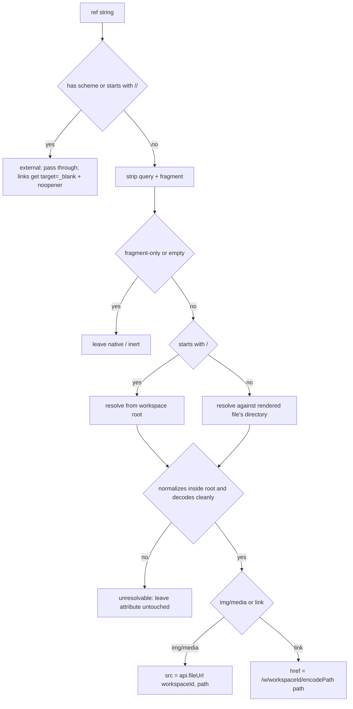

# feat: Relative paths in markdown and folder default pages

## Summary

Resolve relative references in rendered markdown — images display real workspace file bytes via the API file URL, document links navigate in-app — in both the read-only viewer and the Tiptap editor, without ever rewriting the stored markdown. Folders containing a README.md, index.md, or index.html render that file as their default page with a toggle back to the file listing.

---

## Problem Frame

Markdown renders with no reference rewriting (`marked` + DOMPurify into `v-html`), so a relative image resolves browser-relative to an app route that serves the SPA's HTML instead of image bytes, and relative links trigger full page reloads. Folders always show a bare listing even when the author wrote a README as the folder's front page. Agents and the sync CLI write portable markdown with relative references — exactly the content that breaks today (see origin: docs/brainstorms/2026-06-09-relative-paths-folder-defaults-requirements.md).

---

## Requirements

**Reference resolution** (R1–R5 carried from origin)

- R1. Relative image/media references in rendered markdown display the referenced workspace file's content.
- R2. References resolve against the directory of the file being rendered, supporting `./` and `../`. A reference that escapes the workspace root (or fails to decode) is left untouched — broken, never clamped to a different file.
- R3. Root-absolute references (`/assets/logo.png`) resolve from the workspace root.
- R4. External references — anything with a URL scheme, plus protocol-relative `//host/...` — pass through unchanged; external links open in a new tab with `rel="noopener noreferrer"`.
- R5. Stored markdown is never modified; resolution is display-only.

**Document links** (R6–R8 carried from origin)

- R6. A relative link to a workspace file navigates in-app (SPA navigation, no reload) to that file's page.
- R7. A relative link to a folder navigates to that folder's page, where default-page behavior applies.
- R8. A link to a nonexistent path navigates normally and shows the existing missing-file state.

**Editor** (R9 carried from origin)

- R9. The Tiptap editor displays relative images via the same resolution; the stored attribute and serialized markdown keep the original relative path byte-identical.

**Folder default page** (R10–R13 carried from origin)

- R10. A folder containing a default-page file renders it as the folder's page; candidates are README.md, index.md, index.html, matched case-insensitively, in that precedence.
- R11. The folder page toggles between default page and file listing; the default page shows first on each navigation to the folder (toggle state resets on route change, not persisted).
- R12. A default page's relative references resolve against the folder it lives in.
- R13. index.html default pages render through the existing sandboxed HTML viewer.

**Plan-added**

- R14. Raw HTML ``/`<a>` typed inside markdown source resolve identically to markdown syntax.
- R15. Modifier-clicks (cmd/ctrl/shift/middle-click) on internal links keep native browser behavior; rendered hrefs are real `/w/<workspaceId>/<path>` URLs so open-in-new-tab and copy-link work.
- R16. The workspace root counts as a folder: a root-level default page replaces the "select a file" placeholder on the workspace overview, with the same toggle.
- R17. In default-page mode the top bar, breadcrumbs, and info panel keep folder identity; the rendered page is read-only with an affordance to open the underlying file (where editing lives).

---

## Key Technical Decisions

- **Rewrite in a single post-sanitize DOM pass, not a marked renderer.** Parse `marked` output, sanitize with DOMPurify, parse the sanitized HTML into a detached template, walk `img[src]`/`a[href]`/`source[src]`, rewrite attributes, and serialize back for `v-html`. One pass covers markdown syntax and raw HTML alike (R14), and rewriting after sanitization means the sanitizer can't be subverted by the rewrite. Avoids global `marked.use()`/DOMPurify-hook state leaking across components.
- **Reference classification is fail-closed.** External = has a scheme or is protocol-relative (`//`). Root-absolute = leading `/`, resolved from workspace root. Everything else resolves against the rendered file's directory. Escaping the root, malformed percent-encoding, or empty results → classification "unresolvable", attribute left untouched. Resolution is case-sensitive (matches storage); only default-page _filename_ detection is case-insensitive.
- **Query and fragment are stripped before path resolution.** `./img.png?x=1` and `./doc.md#sec` resolve by path part; fragment-only links (`#heading`) stay native/inert (anchors are out of scope per origin).
- **Images use the existing direct-URL pattern.** Rewritten `src` = `api.fileUrl(workspaceId, resolvedPath)` — the same mechanism ImageViewer already uses, so auth/cookie behavior is inherited, not new. (Known limitation on cross-site preview deployments — see Risks.)
- **Links rewrite to app routes plus a delegated click handler.** `href` becomes `/w/<workspaceId>/<encodedPath>`; a single `@click` handler on the rendered article intercepts plain left-clicks on internal links and calls `navigateTo`, ignoring modified clicks (R15). No per-link components inside `v-html`.
- **The resolver is a net-new pure function in the app (`packages/app/app/utils/relativeRefs.ts`).** Nothing in the codebase resolves `../` today (`isSafeRelPath` rejects, server `normalizePath` throws). Hand-rolled string logic, Workers-safe. It stays app-local because it has exactly one consumer today; promote to `packages/shared` only when a real second consumer (CLI/MCP) appears — every existing `shared` export has multiple current consumers.
- **Editor uses attribute-level `renderHTML` on the Image extension.** Display-only `src` resolution in `renderHTML`; `parseHTML` reverse-maps (strips the resolved API prefix) so copy/paste inside the editor can't leak absolute URLs into the document. `@tiptap/markdown` serialization reads `node.attrs.src` directly, so the stored relative path round-trips untouched (verified against Tiptap v3 source).
- **Folder default-page state lives in WorkspaceView and resets on route change** — mirrors the existing `viewMode`/`editing` reset watcher, satisfying R11's per-visit semantics.

---

## High-Level Technical Design

Reference classification, applied identically by viewer and editor:

Render pipeline in MarkdownViewer: `marked.parse(source)` → `DOMPurify.sanitize(html)` → parse into detached template → rewrite pass (above) → serialized HTML → `v-html`, with one delegated click handler on the article for SPA navigation.

---

## Implementation Units

### U1. Shared relative-reference resolver

- **Goal:** Pure classification + resolution functions usable by viewer, editor, and folder default-page logic.
- **Requirements:** R2, R3, R4, R14 (classification half)
- **Dependencies:** none
- **Files:** new `packages/app/app/utils/relativeRefs.ts` (`classifyRef` / `resolveRef(baseDirPath, ref)` or equivalent), tests in `packages/app/test/relative-refs.test.ts`
- **Approach:** Hand-rolled string logic (no Node `path` — Workers constraint). Input: the rendered file's directory and the raw ref. Output: `{ kind: "external" | "fragment" | "workspace" | "unresolvable", path?, query?, fragment? }`. Decode percent-encoded segments before matching (entry paths are stored raw); treat decode failures as unresolvable. Normalize `.`/`..` by segment stack; a `..` pop past root → unresolvable.
- **Patterns to follow:** `encodePath` / `isSafeRelPath` style in `packages/shared/index.ts:101-133`; test style in `packages/app/test/treehouse.test.ts` (`vite-plus/test` imports, pure-function tests).
- **Test scenarios:**
  - Covers AE1. `../assets/a.png` from `docs/guide/intro.md` → workspace path `docs/assets/a.png`.
  - Covers AE2. `../../a.png` from a root-level file → unresolvable (not clamped).
  - `./b.md` and bare `b.md` from `docs/x.md` → `docs/b.md`; `/logo.png` from anywhere → `logo.png`.
  - `https://x.com/a.png`, `mailto:a@b.c`, `//evil.com/x.png` → external; `#heading` and empty href → fragment/inert.
  - `./my%20file.md` → decodes to `docs/my file.md`; malformed `%E0%A4%A` → unresolvable.
  - `./img.png?x=1#frag` → path resolves, query/fragment captured separately.
- **Verification:** `vp test` green; every classification branch in the flowchart has a test.

### U2. MarkdownViewer resolution and SPA link navigation

- **Goal:** Rendered markdown shows resolved images and in-app links in the workspace viewer.
- **Requirements:** R1, R4, R5, R6, R7, R8, R12, R14, R15
- **Dependencies:** U1
- **Files:** `packages/app/app/components/viewers/MarkdownViewer.vue`, new `packages/app/app/utils/markdownRefs.ts` (rewrite pass), `packages/app/app/components/FileViewer.vue` and `packages/app/app/components/WorkspaceView.vue` (pass `workspaceId` + rendered file path down), tests in `packages/app/test/markdown-refs.test.ts`
- **Approach:** MarkdownViewer gains `workspaceId` and `path` props, plumbed from WorkspaceView through FileViewer (MarkdownViewer's only call site). The rewrite pass is a function taking sanitized HTML + `{ workspaceId, docDir, fileUrl }` and returning rewritten HTML: walk `img`/`source` (src → `api.fileUrl`) and `a` (workspace href → `/w/<id>/<encoded>`, external → `target="_blank" rel="noopener noreferrer"`). Keep DOMPurify sanitization exactly as-is and run it before the rewrite. Delegated click handler on the `<article>`: plain left-click on an internal `/w/...` anchor → `preventDefault` + `navigateTo`; modified/middle clicks and external/fragment links fall through. Nonexistent targets need no special casing — navigation lands on the existing `notFound` state (R8); broken images render as the browser's broken image.
- **Patterns to follow:** `api.fileUrl` in `packages/app/app/composables/useTreehouseApi.ts:247`; `navigateTo` usage in `packages/app/app/composables/useWorkspaceData.ts:110-114`; DOMPurify CVE comment discipline in `MarkdownViewer.vue:7-9`.
- **Test scenarios (rewrite pass as pure function):**
  - Covers AE1. `` rendered from `docs/guide/intro.md` → `src` is the API file URL for `docs/assets/a.png`.
  - Covers AE3. `[next](./setup.md)` from `docs/intro.md` → `href="/w/<id>/docs/setup.md"`.
  - Covers R14. Raw `` and `<a href="./doc.md">` in markdown source rewrite identically to markdown syntax.
  - External link gains `target="_blank" rel="noopener noreferrer"`; external img src unchanged; `//host/x.png` treated as external.
  - Unresolvable refs (`../../x` past root, malformed encoding) left byte-identical.
  - Spaces/encoded segments: `./my file.png` and `./my%20file.png` both produce the encoded API URL.
  - Sanitization still strips `javascript:`/`data:` URLs (rewrite runs after, never re-introduces).
- **Test setup:** the app test suite runs in a DOM-less Node environment (no `jsdom`/`happy-dom` installed). Add `happy-dom` as an app devDependency with a per-file environment pragma (or vite-plus test env setting) for the rewrite-pass tests; keep the per-attribute URL-decision logic pure so most scenarios run without a DOM.
- **Verification:** `vp check` + `vp test` green; manually confirm in dev: image displays, relative link navigates without reload, cmd-click opens new tab, external link opens new tab.

### U3. Tiptap editor image resolution

- **Goal:** Relative images display while editing; stored markdown stays byte-identical.
- **Requirements:** R5, R9
- **Dependencies:** U1
- **Files:** `packages/app/app/components/editors/MarkdownEditor.vue`, new `packages/app/app/utils/editorImage.ts` (resolve/unresolve mapping + extended Image extension factory), `packages/app/app/components/FileEditor.vue` and `packages/app/app/components/WorkspaceView.vue` (plumb `workspaceId`; `path` already passed), tests in `packages/app/test/editor-image.test.ts`
- **Approach:** Extend `@tiptap/extension-image` (named export, v3): attribute-level `renderHTML` maps a relative stored `src` to the API file URL for display; `parseHTML` reverse-maps by stripping the resolved API prefix back to the **root-absolute form** (`/docs/shot.png`) — recovering the byte-original `./shot.png` from a URL alone isn't generally possible, and a workspace-rooted path without the leading slash would wrongly re-resolve against the doc's directory. This affects only in-editor copy/paste; the load→serialize round-trip goes through markdown token parsing, never `parseHTML`, so R9's byte-identity is unaffected. Spread `this.parent?.()` in `addAttributes` to keep alt/title/width/height. `@tiptap/markdown`'s `renderMarkdown` reads `node.attrs.src` directly, so serialization is unaffected by `renderHTML`. Honor the editor's existing fidelity rules (raw string canonical, never serialize-on-open — `MarkdownEditor.vue:5-10`).
- **Execution note:** Add the round-trip fidelity test before wiring the extension — the invariant (stored src never changes) is the point of the unit.
- **Test scenarios:**
  - Covers AE6 (mapping half). resolve(`./shot.png`, docDir `docs`) → API URL for `docs/shot.png`; unresolve(that URL) → root-absolute `/docs/shot.png`.
  - Unresolvable/external srcs pass through both directions unchanged.
  - Round-trip: a markdown body with `` loaded into the editor and serialized via `getMarkdown()` is byte-identical (requires the headless editor; if the test environment can't host Tiptap, test the mapping functions purely and verify round-trip manually in dev — state which was done in the PR).
- **Verification:** Editing a doc with a relative image shows the image; saving produces no diff on the image line.

### U4. Folder default pages with listing toggle

- **Goal:** Folders (including workspace root) front their README/index file, with a toggle back to the listing.
- **Requirements:** R10, R11, R12, R13, R16, R17
- **Dependencies:** U2 (default pages render through the same resolving viewer)
- **Files:** `packages/app/app/utils/treehouse.ts` (add `findDefaultPage(children)`), `packages/app/app/components/WorkspaceView.vue` (default-page state + render + toggle), `packages/app/app/components/viewers/FolderView.vue` (toggle affordance if it lives there), `packages/app/app/composables/useWorkspaceData.ts` (root-folder selection if needed), tests in `packages/app/test/treehouse.test.ts`
- **Approach:** `findDefaultPage` scans a folder's children for README.md > index.md > index.html, case-insensitive; ties between case variants prefer the exact canonical name, else first lexicographically — deterministic. WorkspaceView: when `selectedFolder` has a default page and view state is `page`, render `FileViewer` for that entry (markdown/html dispatch comes free, satisfying R13); toggle switches to the listing; state resets to `page` on route change (mirror the `viewMode` reset watcher). Root: keep `selectedFolder` untouched (FolderView, the right panel, and breadcrumbs all branch on it) and handle the root case directly in WorkspaceView from `tree`, replacing the placeholder only when a root default page exists. Chrome: breadcrumbs/info panel keep folder identity; show a small "Viewing README.md — open file" affordance linking to the file's own route (R17); no Edit button in default-page mode. `.keep` stays hidden in the listing (existing tree filtering).
- **Patterns to follow:** `viewMode`/`editing` reset watcher at `WorkspaceView.vue:22-28`; tree building/filtering in `packages/app/app/utils/treehouse.ts:38-79`; folder rendering branch at `WorkspaceView.vue:141-147`.
- **Test scenarios:**
  - Covers AE4. Folder with `readme.md` and `index.md` → `readme.md` wins (precedence over index, case-insensitive match).
  - Covers AE5 (detection half). Folder containing only `index.html` → it is the default page.
  - `README.md` + `Readme.md` both present → exact canonical name wins.
  - Folder with no candidates → no default page (listing renders as today); `.keep`-only folder → no default page.
  - Root-level children produce a root default page.
- **Verification:** `vp test` green; in dev: entering a folder with a README shows it rendered, toggle reveals the listing, navigating away and back shows the README again, relative images inside the README resolve against the folder, root README replaces the overview placeholder.

---

## Scope Boundaries

**Not in scope**

- Public share pages (`/s/<token>`): they render markdown as raw text today and sit behind a deliberately locked-down trust boundary (`docs/solutions/architecture-patterns/public-share-trust-boundary.md`); resolved member-API URLs would 401 for anonymous viewers. Unchanged.
- Relative assets _inside_ HTML files (including index.html default pages) — the existing sandboxed viewer (`packages/app/app/components/viewers/HtmlViewer.vue`, empty-sandbox `srcdoc` iframe) gets no asset rewriting; an index.html with `./style.css` renders degraded by design.
- In-document anchor links (`#heading`) — left native.
- Pasted/uploaded images in the editor (no handler exists today; unchanged).
- Version-history views (they don't render markdown today).
- No storage, file-service API, or MCP changes.

**Deferred to Follow-Up Work**

- Share-scoped reference resolution (needs a share-endpoint URL builder plus server-side `isWithinShare` enforcement; shares would first need to render markdown at all).
- Persisting the folder toggle choice per user.

---

## Risks & Dependencies

- **Cross-site deployments break credentialed `` loads.** Prod (`SameSite=Lax`, shared cookie domain) and worktree dev (same-site `*.treehouse.localhost`) send cookies on image requests; `*.workers.dev` previews against the Railway API will not, so markdown images 404 there. Same limitation already applies to ImageViewer — accepted, not new (see `docs/solutions/developer-experience/railway-cloudflare-deploy-gotchas-2026-06-08.md`).
- **marked/DOMPurify global state.** Keep configuration local (no `marked.use()` per component mount, no global DOMPurify hooks) — the post-sanitize DOM pass avoids both.
- **Tiptap `renderHTML` leaks into `getHTML()`/clipboard.** Mitigated by the `parseHTML` reverse-map (U3); markdown serialization is unaffected either way.
- **References always resolve to current head content** — a doc pinned to an old version (future surface) would show current image bytes. Accepted limitation; note only.

---

## Acceptance Examples

Carried from origin, with AE2 adjusted per the broken-not-clamped decision:

- AE1. **Covers R1, R2.** `docs/guide/intro.md` containing `` renders the content of `docs/assets/a.png`.
- AE2. **Covers R2.** A root-level file containing `` renders a broken image; the reference is not clamped to `a.png`.
- AE3. **Covers R6.** `docs/intro.md` containing `[next](./setup.md)` navigates to `docs/setup.md` without a full reload.
- AE4. **Covers R10.** A folder containing both `readme.md` and `index.md` renders `readme.md` as the default page.
- AE5. **Covers R7, R10.** A link `[api](./api/)` where `api/` contains a README opens the folder page showing the README.
- AE6. **Covers R9.** A markdown file with `` opened in the editor displays the image; saving leaves the reference as `./shot.png`.

---

## Sources & Research

- Origin requirements: docs/brainstorms/2026-06-09-relative-paths-folder-defaults-requirements.md
- Viewer dispatch and kind derivation: `packages/app/app/components/FileViewer.vue:17-70`, `packages/shared/index.ts:57-66`
- Folder selection/tree: `packages/app/app/composables/useWorkspaceData.ts:84-114`, `packages/app/app/utils/treehouse.ts:38-79`
- Editor fidelity rules: `packages/app/app/components/editors/MarkdownEditor.vue:5-10,44-65`
- marked v18 renderer/token API verified against markedjs source (v13+ token-object signatures; `marked-base-url` unsuitable — single base for both links and images)
- Tiptap v3 Image extension: attribute-level `renderHTML`/`parseHTML`, `renderMarkdown` reads `node.attrs.src` (verified against ueberdosis/tiptap main)
- Share trust boundary (why shares are out of scope): `docs/solutions/architecture-patterns/public-share-trust-boundary.md`
- Cross-origin cookie behavior: `docs/solutions/developer-experience/railway-cloudflare-deploy-gotchas-2026-06-08.md`