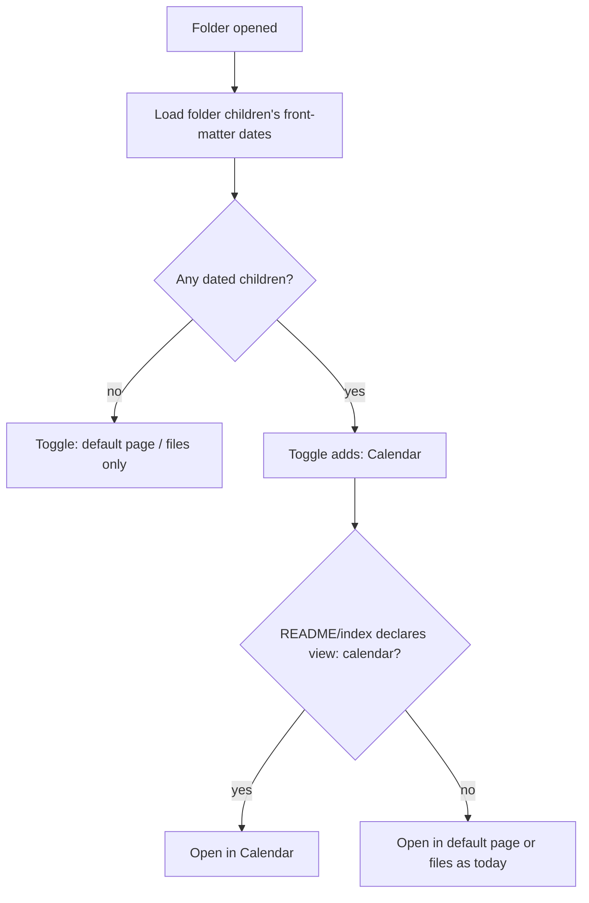
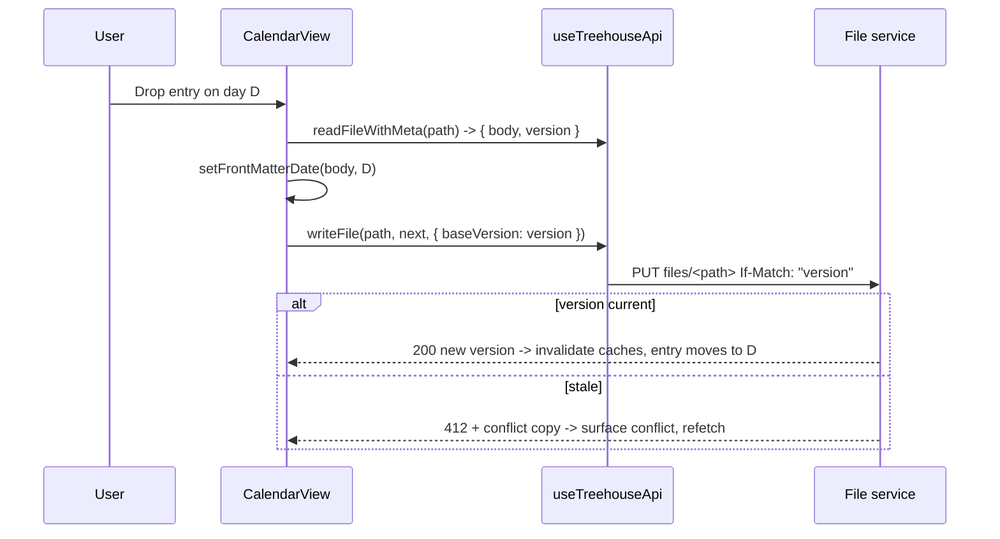

# feat: Folder calendar view

## Summary

Add a folder-level **Calendar view** to the workspace web UI. Markdown files
whose front matter carries a `date` key render on a month calendar inside the
folder's page; dragging one to a different day writes the new `date` back into
that file through the existing version-safe write path. The view is offered
automatically whenever a folder has dated children, and a folder can declare it
as its default presentation via a `view: calendar` key in its README/index front
matter. The work lives entirely in `packages/app` — no backend change.

---

## Problem Frame

Treehouse folders present as a default page (README/index) or a flat listing.
Neither shows _when_ the files in a folder happen. The driving case is a content
calendar: one markdown file per post, a `date` in front matter, and the natural
way to work that material is a month grid you can drag posts around in — the
workflow that currently lives in Notion (see origin:
`docs/brainstorms/2026-06-12-folder-calendar-view-requirements.md`).

The foundations already exist. The README/index default-page-vs-listing toggle
is implemented in `packages/app/app/components/WorkspaceView.vue` via a
`folderView` ref plus a top-bar toggle. Front matter is parsed and type-aware,
with `date` already detected (`packages/app/app/utils/frontmatterData.ts`). The
single write path does read-modify-write with version CAS and conflicted-copy-on-
stale-write (`packages/api/server/utils/files.ts`, reached from the app via
`useFileEditor.save` → `api.writeFile`). A calendar is a third folder view over
dates that are already there, plus a drag that reuses the write that already
exists.

One gap the brainstorm did not surface: front matter is **not** present in the
folder listing data. `GET /list` returns only `{ path, size, contentType,
version }` per entry. To know which children are dated, the app must read each
markdown child's bytes and parse its front matter. This shapes the loading design
(U2) and is the main reason the feature is more than a rendering component.

---

## Requirements

Carried from origin; R-IDs are local to this plan.

**View & discovery**

- R1. A folder offers a Calendar view whenever at least one markdown child carries
  a `date` key in its front matter.
- R2. A folder can declare the Calendar as its default view; the listing stays
  reachable via the view control.
- R3. A folder with no dated children offers no Calendar option and behaves as
  today.
- R4. The user can switch between calendar, listing, and (when present) default
  page within a folder.

**Calendar content**

- R5. Each dated child appears as an entry on the day given by its `date` value.
- R6. An entry identifies its file (title or name) and opens that file when
  activated.
- R7. Multiple files on the same day are all shown for that day.
- R8. Undated children never appear on the calendar; they stay in the listing.

**Rescheduling**

- R9. Dragging an entry to a different day writes the new value into that file's
  `date` front-matter key, reusing the existing front-matter edit path.
- R10. A reschedule write carries the file's loaded version for CAS; a stale write
  yields the server's conflicted copy rather than losing data.
- R11. Files whose date is never changed are left byte-identical; re-serialization
  happens only for a rescheduled file.

**Parity**

- R12. An agent setting or changing a file's `date` produces the same calendar
  placement as a human drag — the calendar reflects front-matter dates whoever
  wrote them.

---

## Key Technical Decisions

- **Slot into the `WorkspaceView.vue` dispatch, not `FolderView.vue`.** The
  calendar is a third value of the existing `folderView` ref (`"page" | "files" |
  "calendar"`) with a top-bar toggle shown only when the folder has dated
  children. This mirrors the already-implemented default-page toggle and keeps
  `FolderView.vue` a plain listing.

- **Client-side per-file front-matter reads over a backend index.** To detect
  dated children, the app reads the folder's markdown children on demand, bounded-
  parallel via `app/utils/concurrency.ts` `mapPool`, cached in Vue Query keyed by
  path + version. Keeps v1 in `packages/app` and reuses `readFileWithMeta`. A
  server endpoint that returns front-matter dates for a folder's children is the
  scale escape hatch, deferred (see Scope Boundaries).

- **Reuse the version-CAS write path for reschedule.** Drag-to-day does
  `readFileWithMeta` → set `date` → `writeFile({ baseVersion })` with `If-Match`.
  It inherits the accepted reformat-on-edit cost (`serializeFrontMatter` re-emits
  the whole block; YAML comments/key-order may normalize) and conflicted-copy-on-
  stale-write. No new write path, no new endpoint.

- **`date` is a `YYYY-MM-DD` string; all date math is timezone-stable.** The app's
  `yaml` parser uses the YAML 1.2 core schema (no timestamp type), so `date`
  round-trips as a string. Month-grid math parses and compares dates as calendar-
  date-only values to avoid off-by-one shifts across timezones. Never route a bare
  `YYYY-MM-DD` through a local-time `Date` for placement.

- **Default-view declaration via README/index front matter.** A `view: calendar`
  key in the folder's default-page file (resolved by the existing `findDefaultPage`
  precedence) pins the calendar as default. Reuses the default-page convention and
  the front-matter parser; it is a plain, agent-writable, portable file. A folder
  without a README can still use the auto-offered toggle but can't pin a default.
  A dedicated per-folder declaration file or metadata field is deferred.

- **Hand-built month grid, native HTML5 drag.** No calendar or date library is
  added (Workers-safe, lean bundle). Drag mirrors the native
  `draggable`/`dragstart`/`drop` pattern in `app/components/FileTree.vue` +
  `app/composables/useFileTreeUi.ts`.

- **Members-only.** The calendar and its drag-write are workspace-member surfaces.
  Public shares render markdown as plain text today and are read-only; this feature
  does not extend to them.

---

## High-Level Technical Design

**Folder view resolution** (in `WorkspaceView.vue`, per navigation):

**Reschedule write** (drag an entry to a new day):

---

## Implementation Units

### U1. Pure date and front-matter utilities

- **Goal:** The testable core — month-grid math and the front-matter `date`
  transform — as pure functions, so the Vue layers above stay thin.
- **Requirements:** R5, R7, R8, R9, R11.
- **Dependencies:** none.
- **Files:**
  - `packages/app/app/utils/calendar.ts` (create) — single new pure-utility module
    for all date/grid math (no separate `calendarDate.ts`; one consumer set)
  - `packages/app/app/utils/frontmatterData.ts` (modify — add `setFrontMatterDate`,
    or co-locate in `frontmatter.ts`)
  - `packages/app/test/calendar.test.ts` (create)
  - `packages/app/test/frontmatterDate.test.ts` (create)
- **Approach:** `buildMonthGrid(year, month)` returns the weeks/days for a month
  (leading/trailing days for week alignment flagged as out-of-month). The grid is
  **Monday-first** (see Open Questions). `groupByDate(entries)` buckets
  `{ path, name, date }` items onto `YYYY-MM-DD` keys. `parseCalendarDate`/
  `isValidDate` treat values as date-only strings. `setFrontMatterDate(source,
  date)` = `splitFrontMatter` → `parseFrontMatter` → set `date` →
  `serializeFrontMatter` → `joinFrontMatter`, returning new source; leaves the body
  untouched and is a no-op-safe round-trip when the date is unchanged.
- **Patterns to follow:** existing pure-util + `vite-plus/test` style in
  `packages/app/test/frontmatterData.test.ts` and `packages/app/test/treehouse.test.ts`.
- **Test scenarios:**
  - Covers R5, R7. `buildMonthGrid` for a 31-day month starting mid-week places
    days in correct week columns; out-of-month padding days flagged.
  - Edge: February in a leap vs non-leap year; a month starting on the week's
    first day (no leading padding).
  - Covers R8. `groupByDate` excludes items with no/invalid date; keeps multiple
    items under the same day key (R7).
  - Timezone stability: a `YYYY-MM-DD` near month/year boundaries lands on the
    same calendar day regardless of host timezone (no off-by-one).
  - Covers R9, R11. `setFrontMatterDate` updates an existing `date`, adds one when
    absent, preserves body bytes and other keys, and returns byte-identical output
    when the date is unchanged.
- **Verification:** `vp test` passes; functions are pure (no Vue/DOM imports).

### U2. Folder front-matter date loading

- **Goal:** For the open folder, resolve which markdown children carry a `date`
  and what it is, efficiently and cached.
- **Requirements:** R1, R3, R12.
- **Dependencies:** U1.
- **Files:**
  - `packages/app/app/composables/useFolderDates.ts` (create)
  - `packages/app/test/folderDates.test.ts` (create — pure selection/merge logic)
- **Approach:** Given the current folder's `TreeNode[]` children, select markdown
  candidates, read each via `readFileWithMeta` through `mapPool` (pool ~4), parse
  front matter, and extract `date`. **Wrap each per-file read in its own try/catch**
  so one unreadable or malformed child does not fail the whole detection — `mapPool`
  propagates the first thrown error, and `uploadFiles` already isolates per-file
  failures the same way; a single bad child must not suppress the folder's calendar.
  Cache per path+version in Vue Query so revisits and unchanged files are free; note
  `version` comes from the flat `entries` list (join children paths against
  `ws.entries`), not from `TreeNode`. Also read the folder's default-page node
  (README/index) front matter here and expose it for U5's default-view resolution —
  the loader, not a pure util, owns all file reads. Expose `datedChildren`
  (`{ path, name, date }[]`), `hasDatedChildren`, `defaultPageFrontMatter`, and a
  `loading` flag. Invalidation hooks into the same `["entries"]` refresh used by
  other mutations, plus the per-file cache key. Extract the candidate-selection and
  result-merge logic into a pure function for unit testing; keep the IO wiring thin.
- **Patterns to follow:** `mapPool` usage in `useWorkspaceData.uploadFiles`; Vue
  Query keying in `useWorkspaceData`.
- **Test scenarios:**
  - Covers R3. Folder with no dated markdown children → `hasDatedChildren` false,
    empty `datedChildren`.
  - Covers R1. Mixed folder → only dated markdown children returned; non-markdown
    and undated files excluded.
  - Covers R12. A child whose `date` was written by an agent (present in fetched
    bytes) appears with that date — the loader is source-driven, not author-driven.
  - Error isolation: one child whose read rejects is skipped; the other dated
    children still resolve and `hasDatedChildren` is true (one bad file never
    suppresses the folder's calendar).
  - Cache key changes with version so a rescheduled file re-reads; unchanged files
    are not re-fetched.
  - `Test expectation:` IO wiring (actual fetch/Vue Query) not unit-tested — the
    selection/merge core is. Integration proven via U4 verification.
- **Verification:** Opening a content folder lists the expected dated entries in
  Vue devtools / a temporary log; non-calendar folders trigger no calendar UI.

### U3. CalendarView component (read-only render)

- **Goal:** Render the month grid and entries for a folder's dated children, with
  month navigation; opening an entry navigates to the file.
- **Requirements:** R5, R6, R7.
- **Dependencies:** U1, U2.
- **Files:**
  - `packages/app/app/components/viewers/CalendarView.vue` (create)
- **Approach:** Props: `datedChildren`, `workspaceId`. Build the visible month from
  `buildMonthGrid`; place entries via `groupByDate`. The calendar **opens on the
  current month** with today highlighted; prev/next/today controls move the visible
  month. An entry chip shows the file's title (front-matter `title` if present, else
  the filename stem with its extension dropped) and emits `select` to navigate
  (reuse the `ws.select`/navigate pattern). A day shows up to a small fixed number of
  chips, then a **"+N more"** control that opens that day's full list (popover or a
  day-detail panel); this keeps grid cells uniform when a day is busy (R7 still
  holds — all entries are reachable). Show empty days plainly; out-of-month padding
  days are visually muted and carry no entries. Theme with existing semantic Tailwind
  tokens (`text-fg`, `bg-surface-2`, `border-border`); icons via `~icons/solar/*`.
- **Patterns to follow:** `FolderView.vue` for prop/emit shape and styling tokens;
  `WorkspaceView.vue` navigation.
- **Test scenarios:** `Test expectation: none -- presentational; grid and grouping
  logic are unit-tested in U1.` Manual: a folder of dated posts renders entries on
  the right days; clicking opens the file; a day with several posts stacks them.
- **Verification:** Calendar renders for a seeded content folder; entries land on
  correct days; clicking an entry opens the file.

### U4. Drag-to-reschedule

- **Goal:** Dragging an entry to another day rewrites its `date` and moves it, with
  conflict-safe writes.
- **Requirements:** R9, R10, R11.
- **Dependencies:** U1, U3.
- **Files:**
  - `packages/app/app/components/viewers/CalendarView.vue` (modify)
  - `packages/app/app/composables/useCalendarReschedule.ts` (create) — or a method
    on `useWorkspaceData`
- **Approach:** Make entry chips `draggable`; make day cells drop targets following
  the `useFileTreeUi` drag-state pattern (`startDrag`/`setDrop`/`endDrag`,
  `canDrop`). **While dragging, highlight the hovered day cell** via the
  `dropTarget`/`canDrop` state (mirror `FileTree.vue`); the dragged chip is the drag
  image. On drop: `readFileWithMeta(path)` → `setFrontMatterDate(body, targetDay)`
  (U1) → `api.writeFile(path, next, { baseVersion: version })`. Optimistically move
  the chip to the target day, reconciling against the U2 folder-date cache. On 200,
  invalidate `["entries"]` and the folder-date cache so the entry settles. On a
  **412 conflict**, reuse the existing `ConflictBanner.vue` surface (the server kept
  a conflicted copy — no data loss) and refetch. On any **other write failure**,
  snap the chip back to its original day and show an error notice. Dropping onto the
  same day is a no-op (no write). **Reschedule is members-only and an enhancement,
  not the only path** — a file's `date` stays editable via the existing
  front-matter fields surface, which is the keyboard-accessible route.
- **Patterns to follow:** native DnD in `FileTree.vue` + `useFileTreeUi.ts`; write +
  invalidate + 412 handling in `useFileEditor.save` and `api.writeFile`
  (`fileWrites.ts`).
- **Test scenarios:**
  - Covers R9, R11. The reschedule transform (`setFrontMatterDate`) produces the
    right bytes — covered by U1; this unit verifies it is invoked with the dropped
    day and the loaded version.
  - Covers R10. A stale write (version mismatch) takes the 412 branch and surfaces
    a conflict rather than overwriting.
  - Edge: drop on the same day is a no-op (no write issued).
  - Integration: after a successful drop, the folder-date cache and `["entries"]`
    are invalidated so the entry shows on the new day without a manual refresh.
  - `Test expectation:` drag/drop DOM wiring is manual; the decision logic
    (target-day resolution, same-day no-op, version pass-through) is extracted and
    unit-tested where feasible.
- **Verification:** Dragging a post to a new day persists the new `date` (visible
  in the file's front matter), the chip moves, and a concurrent stale edit produces
  a conflicted copy instead of data loss.

### U5. Wire the view into folder dispatch and the top-bar toggle

- **Goal:** Make the calendar reachable: extend the folder dispatch, add the toggle,
  and honor the `view: calendar` default declaration.
- **Requirements:** R1, R2, R3, R4.
- **Dependencies:** U2, U3, U4.
- **Files:**
  - `packages/app/app/components/WorkspaceView.vue` (modify)
  - `packages/app/app/utils/treehouse.ts` (modify — add `resolveDefaultView`)
  - `packages/app/test/treehouse.test.ts` (modify)
- **Approach:** Extend `folderView` to `"page" | "files" | "calendar"`. Surface the
  toggle in the `AppTopBar` `#actions` slot, gated on `hasDatedChildren ||
  defaultPageNode` — **not** nested inside the existing `v-if="folderMode &&
  defaultPageNode"` switcher, because the main case (a folder of dated posts with no
  README) has dated children but no default page and must still get a Calendar
  option. Show the Calendar option only when `hasDatedChildren`; show the
  default-page option only when `defaultPageNode` exists. `resolveDefaultView` is a
  **pure function over `(defaultPageFrontMatter, hasDatedChildren)`** (the front
  matter is read by the U2 loader, not by this util): returns `calendar` when the
  front matter has `view: calendar` and dated children exist, else today's default.
  **Loading:** render the existing default-page/files view immediately while U2's
  `loading` is true; the Calendar toggle appears once detection resolves. Because the
  toggle shows only when `hasDatedChildren` is true, it appears-when-ready and never
  flashes-then-hides. **Persistence:** the view resets per navigation, matching the
  existing toggle — a manual switch away from a `view: calendar` default is ephemeral
  (does not persist across navigation). Render `<CalendarView>` when selected.
- **Patterns to follow:** the existing `folderView` toggle + `findDefaultPage`
  consultation in `WorkspaceView.vue`; util-test style in `treehouse.test.ts`.
- **Test scenarios:**
  - Covers R2. `resolveDefaultView({ view: 'calendar' }, true)` returns `calendar`;
    returns the existing default when the key is absent or dated children don't exist.
  - Covers R1. A folder with dated children and no README still offers the Calendar
    toggle (gating is `hasDatedChildren || defaultPageNode`, not `defaultPageNode`).
  - Covers R3. No dated children → no calendar option regardless of any declaration.
  - Edge: `view: calendar` declared but no default-page front matter / malformed
    front matter → `resolveDefaultView` falls back safely, no throw.
  - Covers R4. Switching calendar ↔ files ↔ default page updates the rendered view;
    navigation resets to the resolved default.
- **Verification:** A content folder with `view: calendar` in its README opens on
  the calendar; a dated folder without the declaration shows the Calendar toggle but
  opens as before; a non-dated folder shows no calendar affordance.

---

## Scope Boundaries

**In scope:** the five units above — point-in-time (one file, one `date`, one day)
calendar, drag-to-reschedule, auto-offer + README-front-matter default, members-
only, app package only.

**Deferred for later** (from origin — eventual, not v1):

- Gantt view, durations, and multi-day ranges (`start`/`end`). v1 is single-day.
- A backlog / "unscheduled" tray and dragging undated drafts onto days. Scheduling
  in v1 means giving a file a `date`.

**Deferred to Follow-Up Work** (plan-local sequencing, not a non-goal):

- A server endpoint returning front-matter dates for a folder's children, as a
  scale path if folders grow large enough that client-side N reads hurt first-load.
- A dedicated per-folder declaration (config file or metadata field) for the default
  view, if README-front-matter coupling proves limiting.
- Recognizing fallback date keys beyond `date`.
- Week/agenda layouts beyond the month grid.

**Outside this feature:**

- Workspace-wide or cross-folder calendars (a database-style view spanning folders).
  The calendar is scoped to one folder.
- Schema/validation of the `date` key — the app stays agnostic about front-matter
  meaning.
- Public-share calendar rendering — public shares are read-only plain text today.

---

## Open Questions

Resolved with v1 defaults below; confirm during implementation if a different
choice is wanted — neither blocks starting work.

- **Week-start day.** The grid is Monday-first (the team is UK-based). Switch to
  Sunday-first, or make it locale-driven, if preferred.
- **Day-overflow threshold.** "+N more" appears past a small fixed chip count per
  day cell; the exact cap is a layout detail to settle against real cell sizing.

---

## Risks & Dependencies

- **Timezone off-by-one.** Date strings routed through local-time `Date` objects can
  shift a day. Mitigation: KTD mandates date-only parsing/comparison; U1 tests pin
  boundary cases.
- **First-load cost on large folders.** Detecting dated children reads every
  markdown child on folder open. The workspace root is treated as a folder too, so
  this runs on the landing view — most likely to be large. Mitigation: bounded
  `mapPool` + Vue Query cache, per-file error isolation, and the `loading` flag so
  the existing view renders immediately; server-index escape hatch deferred. Low for
  content-calendar-sized folders, real for very large ones — revisit if it bites.
- **Concurrent edits.** A human drag and an agent write to the same file race.
  Mitigation: the existing version-CAS + conflicted-copy behavior (R10) — the
  reschedule must pass the loaded version and handle 412, never blind-write.
- **YAML comment loss on reschedule.** `serializeFrontMatter` re-emits the whole
  block. Accepted and already true for field edits; documented in KTDs, not
  re-litigated here.
- **Dependency:** relies on the implemented default-page toggle and front-matter
  parsing in `packages/app`; no backend or API change.

---

## Sources & Research

- Origin requirements: `docs/brainstorms/2026-06-12-folder-calendar-view-requirements.md`.
- Dispatch + implemented default-page toggle: `packages/app/app/components/WorkspaceView.vue`,
  `packages/app/app/utils/treehouse.ts` (`findDefaultPage`, `buildTree`, `TreeNode`).
- Front matter: `packages/app/app/utils/frontmatter.ts` (`splitFrontMatter`/`joinFrontMatter`),
  `packages/app/app/utils/frontmatterData.ts` (`parseFrontMatter`/`serializeFrontMatter`,
  `frontMatterFieldKind`, `DATE_RE`).
- Write path: `packages/app/app/composables/useFileEditor.ts`,
  `packages/app/app/composables/useTreehouseApi.ts` (`writeFile`/`readFileWithMeta`),
  `packages/app/app/utils/fileWrites.ts` (`If-Match`/412), and the single write path
  `packages/api/server/utils/files.ts` (per CLAUDE.md).
- Drag pattern: `packages/app/app/components/FileTree.vue`,
  `packages/app/app/composables/useFileTreeUi.ts`.
- Concurrency + data store: `packages/app/app/utils/concurrency.ts` (`mapPool`),
  `packages/app/app/composables/useWorkspaceData.ts`.
- Listing shape (front matter absent): `packages/api/server/routes/api/workspaces/[workspaceId]/list.get.ts`.
- Constraint: Cloudflare Workers bundle — no Node-only deps; `yaml@^2.9.0` already
  present (`docs/solutions/developer-experience/railway-cloudflare-deploy-gotchas-2026-06-08.md`,
  CLAUDE.md).