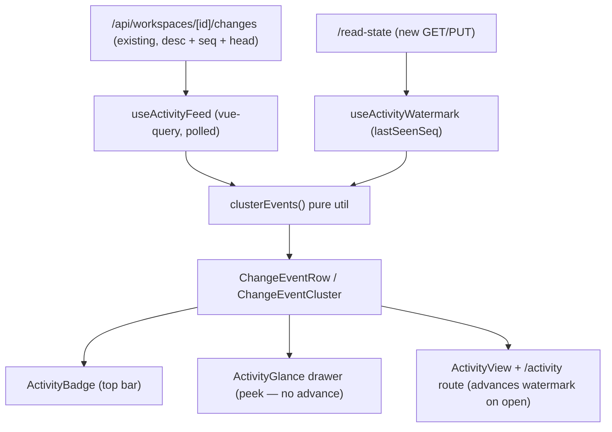

# feat: Workspace activity feed (v1)

## Summary

Surface the existing `ChangeEvent` log as a workspace-wide "what changed while you were away" feed.
An unread badge in the workspace top bar opens a glance-drawer peek and a full day-grouped Activity
view; same-actor bursts cluster into one expandable row; conflicts/restores render inline. The only
backend addition is a per-user read-state table and a `read-state` endpoint for the `lastSeenSeq`
watermark — everything else is client-side over the existing `/changes` API.

---

## Problem Frame

Treehouse records every change as an attributed `ChangeEvent`, but a human can only see it one file
at a time in the per-file History tab (`packages/app/app/components/FileInfoPanel.vue`). There is no
workspace-level view, so an agent that rewrites many files is invisible until you open each one, and
a returning human has no way to ask "what happened here while I was gone?" The data is already
captured and reliably attributed (`principal`, `actorLabel`); the gap is surfacing and catch-up.
See origin: docs/brainstorms/2026-06-12-activity-feed-requirements.md.

---

## Key Technical Decisions

- **Watermark persistence — read-state table + endpoint.** A per-user `lastSeenSeq` lives in a new
  hand-maintained `WorkspaceReadState` model (unique on `userId` + `workspaceId`) with `GET`/`PUT`
  read-state routes. Per-user and cross-device, satisfying R9. It is not a file-write-path field and
  adds no server-side filtering, so it stays within R15's intent. **Do not run `auth:generate`** —
  add the model below the auth section of `packages/db/prisma/schema.prisma` (the documented safe
  zone) and migrate with `prisma:migrate`.
- **Unread count — exact within a window, capped "99+".** `head − lastSeenSeq` overcounts because a
  `move` burns two `seq`s and rolled-back ops leave gaps. Count actual events with `seq > lastSeenSeq`
  from the fetched window and display capped at "99+".
- **Feed paging axis — `seq`, not `createdAt`.** `createdAt` is not unique across a move's two events,
  so it splits/duplicates pairs at page boundaries. The feed orders by `seq` desc. The `/changes` desc
  path orders by `createdAt` server-side (it carries `seq` + `head`), so the client **re-sorts the
  fetched window by `seq` desc** to satisfy this decision. v1 over-fetches a recent window client-side;
  deep scroll-back into old history is deferred (see Scope Boundaries).
- **Divider freezes on open.** Opening the full view advances `lastSeenSeq` to the latest event and
  pins the "new since you were here" divider at that `seq` for the visit. Poll arrivals after open
  render above the frozen divider without moving it, and the badge stays 0 while the full view is
  focused (R11, R12).
- **New / unset watermark seeds to current head.** First observation treats existing history as
  already seen, so a first-time member sees a 0 badge rather than the entire backlog.
- **Read-time clustering is a pure util.** Clustering lives in `packages/app/app/utils/activity.ts`
  (testable per the repo's utils-only test convention). A cluster breaks on actor change, on a day
  boundary, and on the watermark divider; a single non-matching event between bursts renders as its
  own row so no edit is ever hidden; cluster identity falls back to `actorId ?? actorKeyId ??
  principal` when `actorLabel` is null.
- **Reuse the existing row UI.** Extract a shared `ChangeEventRow` (and `ChangeEventCluster`) from the
  History-tab markup in `FileInfoPanel.vue` and reuse it in the drawer, full view, and the panel —
  extending the existing pattern rather than inventing a new one.
- **Badge polling decouples from the edit gate.** `useChangeFeedPoll` only polls while editing a
  file; the badge needs the workspace-open case too. Use a vue-query `["activity", workspaceId]`
  query with a refetch interval / focus refetch. This intentionally changes the "idle workspace makes
  no requests" property for the badge.

---

## High-Level Technical Design

Data flow and the watermark/divider state are the two non-obvious shapes.

Watermark transitions:

```mermaid
stateDiagram-v2
  [*] --> Unset
  Unset --> Seen: first observation seeds lastSeenSeq = head
  Seen --> Unread: new events arrive (seq > lastSeenSeq)
  Unread --> Peeked: open glance drawer (no advance)
  Peeked --> Unread: close drawer (badge unchanged)
  Unread --> Caught: open full view OR mark all seen (advance to head; divider frozen for visit)
  Caught --> Unread: new events arrive after visit
```

---

## Requirements

Carried from origin (docs/brainstorms/2026-06-12-activity-feed-requirements.md), plus
planning-resolved edge behaviors.

**Feed surface & navigation**

- R1. A workspace-wide feed shows `ChangeEvent` activity across all paths, not scoped to one file.
- R2. The feed is reachable from a persistent unread badge available across workspace surfaces.
- R3. The badge opens a compact glance drawer of recent activity with a "see all" affordance into the full view.
- R4. The full Activity view groups the timeline by day, newest first, with scroll-back.

**Clustering & row anatomy**

- R5. Consecutive same-actor events within the clustering window collapse into one summarizing cluster row; mixed operations summarize together.
- R6. A cluster row expands to its constituent events; a single event renders as a normal row.
- R7. Each row shows the actor with a human/agent visual distinction, an operation summary, file reference(s), and a relative timestamp.
- R8. Clicking a file reference navigates to that file (or its per-file history).

**Unread & watermark**

- R9. Each signed-in user has a per-workspace `lastSeenSeq` determining unread events.
- R10. The feed marks the seen/unread boundary with a "new since you were here" divider; the badge shows an unread count.
- R11. Opening the glance drawer does not advance the watermark; opening the full view advances it to the latest event, and an explicit "mark all seen" also advances it.
- R12. After advancing on open, the divider stays visible for the current visit.

**Data & performance**

- R13. Conflict, restore, and delete events render inline with a distinct icon and color.
- R14. A conflict row links to the conflicted copy it created.
- R15. Built on the existing `/changes` API and client helpers; no server-side filtering, no new write-path fields, no realtime transport (polling acceptable). The read-state endpoint is the sole backend addition and touches neither the file write path nor `ChangeEvent`.
- R16. Older activity loads on demand by over-fetching a recent window (re-sorted client-side by `seq`) rather than fetching the whole history at once; deep scroll-back via cursor is deferred (see Scope Boundaries).

**Planning-resolved behaviors**

- R17. A new or unset watermark seeds to the current latest `seq` on first observation; workspace history before first visit counts as seen.
- R18. The unread count is computed from events with `seq > lastSeenSeq` (not `head − lastSeenSeq`) and displayed capped at "99+".
- R19. While the full view is focused, poll arrivals render above the frozen divider without moving it, and the badge stays 0.
- R20. The feed orders and pages by `seq` (desc), not `createdAt`.
- R21. Clustering breaks on actor change, day boundary, and the watermark divider; an isolated non-matching event renders as its own row.
- R22. Rows with a missing `actorLabel` fall back to a resolved member name, then a generic human/agent label — never render "null"; clustering groups null-label events by `actorId`/`actorKeyId`/`principal`.
- R23. A conflict row whose conflicted copy no longer exists disables the link with an explanatory tooltip rather than navigating to a dead path.
- R24. The feed surfaces (badge, glance drawer, full view) define explicit empty, loading, error, and no-org/no-workspace states rather than rendering blank or spinning.
- R25. The badge and drawer are keyboard-operable and screen-reader-accessible: the drawer dismisses on Escape with focus return, and unread-count updates are announced (aria-live).

---

## Implementation Units

### U1. Activity clustering and unread helpers (pure utils)

- **Goal:** Add read-time clustering and unread/divider computation as pure functions.
- **Requirements:** R5, R6, R17, R18, R20, R21, R22.
- **Dependencies:** none.
- **Files:** `packages/app/app/utils/activity.ts` (extend), `packages/app/test/activity.test.ts` (extend).
- **Approach:** Add `clusterEvents(events, { gapMs, dividerSeq })` returning ordered cluster/single
  rows. Sort by `seq` desc. Break a cluster on actor change, a day boundary, and the divider `seq`.
  Cluster identity key = `actorId ?? actorKeyId ?? principal`. Add `unreadCount(events, lastSeenSeq)`
  (count `seq > lastSeenSeq`, cap at 99 with a "99+" display flag) and `seedSeq(events)` (latest
  `seq`, for first-observation seeding). Treat a `move`'s two events (same `createdAt`, adjacent
  `seq`) as one logical event in `unreadCount`. Also update the existing `fileActivity` sort to
  `seq` desc (fallback `createdAt` when `seq` is absent) so the per-file history matches the feed's
  ordering. Reuse `relativeTime`/`exactTime`; do not redefine `ChangeEvent` (import from this
  module, add `seq`).
- **Patterns to follow:** existing pure helpers + sibling test in `activity.ts` / `activity.test.ts`;
  reference requirement IDs in test titles as the suite already does.
- **Test scenarios:**
  - Covers R5, R6. 14 same-actor writes within `gapMs` and nothing else → one cluster of 14; expanding yields 14 rows.
  - Covers R21. `[agent×8, human×1, agent×5]` within window → three rows (cluster, single human row, cluster); the human edit is never hidden.
  - Covers R21. A same-actor burst straddling midnight → two clusters under two day groups.
  - Covers R21. A burst with the divider `seq` inside it → splits into a seen cluster and an unread cluster.
  - Covers R18. Events including one `move` (two `seq`s) above the watermark → count reflects logical events, displayed capped; ≥100 unread → "99+".
  - Covers R17. `seedSeq` returns the latest `seq`; empty input returns the unset sentinel.
  - Covers R22. Consecutive `principal=human, actorLabel=null` events cluster together and never produce a "null" label.
  - Covers R20. Two events with identical `createdAt` but different `seq` order deterministically by `seq`, in both `clusterEvents` and `fileActivity`.

### U2. Read-state persistence (model + endpoints)

- **Goal:** Persist and serve per-user `lastSeenSeq` per workspace.
- **Requirements:** R9, R11, R15.
- **Dependencies:** none.
- **Files:** `packages/db/prisma/schema.prisma` (add `WorkspaceReadState` below the auth section), Prisma migration, `packages/api/server/routes/api/workspaces/[workspaceId]/read-state.get.ts`, `packages/api/server/routes/api/workspaces/[workspaceId]/read-state.put.ts`, `packages/api/test/read-state-routes.test.ts`.
- **Approach:** Model `WorkspaceReadState { id, userId, workspaceId, lastSeenSeq BigInt, updatedAt, @@unique([userId, workspaceId]) }` with a `workspace Workspace @relation(fields: [workspaceId], references: [id], onDelete: Cascade)` and a back-relation on `Workspace` (matching `NodeMeta`/`Share`, so rows die with the workspace). Both routes use `requireWorkspaceFromRoute(event)` and key on `ctx.userId` — the body cannot set `userId` or `workspaceId`. `PUT` additionally requires a cookie session (reject API-key auth, mirroring the key-management routes) since advancing a human's "seen" state has no agent use case and an agent key writing it would silently corrupt the human's unread state. `GET` returns `{ lastSeenSeq: number | null }` (serialize BigInt to JS number like `changes.get.ts`). `PUT` validates the body `lastSeenSeq` is a safe non-negative integer (reject with 400 otherwise) before BigInt conversion, then upserts, advancing monotonically (never lower an existing value). Migrate with `pnpm --filter db run prisma:migrate`; never run `auth:generate`.
- **Patterns to follow:** `requireWorkspaceFromRoute` + `fileRoute` wrappers and BigInt→number serialization in `packages/api/server/routes/api/workspaces/[workspaceId]/changes.get.ts`; route tests in `packages/api/test/files-routes.test.ts`.
- **Test scenarios:**
  - Covers R9. `PUT` then `GET` for the same user/workspace returns the stored `lastSeenSeq`.
  - Covers R9. Two different users in the same workspace keep independent watermarks.
  - `PUT` with a value lower than the stored one does not lower it (monotonic advance).
  - Unauthenticated or non-member request is rejected by `requireWorkspaceFromRoute` (401/403).
  - A key scoped to another workspace cannot read/write this workspace's read-state.
  - `GET` with no prior state returns `lastSeenSeq: null` (drives first-observation seeding).
  - `PUT` with a non-integer, negative, or out-of-safe-range `lastSeenSeq` is rejected with 400 before any DB write.
  - A `userId`/`workspaceId` supplied in the `PUT` body is ignored; the row is keyed on the session identity, not body input.
  - A `PUT` authenticated by an API key (not a cookie session) is rejected.

### U3. API client methods

- **Goal:** Client wrappers for the desc feed read and the read-state endpoints.
- **Requirements:** R1, R9, R16, R20.
- **Dependencies:** U2.
- **Files:** `packages/app/app/composables/useTreehouseApi.ts`.
- **Approach:** Add `changesRecent(workspaceId, limit)` → `$fetch<{ changes: ChangeFeedEvent[]; head: number }>` with `query: { limit, order: "desc" }`, then re-sort the returned events by `seq` desc client-side — the server desc path orders by `createdAt` and returns `seq` + `head`, but the existing `changes()` type omits `seq`, so add a method that surfaces it. Add `getReadState(workspaceId)` and `putReadState(workspaceId, lastSeenSeq)`. Mirror the existing `credentials: "include"` + runtime `apiUrl` base; no new fetch wrapper.
- **Patterns to follow:** existing `changes` / `changesSince` methods and `ChangeFeedEvent` type in `useTreehouseApi.ts`.
- **Test scenarios:** Test expectation: none — thin `$fetch` wrappers with no branching logic; covered indirectly by U2 route tests and U4/U5 consumers, verified via `vp check`.

### U4. Feed and watermark composables

- **Goal:** Provide the polled feed query and the watermark read/advance logic.
- **Requirements:** R10, R11, R12, R17, R18, R19.
- **Dependencies:** U1, U3.
- **Files:** `packages/app/app/composables/useActivityFeed.ts`, `packages/app/app/composables/useActivityWatermark.ts`.
- **Approach:** `useActivityFeed(workspaceId)` wraps a vue-query `["activity", workspaceId]` query over `changesRecent` with a refetch interval + focus refetch (decoupled from the edit gate), exposing clustered rows via `clusterEvents` and the current `head`. `useActivityWatermark(workspaceId)` loads `lastSeenSeq` via `getReadState`, seeds to `head` when null (R17), exposes `unreadCount` (R18), an `advance()` that pins a per-visit frozen divider `seq` and `PUT`s the new watermark (R12, R19), and a `markAllSeen()`. Advancing to the head observed at call time avoids skipping concurrent arrivals.
- **Patterns to follow:** `useChangeFeedPoll.ts` (generation-token / in-flight guards, truncation handling) for poll correctness; vue-query key + invalidation conventions from `plugins/vue-query.client.ts`.
- **Test scenarios:** Test expectation: none — Vue composable with no component-test harness in the repo; the pure logic it orchestrates (clustering, unread count, seeding) is covered in U1, and the endpoint in U2. Verify via `vp check` and manual smoke per the flows.

### U5. Shared change-event row and cluster components

- **Goal:** Extract a reusable row/cluster component and route per-file history through it.
- **Requirements:** R7, R8, R13, R14, R23.
- **Dependencies:** U1.
- **Files:** `packages/app/app/components/ChangeEventRow.vue`, `packages/app/app/components/ChangeEventCluster.vue`, `packages/app/app/components/FileInfoPanel.vue` (refactor History tab to reuse).
- **Approach:** Move the History-tab card markup (actor avatar/initials, principal color `bg-agent/20`/`bg-human/20`, `OP_LABEL`, version + relative time, restore/view kebab) into `ChangeEventRow`, taking the event plus a resolved actor (resolve at list level via `useWorkspaceMembers().byId`, not per row). `ChangeEventCluster` wraps N rows with an expand toggle and a summary line. Conflict/restore styling uses `warning`/`danger` tokens; a conflict row resolves its copy via `conflictedCopiesFor` against current `entries` and disables the link with a tooltip when the target is gone (R23). Long actor labels truncate with ellipsis + a `title` tooltip so a row stays single-line. Keep `FileInfoPanel` behavior identical after the refactor.
- **Patterns to follow:** History tab and conflicted-copy alert in `FileInfoPanel.vue`; `conflictedCopiesFor`/`isRestorable` in `utils/activity.ts`; theming tokens in `assets/css/tailwind.css`.
- **Test scenarios:** Test expectation: none — no Vue component test harness in the repo. Conflict-link-gone resolution (R23) and label fallback (R22) logic should sit in U1 helpers where covered by unit tests; component wiring verified via `vp check` and manual smoke (per-file history renders unchanged; a conflict row links to its copy, and disables when the copy is deleted).

### U6. Unread badge and glance drawer

- **Goal:** Add the persistent badge and the peek drawer.
- **Requirements:** R2, R3, R10, R11.
- **Dependencies:** U4, U5.
- **Files:** `packages/app/app/components/ActivityBadge.vue`, `packages/app/app/components/ActivityGlance.vue`, `packages/app/app/components/WorkspaceView.vue` (wire badge into the `AppTopBar` `#actions` slot and a right-side drawer aside).
- **Approach:** `ActivityBadge` shows `unreadCount` (capped "99+") and toggles the glance drawer. `ActivityGlance` lists recent clustered rows with a "new since you were here" divider and a "see all" link to `/activity`; opening it does NOT call `advance()` (peek, R11). Mirror the existing right-`<aside>` + `RightPanel` toggle pattern for the drawer. Mount the badge so it persists on both the file-browser and the `/activity` view (shared `AppTopBar` `#actions` usage), not only the file browser; the dashboard is out of scope for v1. The drawer caps at ~15 recent rows ("see all" beyond that), defines empty / loading / error / no-workspace states (R24), and is keyboard- and screen-reader-accessible per R25 (Escape dismisses with focus return; the count uses an aria-live region).
- **Patterns to follow:** `AppTopBar` `#actions` slot usage and the right-panel aside in `WorkspaceView.vue`; `RightPanel.vue` dispatcher structure.
- **Test scenarios:** Test expectation: none — component layer, no harness. Manual smoke: badge reflects unread; opening the drawer leaves the badge unchanged; "see all" routes to the full view.

### U7. Full Activity view and route

- **Goal:** Add the day-grouped Activity view and its route.
- **Requirements:** R4, R11, R12, R16, R19, R20.
- **Dependencies:** U4, U5.
- **Files:** `packages/app/app/pages/w/[workspaceId]/activity.vue`, `packages/app/app/components/ActivityView.vue`.
- **Approach:** `activity.vue` is a thin wrapper (`middleware: "auth"`, `layout: "app"`) rendering `ActivityView`; the static route wins over the `[...path].vue` catch-all. `ActivityView` renders clustered rows grouped by day, newest first, with a frozen "new since you were here" divider; calls `advance()` on mount (R11) and offers "mark all seen"; new poll arrivals render above the frozen divider (R19). Day-group headers read "Today" / "Yesterday" / absolute date. When every fetched event is unread, render the divider at the top ("everything is new"). Define empty / loading / error states (R24). Scroll-back over-fetches a larger recent window (~500 events) and re-sorts by `seq` (R20); deep history paging is deferred.
- **Patterns to follow:** thin page wrappers in `pages/w/[workspaceId]/index.vue`; full-bleed view rendering in `WorkspaceView.vue`; day/relative formatting in `utils/activity.ts`.
- **Test scenarios:** Test expectation: none — component/route layer, no harness. Manual smoke: opening the view advances the watermark and clears the badge; the divider stays put for the visit; new events during the visit appear above the divider without moving it; the `/activity` route resolves over the catch-all.

---

## Acceptance Examples

- AE1. Burst clustering — **Covers R5, R6.** Given an agent wrote 14 files within the window and nothing else around it, when the feed renders, then it shows one expandable row ("…wrote 14 files") that expands to 14 events.
- AE2. Peek vs. clear — **Covers R11, R12.** Given 3 unread events, when the user opens and closes the glance drawer, then the badge still shows 3; when the user instead opens the full view, then the badge clears and the divider stays above those 3 events for the visit.
- AE3. Conflict visibility — **Covers R13, R14, R23.** Given a stale write created a conflicted copy, when the feed renders that event, then it appears inline with a distinct conflict icon/color and links to the copy; when the copy was since deleted, then the link is disabled with an explanatory tooltip.
- AE4. New member, large history — **Covers R17.** Given a brand-new member opens a workspace with 5000 historical events, when the feed loads, then the badge shows 0 (history seeded as seen), not "99+".
- AE5. Live arrival while viewing — **Covers R19.** Given the full view is open with the watermark at the latest event, when three new events arrive on a poll, then they render above the frozen divider and the badge stays 0 while the view is focused.
- AE6. Move counts once — **Covers R18, R20.** Given a `move` (two `seq`s, one logical change) sits above the watermark, when the unread count renders, then it counts the move as one and rows order by `seq` without splitting the pair.

---

## Scope Boundaries

Deferred to follow-up work:

- Deep scroll-back into old history (a read-only `beforeSeq` cursor param on the changes route); v1 shows a recent over-fetched window.

Outside v1 (parked in origin):

- Live push / SSE and presence; agents consuming the feed over MCP; server-side filtering / standing queries; digests and email; device-name provenance via per-device keys; CLI sync-batch IDs / write-time run IDs; time-travel scrubber / point-in-time reconstruction.

---

## Risks & Dependencies

- **Cross-origin credentialed polling.** The feed polls the Railway API from the Cloudflare SPA; the session cookie rides only with `credentials: "include"` and an origin-echoing CORS response, and `NUXT_PUBLIC_API_URL` is baked at build time. Treat 401-on-poll as a cookie/CORS/base-URL issue first, not a query bug. (docs/solutions/developer-experience/railway-cloudflare-deploy-gotchas-2026-06-08.md)
- **No-org / no-workspace state.** A brand-new user with no organization currently 400s; the badge, drawer, and view must degrade to an empty state rather than spin.
- **`auth:generate` landmine.** Regenerating the auth schema deletes the hand-maintained Treehouse models. Add `WorkspaceReadState` by hand below the auth section and migrate directly.
- **Badge polling cost.** Decoupling the badge poll from the edit gate means an open idle workspace now makes periodic requests — an intentional change from the prior "idle workspace makes no requests" property. The poll interval is a tunable (see Open Questions).
- **Actor-id exposure (accepted for v1).** The feed renders `actorId`/`actorKeyId`/`actorLabel` to every workspace member — these are already returned by `/changes`, so internal user ids are visible org-wide. Accepted for v1; revisit if path-level ACLs are ever introduced.
- **No component test harness.** The repo tests pure utils only; behavioral coverage concentrates in U1 (clustering, unread, seeding, label fallback) and U2 (endpoint). Component/route units rely on `vp check` plus manual smoke — keep testable logic in utils, not in `.vue` files.

---

## Open Questions

Deferred to implementation (starting values to confirm against real data):

- Clustering gap window (`gapMs`), the badge poll interval, the glance drawer row cap (~15), and the full-view over-fetch size (~500 events).
- Mixed-operation cluster summary copy (e.g., "wrote 8 files, deleted 3" vs. "made 11 changes") and the cluster expand/collapse affordance.

---

## Sources & Research

- docs/brainstorms/2026-06-12-activity-feed-requirements.md — origin requirements.
- docs/ideation/2026-06-12-activity-feed-ideation.md — upstream ideation (parked roadmap).
- `packages/api/server/routes/api/workspaces/[workspaceId]/changes.get.ts` — `/changes` contract: dual cursor, `{ changes, head }`, `order=desc` carries `seq`, BigInt→number serialization, `requireWorkspaceFromRoute`.
- `packages/app/app/utils/activity.ts` + `packages/app/test/activity.test.ts` — helper + test conventions to extend (clustering goes here).
- `packages/app/app/composables/useTreehouseApi.ts` — `changes`/`changesSince`, `ChangeFeedEvent`, `credentials: "include"` + runtime `apiUrl`.
- `packages/app/app/composables/useChangeFeedPoll.ts` — poll correctness (generation token, in-flight guard, truncation handling).
- `packages/app/app/components/FileInfoPanel.vue` — History-tab row markup, conflicted-copy alert, restore flow to extract/reuse.
- `packages/app/app/components/WorkspaceView.vue` + `AppTopBar.vue` + `RightPanel.vue` — top-bar `#actions` slot and right-drawer pattern.
- `packages/db/prisma/schema.prisma` — `ChangeEvent` shape; no per-user state model today; safe zone for the new model below the auth section.
- `packages/app/app/plugins/vue-query.client.ts` — query-key + invalidation conventions.