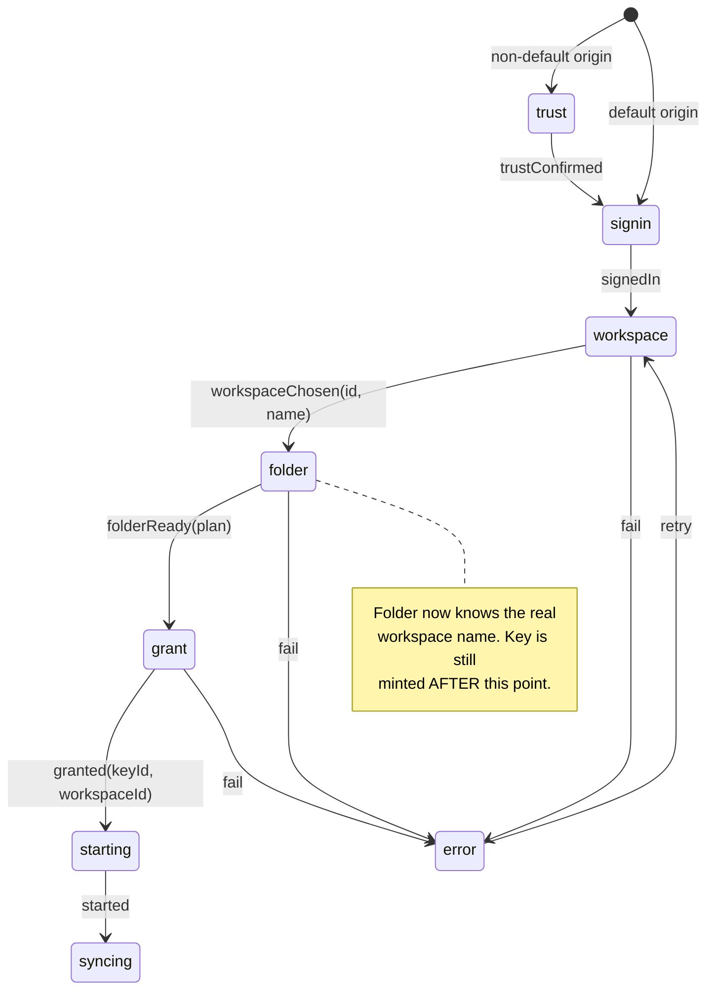
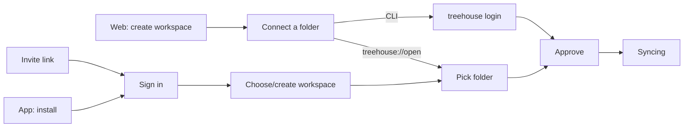

# feat: Unified Onboarding

## Summary

Give onboarding one spine — **workspace → folder → connect** — entered from either the web
or the desktop app. The desktop flow gains a workspace step _before_ the folder step, which
fixes the folder-naming defect at its root and makes a folder picker meaningful. The web
gains a "connect a folder" hand-off after workspace creation. Both meet at the same place.
Folder management arrives in the tray, and a light brand pass lands on the screens a new
user actually sees.

---

## Problem Frame

Onboarding reaches a syncing folder, but the two entry directions were built separately.
The seams are concrete, not aesthetic (see origin: `docs/brainstorms/2026-07-30-unified-onboarding-requirements.md`):

- The create-workspace path names every folder `Workspace` (then `Workspace 2`, `3`…),
  because the folder step runs before the workspace is known.
- No folder picker exists — `planFolder`'s `override` parameter is dead code.
- The desktop app cannot create a workspace; a zero-workspace user dead-ends to a web link.
- Creating a workspace on the web never mentions the app or the CLI.
- No way to change where a workspace syncs after setup.
- Every auth/onboarding screen is in the generic blue, while the brand system sits unused
  by `packages/app`.

---

## Requirements

Carried from origin R1–R12. All in scope.

| ID  | Requirement                                                              | Units      |
| --- | ------------------------------------------------------------------------ | ---------- |
| R1  | Workspace step precedes the folder step                                  | U1, U3, U5 |
| R2  | Folder step defaults to the real workspace name, with a native picker    | U4, U5     |
| R3  | No folder created before its workspace is known; `Workspace` unreachable | U1, U4     |
| R4  | Key still minted after the folder exists, written straight into it       | U1         |
| R5  | Resume lands on the right step, including mid-workspace-step             | U1         |
| R6  | Web offers a folder connection after workspace creation                  | U7         |
| R7  | `treehouse://open` enters onboarding when the workspace is unlinked      | U6         |
| R8  | Tray exposes per-folder path, change location, pause/resume, unlink      | U8         |
| R9  | Changing location moves contents; no re-grant, no full re-upload         | U8         |
| R10 | App defaults to the treehouse palette, switcher intact                   | U9         |
| R11 | Auth/onboarding screens carry the brand                                  | U9         |
| R12 | Every step leaves a diagnostic trail                                     | U10        |

---

## Key Technical Decisions

**KTD1 — Move workspace _selection_ earlier; leave the key write where it is.**
Folder-before-grant exists so the minted key is written straight into the folder — no
in-memory custody, and resume needs no key persistence (`packages/desktop/src/onboarding/machine.ts`
header comment). Only the workspace choice moves ahead of the folder step. The grant, and
therefore the key write, stays exactly where it is. R4 is preserved by construction.

**KTD2 — The shell observes; it never exposes IPC.**
Web steps hand results back by navigating to a sentinel path on the app origin, which
`windows.ts`'s existing `will-navigate` hook already sees and `isAllowedNavigation` already
permits. No preload, no `contextBridge`, no new IPC channel. This is the same
observe-don't-call posture already used for sign-in (cookie polling) and the device grant,
and it keeps `docs/solutions/architecture-patterns/electron-remote-content-shell.md` intact.

**KTD3 — Change-location moves the contents, including `.treehouse/`.**
`checkRootLiveness` (`packages/cli/src/sync-core.ts`) keys solely on
`<root>/.treehouse/config.json` being readable, and a missing root suppresses
delete-propagation. So a move is safe in the intermediate state: the old path reads as
missing (no team-wide delete), and the new path arrives with the key and the local index
intact — no re-grant, no full re-upload. Re-syncing from remote would be slower and would
discard local-only edits. Ordering is load-bearing: **pause → move → re-register → resume**.

**KTD4 — Onboarding web screens live in `packages/app`, gated to app mode.**
One implementation serves both directions and inherits the brand. They follow `link.vue`'s
existing `?app=1` convention. A plain-browser visit renders a "this step happens in the
desktop app" fallback rather than a folder step it cannot fulfil (resolves origin Q1).

**KTD5 — Keep `--th-*`; change only the default.**
The theme system and switcher stay. The treehouse preset already in `tailwind.css` is
promoted to `:root`. `packages/app` does **not** take a dependency on `design/tokens.css`.
Fonts and illustration assets may be imported à la carte from `design/` subpath exports.

---

## High-Level Technical Design

The step machine gains one state. Everything downstream of `folder` is unchanged.

Both entrances converge on the same spine:

---

## Implementation Units

### Phase A — The spine

### U1. Workspace step in the onboarding machine

**Goal:** Add a `workspace` step between `signin` and `folder`, with resume support.
**Requirements:** R1, R3, R4, R5
**Dependencies:** none
**Files:**

- `packages/desktop/src/onboarding/machine.ts`
- `packages/desktop/src/onboarding/state.ts`
- `packages/desktop/test/onboarding-machine.test.ts`
- `packages/desktop/test/onboarding-state.test.ts`

**Approach:** Add `"workspace"` to `Step`, a `workspaceChosen` event carrying `{ id, name }`,
and a `workspaceChosen` fact to `ResumeFacts` (derived from `ctx.workspaceId` being set —
`PersistedOnboarding` already carries it, so no persistence schema change). `entryStep` gains
one clause between `signedIn` and `folderExists`. Add a `chooseWorkspace` effect to
`OnboardingEffects`. The invite path (F3) skips the step because `ctx.workspaceId` is already
set — resume-fact logic handles this without a special case.

**Patterns to follow:** the existing pure reducer + `entryStep` fact table; every new branch
stays in this file, per `docs/solutions/conventions/pure-wired-split-electron.md`.

**Test scenarios:**

- `entryStep` returns `workspace` when signed in and no workspace chosen.
- `entryStep` returns `folder` when a workspace is chosen but no folder exists.
- `entryStep` never returns a step past `grant` unless `configPresent` — existing invariant holds with the new step inserted.
- Invite context (workspaceId preset) resumes at `folder`, not `workspace`.
- `reduce(workspace, workspaceChosen)` sets `workspaceId` + `workspaceName` and moves to `folder`.
- `reduce(workspace, <unrelated event>)` is a no-op.
- A `fail` at `workspace` sets `recoverTo: "workspace"`; `retry` returns there.
- Covers AE1. The `folder` step is never reachable with an unset `workspaceName`.

---

### U2. Sentinel-navigation contract

**Goal:** A pure contract for handing a web step's result back to the shell via navigation.
**Requirements:** R1, R7
**Dependencies:** none
**Files:**

- `packages/desktop/src/contract.ts`
- `packages/desktop/test/contract.test.ts` (new)

**Approach:** Extend `contract.ts` with a builder for the app-mode onboarding URL and a
parser that recognises the sentinel result path and extracts `workspaceId`. Treat the parsed
value as untrusted: validate shape, ignore anything on a different origin. The shell resolves
the workspace authoritatively by id afterwards (the same membership-checked lookup `link.vue`
already does), so a spoofed sentinel cannot select a workspace the user lacks.

**Patterns to follow:** `buildApprovalUrl` / `parseDeepLink` in the same file — same
build-and-parse pair shape.

**Test scenarios:**

- Round-trip: built URL parses back to the same workspace id.
- A sentinel path on a foreign origin yields null.
- Missing/empty/array-valued `workspace` param yields null.
- An oversized or malformed id is rejected rather than truncated.
- A non-sentinel path on the app origin yields null (ordinary navigation is not a result).

---

### U3. Web onboarding route — choose or create a workspace

**Goal:** The app-mode screen that lists workspaces and can create one.
**Requirements:** R1, R11
**Dependencies:** U2
**Files:**

- `packages/app/app/pages/connect/workspace.vue` (new)
- `packages/app/test/connect-workspace.test.ts` (new)

**Approach:** Authenticated page, app-mode gated per KTD4. Lists workspaces via
`listWorkspaces`, offers creation via `createWorkspace` (`useTreehouseApi.ts`). On selection
or creation it navigates to the sentinel path from U2. Outside app mode it renders the
fallback rather than a dead end.

**Patterns to follow:** `packages/app/app/pages/link.vue` — app-mode detection, workspace
list rendering, `WorkspaceIcon`, and its step-transition styling.

**Test scenarios:**

- Selecting an existing workspace produces the sentinel URL with that id.
- Creating a workspace calls `createWorkspace` then navigates with the _new_ id.
- A creation failure surfaces an error and does not navigate.
- Zero workspaces renders the create form directly rather than an empty list.
- Non-app-mode renders the fallback, not the picker.

---

### U4. Folder step — real name and a real picker

**Goal:** Default to `~/Treehouse/<real workspace name>` and let the user change it.
**Requirements:** R2, R3
**Dependencies:** U1
**Files:**

- `packages/desktop/src/onboarding/folder.ts`
- `packages/desktop/test/folder.test.ts`

**Approach:** `planFolder` already supports `override` with TCC warning — the pure side needs
only a guard making the `"Workspace"` fallback unreachable (the name is now always known) and
a helper deciding whether an override is acceptable (must not be an existing non-empty
directory — the existing never-adopt rule).

**Patterns to follow:** the existing pure `planFolder` / `sanitizeFolderName` pair.

**Test scenarios:**

- Default path uses the real workspace name, sanitised.
- Collisions still suffix numerically.
- An override into a TCC-protected top-level dir warns; one outside does not.
- An override onto an existing **non-empty** directory is rejected (never adopt — would
  upload personal files to the team).
- An override onto an existing **empty** directory is accepted.
- A workspace named only of illegal characters still yields a usable folder name.

---

### U5. Wire the shell — workspace effect and native picker

**Goal:** Connect U1–U4 to Electron.
**Requirements:** R1, R2
**Dependencies:** U1, U2, U3, U4
**Files:**

- `packages/desktop/src/onboarding/effects.ts`
- `packages/desktop/src/windows.ts`
- `docs/desktop/qa-checklist.md`

**Approach:** Implement `chooseWorkspace` by loading the U3 route and awaiting the sentinel
navigation (a promise resolved from the existing `will-navigate` hook, aborting on the
driver's `AbortSignal` like `waitForSession` does). Then `dialog.showOpenDialog` for the path,
defaulting to the planned folder, feeding `override` into `planFolder`.

**Execution note:** wired code — no unit tests. Add the corresponding QA checklist entries in
the same commit, per the pure/wired convention.

**Test scenarios:** `Test expectation: none -- wired Electron glue.` Covered by new
`docs/desktop/qa-checklist.md` items: workspace step lists and creates; cancelling the picker
returns to the step rather than wedging; the chosen path is the path that syncs; supersede
mid-step aborts cleanly.

---

### Phase B — The entrances

### U6. `treehouse://open` enters onboarding for an unlinked workspace

**Goal:** A deep link for a workspace with no local folder starts the spine at the folder step.
**Requirements:** R7
**Dependencies:** U1
**Files:**

- `packages/desktop/src/deep-link.ts`
- `packages/desktop/test/deep-link.test.ts`

**Approach:** `contract.ts` already parses the `open` host. `routeDeepLink` currently maps it
to `focus-workspace` only. Route to `onboard` when the workspace id is absent from
`linkedWorkspaceIds`, carrying the id so the workspace step is skipped. Unknown origins still
clear TOFU — that gate is untouched.

**Test scenarios:**

- `open` for a linked workspace still focuses the window (no regression).
- `open` for an unlinked workspace returns an `onboard` entry carrying the workspace id.
- `open` with an unknown origin still requires TOFU.
- `open` with a missing/garbage workspace id is ignored.
- Covers AE3.

---

### U7. Web "connect a folder" hand-off

**Goal:** After creating a workspace on the web, offer the app or the CLI.
**Requirements:** R6, R11
**Dependencies:** U6
**Files:**

- `packages/app/app/pages/connect/index.vue` (new)
- `packages/app/app/utils/desktopApp.ts`
- `packages/app/test/desktopApp.test.ts`

**Approach:** Platform-detected screen reusing `desktopAppSupport` and `DESKTOP_DOWNLOAD_URL`.
Supported Macs get the download plus a `treehouse://open` link; everyone else gets the CLI
one-liner. Add a `buildOpenDeepLink` alongside the existing `buildInviteDeepLink`. Link to it
from workspace creation.

**Test scenarios:**

- `buildOpenDeepLink` round-trips workspace id and origin.
- Apple Silicon Mac → download offered.
- Intel Mac → CLI path, no unsupported download (existing `desktopAppSupport` behaviour).
- Windows/Linux/mobile → CLI or web, never a dead end. Covers AE4.

---

### Phase C — Management and polish

### U8. Tray folder management and change-location

**Goal:** See and change where a workspace syncs.
**Requirements:** R8, R9
**Dependencies:** none
**Files:**

- `packages/cli/src/links-store.ts`
- `packages/cli/src/relocate.ts` (new)
- `packages/cli/test/relocate.test.ts` (new)
- `packages/desktop/src/tray.ts`
- `docs/desktop/qa-checklist.md`

**Approach:** A pure `planRelocation(from, to, facts)` decides whether a move is permissible
(destination absent or empty; source alive; not nested inside itself) and returns the ordered
steps. The wired mover executes **pause → move (including `.treehouse/`) → update
`links.json` → resume** per KTD3. Tray gains per-folder path display, "Change location…",
unlink, and a global "Add a folder…" that re-enters the spine.

**Execution note:** the relocation decision is pure and test-first; the fs/tray glue is wired.

**Test scenarios:**

- Destination inside the source is refused (would recurse).
- Destination existing and non-empty is refused.
- Destination existing and empty is allowed.
- Source not alive (already moved) is refused with a distinct reason.
- The returned step order always pauses before moving and resumes last.
- `links.json` update is keyed on the old root and rewrites exactly one entry.
- Covers AE5.

---

### U9. Default theme and brand pass

**Goal:** Ship the treehouse palette by default and lift the auth/onboarding screens.
**Requirements:** R10, R11
**Dependencies:** U3, U7
**Files:**

- `packages/app/app/assets/css/tailwind.css`
- `packages/app/app/pages/sign-in.vue`, `sign-up.vue`, `forgot-password.vue`, `reset-password.vue`
- `packages/app/app/pages/link.vue`, `invite/[token].vue`
- `packages/app/app/pages/connect/*.vue`
- `packages/app/package.json`

**Approach:** Promote the existing `[data-theme="treehouse"]` values into `:root`, leaving the
preset blocks and the switcher untouched (KTD5). Add `design` as a dependency only for
`design/fonts.css` and `design/assets/*`; do **not** import `design/tokens.css`. Apply Fraunces
to onboarding/auth headings and place a motif or mascot on the moments that matter — the
workspace step and the success state — not on every screen (resolves origin Q5 toward
restraint).

**Test scenarios:** `Test expectation: none -- styling and token defaults.` Verified by the
existing theme switcher continuing to work and by QA checklist review of each screen.

---

### U10. Onboarding diagnostics

**Goal:** An abandoned or failed onboarding leaves a reconstructable trail.
**Requirements:** R12
**Dependencies:** U1
**Files:**

- `packages/desktop/src/onboarding/journal.ts` (new)
- `packages/desktop/test/journal.test.ts` (new)
- `packages/desktop/src/onboarding/run.ts`

**Approach:** A small append-only journal under the app dir recording step transitions and
failure reasons with timestamps — never tokens, keys, or cookies. Wire it to the machine's
existing `onTransition` hook, so no new call sites are needed. Bound the file size.

**Test scenarios:**

- A transition sequence is recorded in order with monotonic timestamps.
- A failure records the step and message.
- Redaction: a context containing a `keyId` or token-shaped value is not written verbatim.
- The journal is bounded — writing past the cap drops oldest entries, never unbounded growth.
- An unwritable journal path degrades silently and never fails onboarding.
- Covers AE6.

---

## Scope Boundaries

**In:** everything in the origin's "In" list, as U1–U10.

**Out (from origin):** Windows/Linux desktop builds; adopting `design/tokens.css` into
`packages/app`; restyling the workspace UI beyond auth/onboarding; multi-folder-per-workspace;
changing the device-grant protocol; the marketing site.

### Deferred to Follow-Up Work

- The **tray template icon** (`treehouse-mono.svg` from `packages/design`) — adjacent and
  desirable, but it belongs with the icon work in PR #45 rather than this flow change.
- Swapping the app icon artwork to `app-icon.svg` — same reason.
- Retiring the `th_cli_installed` localStorage step-skip in `link.vue` now that the app has
  its own path.

---

## Assumptions

Recorded because this plan was written in pipeline mode without a confirmation gate:

- **A1.** The workspace step is worth a full screen rather than a native list. Chosen for
  brand consistency and one implementation across both directions (KTD4).
- **A2.** Origin Q3 resolved as _no_ — the web does not pre-name the folder. The machine that
  owns the disk makes that call, and carrying a name through a deep link invites mismatch.
- **A3.** Origin Q4 resolved toward a purpose-built onboarding screen rather than reusing
  `WorkspaceDialog.vue`, which is a modal inside the workspace shell and carries chrome that
  does not belong mid-onboarding.
- **A4.** Origin Q5 resolved toward restraint — motifs on two moments, not every screen.

---

## Risks

- **Sentinel navigation is a new coupling** between the shell and specific app routes. A
  deployed app that drops the route would strand the shell at the workspace step. Mitigation:
  the shell must time-bound the wait and fail to the recoverable error step, exactly as
  `waitForSession` does at five minutes.
- **Relocation is the highest-risk unit.** It moves user data. The liveness guard makes the
  intermediate state safe from delete-propagation, but an interrupted move (power loss,
  ENOSPC) can leave a half-moved tree. Mitigation: refuse when the destination is non-empty,
  and treat the `links.json` update as the commit point — until it is rewritten, the old root
  remains authoritative.
- **Changing the default theme touches every screen**, not just onboarding. Presets and the
  switcher must keep working; a broad visual diff is expected and should be reviewed as such.

---

## Verification

- `vp check` and `vp test` pass; new pure modules carry the scenarios enumerated above.
- ~~Note: `vp test packages/desktop` currently reports failures from stale copies under
  `.claude/worktrees/` — scope runs with `npx vitest run --dir packages/desktop`.~~
  **No longer needed.** `vp test packages/desktop` scopes cleanly (verified with a second
  worktree checked out: 14 files, 227 tests, no stale-copy failures), so stay on `vp` —
  there is no reason to reach for `npx vitest` here.
- `docs/desktop/qa-checklist.md` gains entries for every wired unit (U5, U8, U9), since
  neither CI nor review can prove them.

---

## Sources & Research

- Origin: `docs/brainstorms/2026-07-30-unified-onboarding-requirements.md`
- `docs/solutions/conventions/pure-wired-split-electron.md` — the pure/wired split this plan follows
- `docs/solutions/architecture-patterns/electron-remote-content-shell.md` — the lockdown KTD2 preserves
- `packages/cli/src/sync-core.ts` — `checkRootLiveness`, the evidence behind KTD3