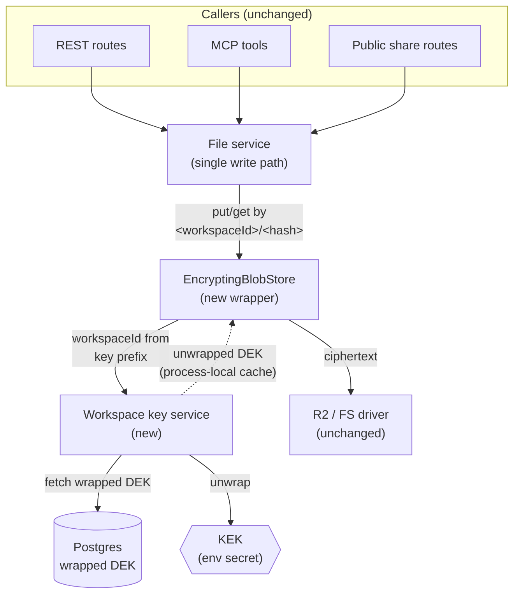
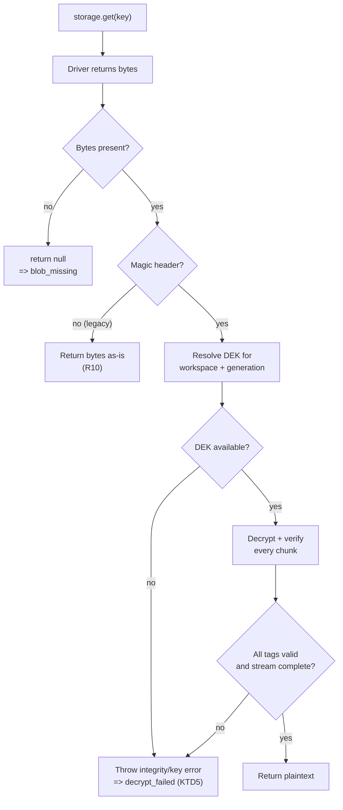

# feat: Per-workspace envelope encryption for file bytes at rest

## Summary

Encrypt every file's bytes before they reach the blob store, transparently at the `BlobStore` seam, using a per-workspace data key (DEK) wrapped by a master key (KEK) held in Railway secrets. A leaked R2 bucket, a stolen backup, or a misconfigured-public bucket yields ciphertext only. Agents, web preview, CLI sync, dedup, share links, and version history keep working unchanged — no caller of the file service is aware encryption exists.

The on-disk format follows Tink's AES-GCM-HKDF streaming layout: a self-describing header plus independently-authenticated fixed-size chunks. This is streaming- and Range-ready from day one, so the future large-file/video path is an upgrade rather than a re-encryption migration.

---

## Problem Frame

File bytes live in R2 (deployed) or a local filesystem driver (dev), keyed by content hash, with metadata in Postgres. Today those bytes are written and read in plaintext (`packages/api/server/utils/storage.ts`). Anyone who obtains the bucket contents — a leaked R2 credential, a stolen backup, a misconfigured bucket — reads every file in every workspace directly, with no further compromise required.

That is the gap this closes: the most realistic data-exposure path for a hosted file workspace is the storage layer leaking _independently of the application_, and right now such a leak hands over cleartext. The cost is a full-fidelity breach of customer file contents from a single misplaced credential.

This is deliberately scoped to the **infrastructure-at-rest** threat. It does not protect against an attacker who can execute code in the API process or read its environment, and it does not hide file contents from Treehouse-the-operator — that is zero-knowledge territory, a different product that conflicts with server-side agents (see origin: `docs/brainstorms/2026-06-09-file-encryption-at-rest-requirements.md`).

---

## Requirements

Carried from the origin document, with R5/R6 amended and R11–R13 added from the planning discussion.

**Encryption at the storage boundary**

- **R1.** All blob bytes are encrypted before persistence and decrypted after fetch, at the `BlobStore` seam, so no calling code (file service, REST routes, MCP tools, CLI) changes.
- **R2.** Encryption uses an authenticated cipher (AES-256-GCM) so a tampered, truncated, reordered, or corrupted blob fails decryption **loudly** rather than returning corrupt plaintext.
- **R3.** The stored object is self-describing: it carries a format marker, key generation, and per-blob salt/nonce material needed to decrypt, without a schema change to `FileNode` or `ChangeEvent`.
- **R4.** The format is chunked and framed (fixed-size chunks, each independently authenticated) so it is compatible with future streaming and HTTP Range reads. v1 still buffers whole files; the format must not require re-encryption when streaming arrives.

**Key management (amended — supersedes origin R5/R6)**

- **R5.** Each workspace has its own data key (DEK). The DEK is stored only in wrapped form, encrypted under a master key (KEK) held in environment secrets — never in the bucket, never in plaintext in the database.
- **R6.** The KEK is identified per wrapped DEK, so a new KEK can be introduced and old DEKs re-wrapped without touching a single blob. Retired KEKs remain available for unwrap-only.
- **R7.** Each blob records the key generation it was encrypted under, so a future DEK rotation can introduce a new generation for new writes while old blobs stay readable — without shipping DEK-rotation tooling now.
- **R8.** The API fails closed in production when no KEK is configured, mirroring the existing `SHARE_COOKIE_SECRET` and blob-store production boot guards.

**Content-addressing and compatibility**

- **R9.** Blob keys remain derived from the **plaintext** content hash (`<workspaceId>/<sha256(plaintext)>`), preserving dedup and keeping `ChangeEvent.contentHash` version/restore pointers working unchanged.
- **R10.** Reads tolerate legacy plaintext blobs: a stored object with no encryption header is returned as-is, so existing data keeps working with no flag day. New writes always encrypt.

**Behaviour preservation and new coverage**

- **R11.** Agents (MCP), the web file browser and preview, REST reads/writes, public share links, version view/restore, and CLI two-way sync continue to function exactly as today.
- **R12.** The public share read path sets validators and cache directives so repeat views short-circuit before a blob fetch and decrypt — without weakening the existing "revocation beats a live cookie" invariant.
- **R13.** Deleting a workspace destroys its wrapped DEK, rendering its bytes permanently unrecoverable (crypto-shredding).

---

## Success Criteria

- An actor holding only the blob store contents (bucket objects plus a backup), without the API's environment, cannot read any file's contents in any workspace.
- A flipped, truncated, reordered, or cross-workspace-substituted blob is detected on read and surfaces as an explicit integrity failure — never as "missing" and never as corrupt plaintext.
- Compromise of one workspace's DEK does not expose any other workspace's files.
- Existing workspaces created before this change continue to read and write with no migration step.
- Repeat views of a public share link do not re-fetch and re-decrypt the blob.

---

## Key Technical Decisions

**KTD1. Envelope encryption (per-workspace DEK under a master KEK), not a single master key.**
The origin document specced one env-held master key with a key-id header. Planning amends this. The cost is one table and an in-process unwrap cache; the benefits are concrete: (a) **rotation actually works** — rotating the KEK re-wraps N database rows in seconds, whereas rotating a single master key means re-encrypting every blob or keeping the old key alive forever; (b) **crypto-shredding** — destroying one row makes a workspace's bytes unrecoverable, which matters more than usual here because blobs are _never deleted_ today (`BlobStore.delete` has no callers; deletion removes only the `FileNode` row), so shredding the key is the **only** mechanism by which bytes actually become unrecoverable; (c) **blast-radius containment** per tenant; (d) a BYOK path if an enterprise customer asks.

The origin document deferred per-workspace keys partly because they would cost cross-workspace dedup. That reason does not hold: `blobKeyFor()` in `packages/api/server/utils/files.ts` is already `<workspaceId>/<hash>`, so dedup is **already workspace-scoped**. Per-workspace keys cost nothing that exists today.

**KTD2. Adopt a published chunked-AEAD layout (Tink AES-GCM-HKDF streaming) rather than inventing a header.**
The origin document left the exact header and nonce derivation to planning. Framing is the easiest part of an encryption scheme to get subtly wrong — nonce reuse across chunks, unauthenticated headers, undetectable truncation, and chunk-reordering are all classic failures. Following a specified, analysed layout removes that design risk. Notably, deriving a **per-blob key** via HKDF from (DEK, random salt) means the workspace DEK is never used directly as a GCM key across many blobs, which removes the nonce-collision analysis entirely.

This is not "rolling your own crypto": the primitives (AES-256-GCM, HKDF-SHA256) come from Node's `crypto`; only the framing is implemented, against a published spec. A runtime Tink dependency is avoided — the layout is small, the JS binding is WebCrypto-oriented and awkward under Nitro, and a bespoke dependency for ~150 lines of framing is poor value. Revisit if the format grows.

**KTD3. Bind workspace and content identity into key derivation and AAD.**
The HKDF info and per-chunk AAD incorporate the workspace id and content hash. This makes a blob cryptographically non-portable: an attacker with bucket _write_ access cannot move workspace A's ciphertext into workspace B's key namespace and have it decrypt. Without this, per-workspace keys still isolate reading but not blob substitution.

**KTD4. Derive the workspace id from the blob key prefix, not a widened `BlobStore` interface.**
The wrapper needs to know which workspace a key belongs to in order to fetch the right DEK. The blob key already carries it (`<workspaceId>/<hash>`), and that shape is an established invariant owned by `blobKeyFor()`. Parsing the prefix keeps the three-method `BlobStore` interface untouched, so alternate backends still drop in without change. The trade-off is an implicit contract between the key format and the wrapper — mitigated by validating strictly and throwing on a key without a well-formed workspace prefix, rather than silently guessing. The alternative (adding a context argument to `put`/`get`) was rejected as a wider blast radius for no security gain.

**KTD5. A decryption failure is a distinct outcome from a missing blob.**
Today `storage.get` returning null maps to `blob_missing`. Reporting a _tamper or key_ failure the same way would mislabel an integrity attack as ordinary data loss and hide it in the noise. Decryption failures surface as their own status, map to a 5xx, and are logged with the blob key — never conflated with absence, never degraded to partial content.

**KTD6. Public share caching is `private`, not `public`.**
Repeat views of a public link are the highest-fanout read path in the product and the place where per-read decryption costs most. A shared/CDN cache would absorb that traffic best — but `Cache-Control: public` breaks control #6 of the public share trust boundary (`docs/solutions/architecture-patterns/public-share-trust-boundary.md`): revocation must beat a live cookie, and every read re-resolves the share filtering `revokedAt: null`. A CDN would keep serving a revoked link until TTL expiry. So the share path gets an `ETag` plus `Cache-Control: private` with a short max-age: browser-level 304s only, revocation intact.

**KTD7. Workspace deletion cascades the wrapped DEK (crypto-shred), with no grace period.**
There is currently **no workspace-delete and no org-delete surface anywhere in the product** — verified across the API routes, the app, and the CLI. Workspaces can only disappear via a direct database action or a future feature. So this is a lifecycle rule to encode now, not a code path to build: the wrapped-DEK row cascades with its workspace, exactly as `FileNode`, `NodeAcl`, and `ChangeEvent` already do. Deletion is therefore irreversible for file contents, which is the correct default and the honest one to design a future delete UX against. A retention grace period is deferred; if a future delete feature wants "undelete", it must introduce soft-delete before it introduces deletion.

---

## High-Level Technical Design

Directional guidance for review — the prose above is authoritative where they disagree.

### Component and data flow



### Stored blob layout

```text
+--------------------------------------------------------------+
| HEADER  (cleartext, authenticated as AAD on every chunk)      |
|   magic          - format marker, absent => legacy plaintext  |
|   formatVersion  - u8                                         |
|   keyGeneration  - u32, which DEK generation encrypted this   |
|   salt           - random, per blob (HKDF input)              |
|   noncePrefix    - random, per blob                           |
|   chunkSize      - u32, plaintext bytes per chunk             |
+--------------------------------------------------------------+
| CHUNK 0   ciphertext + GCM tag                                |
| CHUNK 1   ciphertext + GCM tag                                |
| ...                                                           |
| CHUNK N   ciphertext + GCM tag   (final-chunk flag set)       |
+--------------------------------------------------------------+

per-blob key   = HKDF-SHA256(DEK, salt, info = workspaceId || contentHash)
per-chunk nonce = noncePrefix || counter(u32 BE) || finalFlag(u8)
per-chunk AAD   = header bytes
```

The final-chunk flag makes truncation detectable; the counter in the nonce makes reordering detectable; the header-as-AAD makes header tampering detectable; `workspaceId` in the HKDF info makes cross-workspace substitution undecryptable.

### Read path



---

## Implementation Units

### U1. Workspace key service and wrapped-DEK model

**Goal:** Per-workspace DEKs, wrapped under an env-held KEK, provisioned lazily and cached per process.

**Requirements:** R5, R6, R8, R13.

**Dependencies:** none.

**Files:**

- `packages/db/prisma/schema.prisma` — new `WorkspaceKey` model (hand-maintained section, below the auth block)
- `packages/db/prisma/migrations/` — new migration
- `packages/api/server/utils/workspace-keys.ts` — new
- `packages/api/test/workspace-keys.test.ts` — new

**Approach:**
`WorkspaceKey` holds `workspaceId` (unique, cascade-delete to `Workspace` per KTD7), `generation`, `kekId`, and the wrapped DEK bytes. KEK material loads from environment as `<kekId>:<base64 32-byte key>` for the active key, plus an optional retired list for unwrap-only, mirroring the env-parsing discipline in `packages/api/server/utils/quota.ts` (strict validation, no silent coercion). Production boot fails closed when no KEK is set, mirroring the `SHARE_COOKIE_SECRET` guard in `shares.ts` and the blob-store guard in `storage.ts`.

`dekFor(workspaceId)` returns the unwrapped DEK, provisioning one on first use. Provisioning must be idempotent under concurrency: rely on the unique constraint and re-read on `P2002` (the same pattern `files.ts` uses in `resolveWriteMiss`). Unwrapped DEKs are memoized in a process-local map — without this, every image in a markdown document adds a database round-trip.

**Patterns to follow:** `packages/api/server/utils/quota.ts` (env resolution seam), `packages/api/server/utils/storage.ts` (memoized `use*` singleton, production boot guard), `packages/api/server/utils/files.ts` (`isUniqueViolation` race handling).

**Test scenarios:**

- Provisioning a DEK for a workspace with none creates exactly one row; a second call returns the same key without creating another.
- Two concurrent first-time calls for the same workspace both resolve to the same DEK and leave exactly one row (unique-violation path).
- Different workspaces receive different DEKs.
- A DEK wrapped under the active KEK round-trips through wrap and unwrap.
- A DEK wrapped under a _retired_ KEK id still unwraps; a DEK naming an unknown KEK id fails explicitly rather than returning garbage.
- A tampered wrapped-DEK blob fails to unwrap loudly.
- With `NODE_ENV=production` and no KEK configured, resolution throws at load with a message naming the variable.
- Outside production with no KEK configured, resolution reports encryption as disabled rather than throwing (dev keeps working).
- Malformed KEK material (wrong length, non-base64, missing id prefix) is rejected explicitly, never silently truncated or padded.
- **Covers R13.** Deleting a workspace row removes its `WorkspaceKey` row via cascade.

---

### U2. Chunked AEAD blob format

**Goal:** Encode and decode the self-describing, chunk-authenticated blob format, with legacy-plaintext detection.

**Requirements:** R2, R3, R4, R7, R10.

**Dependencies:** none (pure functions over bytes and a key; independent of U1).

**Files:**

- `packages/api/server/utils/blob-crypto.ts` — new
- `packages/api/test/blob-crypto.test.ts` — new

**Approach:**
Follow the layout in High-Level Technical Design, which mirrors Tink's AES-GCM-HKDF streaming construction. Primitives come from Node's `crypto`; only the framing is implemented here. The module is pure — it takes bytes and a DEK, and knows nothing about Postgres, R2, or the file service — so the adversarial cases below are unit-testable in isolation, matching how `shares.ts` is kept HTTP-free for the same reason.

Legacy detection is the absence of the magic marker. The marker must be chosen so a plaintext file cannot plausibly begin with it; treat "a real file happens to start with the magic bytes" as a case to reason about explicitly rather than assume away.

**Execution note:** Implement the adversarial cases test-first. The security properties of this unit are exactly the cases that are easy to leave untested and impossible to notice in manual use.

**Test scenarios:**

- **Covers R2.** Round-trips text, binary, and UTF-8-invalid bytes with byte-exact fidelity.
- Round-trips an empty (0-byte) file.
- Round-trips a payload spanning several chunks, and one exactly on a chunk boundary (no off-by-one in the final-chunk flag).
- **Covers R2.** A single flipped bit anywhere in the ciphertext fails decryption.
- **Covers R2.** A flipped bit in the _header_ fails decryption (header is authenticated as AAD).
- **Covers R2.** Removing the final chunk fails decryption (final-chunk flag detects truncation).
- **Covers R2.** Swapping two chunks fails decryption (counter is bound into the nonce).
- **Covers KTD3.** A blob encrypted for workspace A fails to decrypt when presented as workspace B's, even with B's DEK available.
- **Covers KTD3.** A blob encrypted for content hash X fails to decrypt when presented under hash Y.
- Decrypting with the wrong DEK fails explicitly rather than returning garbage.
- **Covers R10.** Bytes with no magic marker are detected as legacy plaintext and returned unchanged.
- **Covers R7.** The key generation stamped in the header round-trips and is readable without decrypting the body.
- Two encryptions of identical plaintext produce different ciphertext (fresh salt and nonce prefix per blob).

---

### U3. Encrypting blob-store wrapper

**Goal:** Wrap any `BlobStore` driver so bytes are encrypted on write and decrypted on read, invisibly to every caller.

**Requirements:** R1, R9, R10, R11.

**Dependencies:** U1, U2.

**Files:**

- `packages/api/server/utils/storage.ts` — add the wrapper, compose it in `resolveBlobStore`
- `packages/api/test/storage.test.ts` — extend

**Approach:**
A decorator implementing the existing three-method `BlobStore` interface, wrapping either driver so R2 and the filesystem path are covered by one implementation. `put` encrypts then delegates; `get` delegates then decrypts, passing legacy plaintext through untouched. `delete` delegates unchanged.

The workspace id comes from the blob key prefix (KTD4) — validate strictly and throw on a malformed key rather than guessing. `contentType` continues to travel as blob-store metadata (R2 object metadata, `.ct` sidecar on the filesystem driver) and stays cleartext, which leaks nothing new: it is already stored on `FileNode`.

`resolveBlobStore` composes the wrapper when a KEK is configured and returns the bare driver when not, so dev without a KEK behaves exactly as today. The existing `setStorageForTesting` seam stays intact.

Recorded size stays the **plaintext** byte length. `files.ts` writes `FileNode.size` from the incoming body and the quota gate sums that column, so a workspace's real R2 footprint now exceeds its accounted usage by the ciphertext overhead (a header plus one tag per chunk — under 0.01% at 1 MiB chunks). Leave it: changing the recorded size to ciphertext length would make the number stop matching what a user sees as the file's size, for an accounting correction far below any plausible quota threshold.

Two notes for the implementer:

- `restore()` in `files.ts` re-puts identical plaintext, which now produces _different ciphertext_ at the same blob key (fresh salt per encryption). This is correct — the key is the plaintext hash, so the object is simply overwritten with an equally valid encryption — but it means blob bytes are no longer stable across re-puts. Nothing depends on that stability today; confirm nothing new does.
- Encryption failures on write must **propagate**, never be swallowed into a partial or plaintext put. `files.ts` deliberately persists the blob before the metadata CAS so a committed row never points at a missing blob; a silently-failed encryption would invert that invariant into a row pointing at unreadable bytes.

**Patterns to follow:** the existing driver classes in `storage.ts` (private-field style, `BlobStore` conformance), `packages/api/test/storage.test.ts` (temp-dir filesystem driver, dynamic import after env setup).

**Test scenarios:**

- **Covers R1.** A written blob round-trips through the wrapper with byte-exact fidelity, for text and binary.
- **Covers R1.** The bytes actually landing in the underlying driver are _not_ the plaintext (assert on the raw stored object, not just the round-trip).
- **Covers R9.** The blob key is unchanged by encryption — still the plaintext content hash under the workspace prefix.
- `contentType` round-trips intact through the wrapper on both drivers.
- **Covers R10.** A plaintext blob written directly to the underlying driver (simulating pre-encryption data) reads back correctly through the wrapper.
- Blobs for two different workspaces are not decryptable with each other's keys end-to-end through the wrapper.
- A missing key still returns null (absence is not conflated with a decryption failure).
- A corrupted stored object raises a decryption failure rather than returning null or partial bytes.
- An encryption failure during `put` propagates to the caller and leaves no object in the underlying driver — never a partial or plaintext write (protects the blob-before-metadata durability ordering in `files.ts`).
- **Covers KTD4.** A blob key without a well-formed workspace prefix is rejected explicitly.
- With no KEK configured, `resolveBlobStore` returns an unwrapped driver and behaviour is identical to today.

---

### U4. Surface decryption failure distinctly from a missing blob

**Goal:** An integrity or key failure reads as its own outcome through the file service and routes — never as `blob_missing`.

**Requirements:** R2, R11.

**Dependencies:** U3.

**Files:**

- `packages/api/server/utils/files.ts` — extend the result unions on `read`, `readByHash`, `readVersion`, and the `restore` path that consumes `readVersion`
- `packages/api/server/routes/api/workspaces/[workspaceId]/files/[...path].get.ts`
- `packages/api/server/routes/api/workspaces/[workspaceId]/version.get.ts`
- `packages/api/server/routes/api/share/[token]/file.get.ts`
- `packages/api/server/utils/mcp.ts` — read tools
- `packages/api/test/files-service.test.ts` — extend
- `packages/api/test/files-routes.test.ts` — extend

**Approach:**
Add a distinct decrypt-failure outcome alongside `blob_missing` in the file-service result unions, and map it at every consumer to a 5xx with a log line carrying the blob key. Per KTD5, this must not be folded into `blob_missing` (which routes map to 502 and the share path maps to 410 for pinned versions) — a 410 on a _tampered_ blob would tell a share visitor the version was cleanly retired, and would leave an integrity attack indistinguishable from ordinary lifecycle.

Every consumer of the affected unions must be updated; the compiler will find them, but the share route's pinned-version branch and the MCP read tools are the two easiest to map carelessly.

**Test scenarios:**

- A corrupted blob read through the file service returns the decrypt-failure status, not `blob_missing`.
- The authenticated file route maps a decrypt failure to a 5xx, not 404, 410, or 502.
- **Covers R11.** The share route maps a decrypt failure on a _pinned_ version to a 5xx, not the 410 it uses for a genuinely absent pinned blob.
- A genuinely absent blob still maps to its existing status and code on every route (no regression).
- An MCP read tool surfaces a decrypt failure as an explicit error rather than empty or partial content.
- The version-read path distinguishes decrypt failure from `version_not_found`.

---

### U5. Conditional requests and cache directives on byte-serving routes

**Goal:** Repeat views short-circuit before the blob is fetched and decrypted, without weakening revocation.

**Requirements:** R12.

**Dependencies:** none (independent of the encryption units; sequence last as it is a mitigation, not a prerequisite).

**Files:**

- `packages/api/server/routes/api/share/[token]/file.get.ts`
- `packages/api/server/routes/api/workspaces/[workspaceId]/files/[...path].get.ts`
- `packages/api/test/share-public-routes.test.ts` — extend
- `packages/api/test/files-routes.test.ts` — extend

**Approach:**
The share route currently sets no validator and no cache directive at all, so every view is a full fetch and (post-encryption) a full decrypt. Add an `ETag` and `Cache-Control: private` with a short max-age, and honour `If-None-Match` with a 304 **after** the share is re-resolved and the private-node ACL re-checked — the short-circuit must sit downstream of the security checks, never upstream, or a revoked link would serve 304s from a stale validator. Per KTD6, the directive is `private`, not `public`.

This unit also adds `If-None-Match` handling to the authenticated file route, which already emits an `ETag` (its version) but does not act on the conditional request. That route is where the app's image and preview traffic lands — a markdown document embedding twenty images currently performs twenty full reads per render — so it is the same mitigation for the same problem and belongs with it rather than in a follow-up.

For the share path, derive the validator from the pinned content hash where one exists and the node version otherwise, so a pinned permalink's validator is stable and a live share's changes when the file does.

**Patterns to follow:** `hardenShareResponse` in the share route (header-setting shape, and the ordering discipline that keeps security headers unconditional); the `ETag` emission already in `files/[...path].get.ts`.

**Test scenarios:**

- **Covers R12.** A share request with a matching `If-None-Match` returns 304 with no response body.
- **Covers R12.** A repeat share view does not reach the blob store (assert the store was not called, so the saving is real rather than assumed).
- A share request with a stale `If-None-Match` returns 200 and the current bytes.
- A share whose file has changed since the validator was issued returns 200, not 304.
- **Covers KTD6.** `Cache-Control` on a share response is `private` — assert explicitly, so a future change to `public` fails the suite rather than silently breaking revocation.
- **Critical.** A _revoked_ share returns 404 even when the request carries a previously-valid `If-None-Match` — the conditional short-circuit must not run before re-resolution.
- A _password-protected, not-yet-unlocked_ share returns its gate response even with a matching `If-None-Match`.
- A share pointing at a node that has since been made private returns 404 even with a matching validator.
- The existing hardening headers (`nosniff`, CSP, `Content-Disposition`) are still present and unchanged on every 200 response.
- The authenticated file route returns 304 for a matching `If-None-Match` and 200 for a stale one.

---

### U6. Operational wiring and documentation

**Goal:** The KEK is configurable, documented, generatable, and fails closed in production; the shred and memory implications are written down.

**Requirements:** R8, R13.

**Dependencies:** U1.

**Files:**

- `packages/api/.env.example`
- `README.md` — deployment/env section
- `docs/solutions/architecture-patterns/public-share-trust-boundary.md` — extend the deploy-gotchas section with the new required secret and the `private`-not-`public` caching rule
- `CONCEPTS.md` — add the key-management vocabulary if absent

**Approach:**
Document the KEK variables with a generation command, following the `SHARE_COOKIE_SECRET` precedent already in `.env.example` (which pairs the variable with `openssl rand -hex 32` and states the production requirement). State the operational facts that are easy to discover too late:

- **Losing the KEK loses every file.** There is no recovery path. It belongs in whatever holds the other Railway secrets, with a backup outside the same blast radius.
- **Deletion is irreversible** (KTD7): removing a workspace destroys its DEK and its bytes are unrecoverable, which matters because blobs themselves are never garbage-collected today.
- **Peak memory roughly doubles per in-flight write.** `MAX_FILE_BYTES` defaults to 100 MB and the write path already buffers the whole body; encryption adds a transient second buffer, so the ceiling is ~200 MB per concurrent large write on the instance. Flag this against instance sizing rather than changing the default silently.

Also note in the deploy documentation that provider-managed R2 server-side encryption is assumed as a baseline beneath this layer — the origin document flagged that as unverified, and it remains unverified here (see Open Questions).

**Test scenarios:** `Test expectation: none — documentation and configuration only. The production boot-guard behaviour it documents is tested in U1.`

---

## Scope Boundaries

Carried from the origin document unless marked.

**Non-goals**

- **Metadata stays cleartext.** Paths, file names, sizes, content types, and the entire change feed remain unencrypted in Postgres because they power list, search, and incremental sync. File names and sizes leak; this is accepted for the infrastructure-at-rest threat model, and is the claim to be careful about if this is ever marketed as "encrypted".
- **No protection against process or environment access.** Anyone who can read the API process memory or its environment can still read plaintext. That is zero-knowledge territory and conflicts with server-side agents.
- **No isolation between members of one workspace.** The DEK is per workspace, so encryption at rest adds nothing between members — including for private directories, whose separation is entirely the ACL layer's job.
- **The plaintext-hash confirmation oracle is not closed.** Because blob keys are the plaintext hash (R9), a bucket attacker who can _guess_ a file's exact bytes can confirm its presence. HMAC-keyed addressing would close this at the cost of the version/restore pointer model; irrelevant to the stolen-bucket threat.
- **Large-file and video capability is a separate future service.** Not handled here. The chunked format exists so that work is an upgrade rather than a re-encryption.

**Deferred to follow-up work**

- **Backfill of legacy plaintext blobs.** Confirmed out of scope in planning. R10 keeps them readable indefinitely, and natural re-writes convert files over time. A one-off re-encryption pass (the `packages/workers` BullMQ worker is the natural home) can be added later without a format change.
- **DEK rotation tooling.** R7 stamps a key generation per blob so rotation is possible without re-encrypting; the machinery to actually rotate is not built.
- **KEK rotation tooling.** R6 makes it a re-wrap of database rows rather than a blob migration; the runner is not built.
- **A workspace-delete feature.** None exists today. KTD7 defines what the key does when one arrives.
- **Streaming and HTTP Range reads.** The format supports them; the code paths still buffer whole files.
- **Per-blob DEK envelopes, external KMS, and BYOK.** The envelope structure leaves the door open.

---

## Risks

- **KEK loss is unrecoverable data loss.** The most severe operational risk this introduces, and it is new — today a lost secret costs nothing at the byte level. Mitigated only by documentation and secret-management discipline (U6); there is no technical mitigation available without weakening the threat model.
- **A silently-broken wrapper writes unreadable data.** If encryption succeeds but decryption is subtly wrong, corruption is invisible until someone reads an old file. The adversarial unit tests in U2 and the raw-bytes assertion in U3 exist specifically to catch this before it reaches data; the assertion that stored bytes are _not_ plaintext is the one that catches a no-op wrapper.
- **The conditional-request short-circuit is a security-ordering hazard.** Placing the 304 check before share re-resolution would let a revoked link keep serving. Called out in U5 with a dedicated test.
- **Memory pressure at the file-size ceiling.** ~2× peak per in-flight write against a 100 MB cap on a small Railway instance. Documented in U6; an explicit concurrency cap is available if it bites.
- **Unverified R2 server-side-encryption baseline.** Carried unresolved from the origin document. Does not block this work — the whole point is a Treehouse-held layer above it — but it should stop being an assumption.

---

## Open Questions

**Deferred to implementation**

- Exact chunk size (1 MiB is the working default; measure against typical file sizes before fixing it).
- Whether the magic marker collides plausibly with any real file type's leading bytes, and what the format does if it does.
- Whether the memoized DEK cache needs eviction, or whether an unbounded map keyed by workspace is acceptable at current workspace counts.

**Needs verification, not blocking**

- Confirm R2 provider-managed server-side encryption is actually enabled on the `treehouse-blobs` bucket (unverified since the origin document).
- Confirm large uploads are not subject to a request-size or memory cap in the deployed Cloudflare → Railway topology, independent of encryption correctness (carried from origin).

---

## Sources & Research

**Codebase**

- `packages/api/server/utils/storage.ts` — `BlobStore` interface, R2 and filesystem drivers, memoized resolution, production boot guard, `setStorageForTesting` seam.
- `packages/api/server/utils/files.ts` — the single write path. `blobKeyFor()` is already workspace-scoped (the fact that invalidates the origin's dedup objection to per-workspace keys); three `storage.get` call sites and two `storage.put`; `BlobStore.delete` has no callers, so blobs are never garbage-collected.
- `packages/api/server/routes/api/share/[token]/file.get.ts` — the only unauthenticated read surface; sets hardening headers but no validator or cache directive.
- `packages/db/prisma/schema.prisma` — hand-maintained Treehouse models below the auth block. **Do not run `auth:generate`**; it regenerates the whole file and deletes them.
- `packages/api/server/utils/quota.ts`, `shares.ts` — env-resolution and fail-closed-in-production precedents.
- Verified absent: any workspace-delete or org-delete surface across the API, app, and CLI (basis for KTD7).

**Institutional learnings**

- `docs/solutions/architecture-patterns/public-share-trust-boundary.md` — the ten controls of the public read surface. Control #6 (revocation beats a live cookie) is what constrains U5 to `private` caching; the deploy-gotchas section is extended by U6.

**External**

One targeted search on chunked-AEAD prior art, to ground KTD2. Confirmed the construction the origin document sketched (base nonce plus chunk counter plus final-chunk flag) is the standard STREAM framing, and that Tink's AES-GCM-HKDF streaming layout additionally derives a per-blob key from a random salt — adopted here to remove nonce-collision analysis. No broader external review was run; the format should be checked against the Tink specification directly at implementation time rather than from this summary.

- [Streaming AEAD — Tink](https://developers.google.com/tink/streaming-aead)
- [AES-GCM-HKDF Streaming AEAD — Tink](https://developers.google.com/tink/streaming-aead/aes_gcm_hkdf_streaming)
- [Encrypting streams — ImperialViolet](https://www.imperialviolet.org/2014/06/27/streamingencryption.html)
- [aead::stream (STREAM construction)](https://docs.rs/aead/latest/aead/stream/index.html)