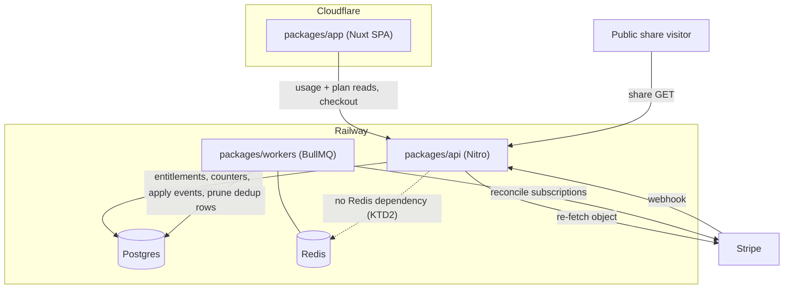
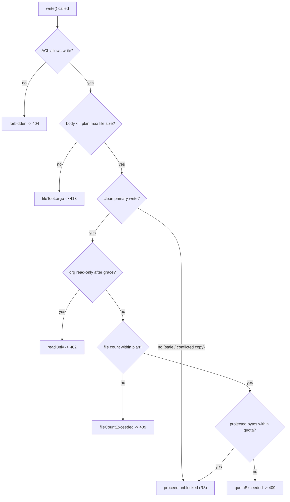
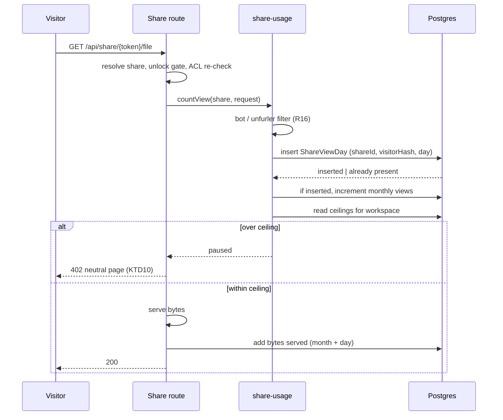
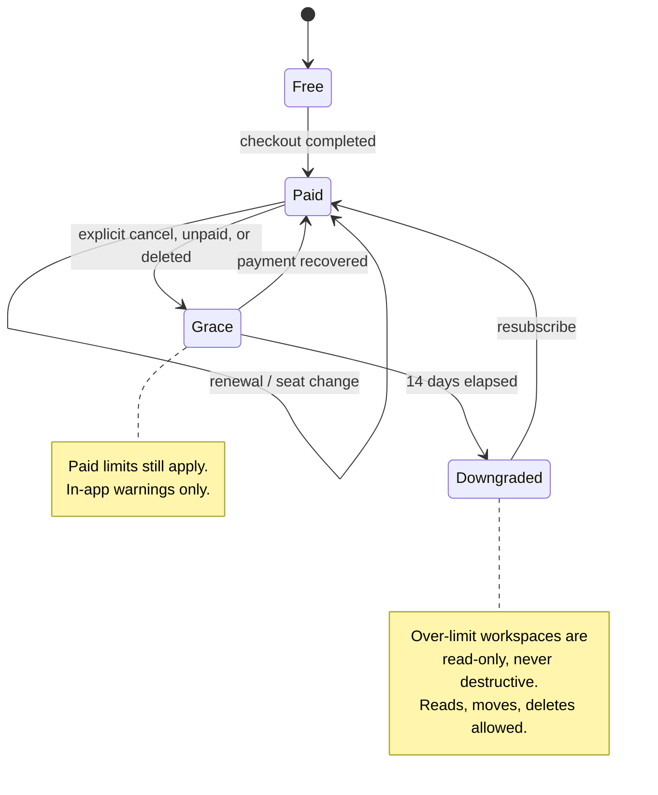

# feat: Billing, plan entitlements and usage limits

## Summary

Introduce three paid tiers (Seedling / Grove / Forest) billed per member to the
organization, with every limit — storage, file count, file size, workspaces, org
membership, public share views — derived from the org's plan. Stripe is wired
through better-auth's plugin, backed by a durable event log and a reconciliation
job. Every limit ships dormant and is activated by assigning plans.

## Problem Frame

Treehouse has no revenue path and no cost ceiling. Storage quota exists as a fully
built but dormant mechanism (`packages/api/server/utils/quota.ts` reads one env var
and treats unset as unlimited), and nothing else is capped at all: a user can create
unlimited organizations, each with unlimited workspaces, and a single public share
link can serve unbounded traffic.

Two facts shape the design. First, share traffic is the only cost a single free user
can drive without bound — bytes leave via Railway at ~$0.05/GB, and because files are
encrypted at rest the API must decrypt and serve them itself, so no CDN can absorb
it. Second, gigabytes are the wrong dial for a markdown workspace: 1 GB holds ~100,000
typical documents but only ~1,500 screenshots, so a storage cap constrains attachments
rather than work. File count caps the countable unit instead, and enforces a non-goal
STRATEGY.md already declares — no syncing dependency folders or build caches.

The product constraint that governs every decision below: this is a file workspace
whose core promise is never losing data. A billing glitch must never block a team from
their own files.

---

## Requirements

**Entitlements**

- R1. Every organization resolves to exactly one plan tier, and every limit in the
  product derives from that tier.
- R2. Entitlement resolution reads only Postgres — never Stripe, never Redis.
- R3. A self-hosted deployment with no billing configured resolves to an unlimited
  plan.
- R4. Limits ship inert: an existing deployment sees no behaviour change until plans
  are assigned.

**Workspace limits**

- R5. A workspace's storage quota derives from the owning org's plan (see origin:
  `docs/brainstorms/2026-06-09-workspace-storage-limits-requirements.md` R3).
- R6. A workspace has a maximum live file count derived from the plan; an ordinary
  write that would exceed it is rejected.
- R7. Maximum single-file size derives from the plan, replacing the global
  `MAX_FILE_BYTES` ceiling as the effective limit.
- R8. Data-preservation writes (conflicted copies from stale-write handling) are
  exempt from every workspace limit.
- R9. Reads, moves and deletes are permitted regardless of limit state, so a user over
  a limit can always recover.
- R10. Limit rejections carry machine-readable codes distinguishing which limit was
  hit, so agents stop rather than retry and the UI can render the right upsell.

**Org and membership limits**

- R11. The number of organizations a user may create derives from their plan.
- R12. An organization's member count derives from its plan.
- R13. An organization's workspace count derives from its plan.

**Share usage**

- R14. Public share views are counted per workspace per calendar month, deduplicated
  per visitor per share link per day.
- R15. Bytes served on public share routes are counted per workspace per month and
  per day.
- R16. Known bots and link unfurlers are excluded from view counts.
- R17. Authenticated member access to workspace files is never counted as a share
  view.
- R18. Per-share view counts and last-viewed timestamps are visible to workspace
  members.
- R19. When a share ceiling is reached, public share serving pauses; authenticated
  workspace access is unaffected.
- R20. The workspace owner is warned in-app at 80% of the view limit and emailed when
  a ceiling is hit.

**Billing**

- R21. Subscriptions reference the organization, not the user.
- R22. Stripe seat quantity tracks the org's member count.
- R23. Every Stripe webhook event is recorded durably and applied at most once.
- R24. Subscription state is reconciled against Stripe on a schedule, independent of
  webhook delivery.
- R25. Ambiguous or missing billing state resolves to the last known plan — never
  downward.
- R26. After grace expiry, a workspace over its new limits becomes read-only rather
  than losing data.

---

## Key Technical Decisions

- KTD1. **Entitlements resolve from Postgres only.** A file write must never block on
  Stripe being slow or Redis being down. The plan lives in the `subscription` row;
  resolution is a cached org lookup.
- KTD2. **Share usage counters write directly to Postgres, not Redis.** The API
  package has no Redis or BullMQ dependency — those live only in `packages/workers` —
  and share serving is low-volume by design, already doing a share lookup plus a blob
  fetch plus decryption per request. One atomic increment is noise against that. This
  supersedes the Redis-buffer suggestion in the origin research doc.
- KTD3. **File count is the primary workspace limit; storage bytes are secondary.**
  Gigabytes do not constrain a markdown workspace and do not track our real cost
  (Postgres rows do).
- KTD4. **Every limit ships dormant.** Existing workspaces — including Pixelhop's own
  — exceed the free-tier numbers today. Enforcement activates per-org by plan
  assignment, not by deploy.
- KTD5. **Existing organizations are grandfathered onto a `legacy` unlimited plan.**
  Assumption, not a settled product decision: it avoids breaking current users at
  rollout, at the cost of a permanent extra tier in the catalog.
- KTD6. **Stripe direct via better-auth's plugin, not a merchant of record.** Chosen
  over Polar/Paddle; the VAT and sales-tax obligation stays with us (see Open
  Questions).
- KTD7. **Webhook handlers re-fetch the object from Stripe rather than trusting the
  payload.** Stripe does not guarantee delivery order, so a `subscription.updated` can
  arrive before the `checkout.session.completed` that created it. Re-fetching makes
  ordering irrelevant.
- KTD8. **Fail open on ambiguous billing state.** Never downgrade on absence of data.
  A spurious drop to Seedling would apply a 1,000-file cap to a workspace holding
  20,000 files and block a paying team from their own client work.
- KTD9. **Visitor dedup uses a salted daily hash of IP + user-agent, not a cookie.**
  No consent banner, nothing stored about the visitor, consistent with the product's
  own-your-data positioning.
- KTD10. **The paused-share page is neutral and Treehouse-branded.** It is seen by the
  owner's client, not the owner. It must never name the owner's plan state; the
  upgrade pressure goes to the owner's inbox.
- KTD11. **Stripe plugin schema is generated into a scratch file and merged by hand.**
  `auth:generate` rewrites the whole of `packages/db/prisma/schema.prisma` and would
  delete the hand-maintained Treehouse models.

---

## High-Level Technical Design

### Component and data flow

The dotted edge is the boundary this plan preserves: the API never gains a Redis
dependency, so entitlement and counter paths stay available when Redis is not.

### Write-path limit gate

Extends the existing gate in `packages/api/server/utils/files.ts`, which already
skips non-clean-primary writes so data-preservation paths are never blocked.

### Share view counting

The 304 path returns before bytes are counted, so repeat views cost nothing in the
byte column while still registering as a view.

### Plan lifecycle and the downgrade ladder

Absence of data never moves a state. Only an explicit, confirmed signal from Stripe —
webhook or reconciliation — advances Paid to Grace (R25, KTD8).

---

## Implementation Units

**Phase 1 — Entitlements foundation (ships dormant)**

### U1. Plan catalog and entitlement resolution

**Goal:** One module that answers "what limits apply to this org?" for every other
unit to consume.

**Requirements:** R1, R2, R3, R4

**Dependencies:** none

**Files:**

- `packages/api/server/utils/plans.ts` (new)
- `packages/api/test/plans.test.ts` (new)

**Approach:** A frozen catalog maps plan slug to a `PlanLimits` shape covering storage
bytes, file count, max file size, workspace allowance, member allowance, org-creation
allowance, share views, share bytes (month and day), and history retention days.
Workspace-count and member allowances are formulas of seat count, not constants, per
the origin doc's `3 + 1 per member` shape.

Resolution takes an org id and returns limits, cached in-process with a short TTL —
follow the existing in-memory singleton convention noted in
`packages/api/server/utils/device.ts` rather than introducing a cache dependency.
Until U6 lands there is no `subscription` table, so resolution returns the unlimited
plan; the seam is what matters here, not the lookup.

`legacy` is a real catalog entry (unlimited, KTD5), as is `unlimited` for self-host.

**Patterns to follow:** the dormant-by-default posture and fail-open-on-bad-input
handling already in `packages/api/server/utils/quota.ts`.

**Test scenarios:**

- An unknown or absent plan slug resolves to the unlimited plan, not to Seedling —
  the fail-open direction.
- Each catalog tier returns its documented numbers for all limit fields.
- Workspace allowance for a Grove org with 1 member is 4; with 5 members, 8.
- Member allowance for Seedling is 1; Grove and Forest are unbounded.
- Two resolutions for the same org inside the TTL issue one database query.
- A resolution after TTL expiry re-queries.

**Verification:** every other unit can ask for an org's limits through one function,
and a deployment with no plans assigned behaves exactly as it does today.

### U2. Workspace write-path limits

**Goal:** Storage, file count and file size all enforced at the single shared write
path, so REST and MCP are gated identically.

**Requirements:** R5, R6, R7, R8, R9, R10

**Dependencies:** U1

**Files:**

- `packages/api/server/utils/quota.ts`
- `packages/api/server/utils/files.ts`
- `packages/api/server/routes/api/workspaces/[workspaceId]/files/[...path].put.ts`
- `packages/api/server/routes/api/workspaces/[workspaceId]/usage.get.ts`
- `packages/api/server/utils/mcp.ts`
- `packages/api/test/quota.test.ts`
- `packages/api/test/files-service.test.ts`
- `packages/api/test/files-routes.test.ts`

**Approach:** `quotaForWorkspace()` currently reads an env var with no query; it gains
a workspace-to-org lookup feeding U1's resolver, with `DEFAULT_WORKSPACE_QUOTA_BYTES`
retained as the self-host override. The lookup must be cached — `write()` calls this
inline on every write.

File count reuses the existing gate's `cleanPrimary` guard so conflicted copies stay
exempt (R8), counting live `FileNode` rows for the workspace. File size replaces
`maxFileBytes()` as the effective ceiling while keeping the existing global as a hard
backstop; the PUT route's `Content-Length` pre-check should use the plan value so a
large upload aborts before buffering.

`WriteResult` grows discriminated failure fields alongside the existing
`quotaExceeded`, and routes map each to its own status and error code (R10). The
existing comment warning that `quotaExceeded` must be tested before the `!ok` conflict
branch applies to the new fields too.

`usage.get.ts` extends to report file count and the plan's limits alongside bytes.

**Execution note:** add the failing service-level tests for file count and size before
touching the gate — the exemption ordering is the part most likely to regress.

**Patterns to follow:** the existing storage-limit block in `files.ts` — its
`cleanPrimary` derivation, its avoidance of a second aggregate query on the reject
path, and its skip-entirely-when-unlimited shape.

**Test scenarios:**

- A workspace one file below its count limit accepts a create; the next create is
  rejected with the file-count code and no `FileNode` row is written.
- Covers AE1. A workspace at 9.8 GB of a 10 GB quota rejects a 0.5 GB upload and usage
  stays at 9.8 GB.
- Covers AE4. A workspace at its file-count limit still writes a conflicted copy on a
  stale write, taking it over the limit; the next ordinary write is blocked.
- Covers AE2. Deleting a file below the limit restores writes.
- Covers AE3. A move succeeds while the workspace is over a limit.
- An overwrite of an existing file at the count limit succeeds — replacing a file does
  not increase the count.
- A body above the plan's max file size is rejected with the size code before any blob
  is written to storage.
- A workspace whose org has no plan (unlimited) performs zero extra queries on the
  write path.
- The same rejection reaches an MCP agent as a structured error naming the limit, not
  a generic failure.

**Verification:** REST and MCP writes hit identical limits, conflicted copies are never
blocked, and an unlimited workspace's write path is unchanged.

### U3. Org, membership and workspace-count limits

**Goal:** Close the loophole that makes per-org limits meaningless.

**Requirements:** R11, R12, R13, R10

**Dependencies:** U1

**Files:**

- `packages/api/server/utils/auth.ts`
- `packages/api/server/routes/api/workspaces/index.post.ts`
- `packages/api/test/org-limits.test.ts` (new)

**Approach:** Today `provisionForNewUser` creates an org plus a "Default" workspace on
every signup, and the `organization()` plugin sets no limits — so one free workspace is
bypassed by creating a second team. Set `organizationLimit` and `membershipLimit` as
functions of the user's plan, and add a workspace-count check to the create route.

`organizationLimit` counts orgs the user created, not orgs they belong to. That
distinction is deliberate and must be preserved in tests: a free user owns one team but
can be invited into any number of paid teams, because someone else pays that seat.

Rejections need machine-readable codes; the app renders upsells from them in U9.

**Test scenarios:**

- A Seedling user's second org-creation attempt is rejected; the first succeeded.
- A Seedling user accepts an invitation into a Grove org successfully, and can accept a
  second — membership is not capped by the invitee's own plan.
- A Seedling org's second member invitation is rejected with the member-limit code.
- A Grove org with 2 members creates its 5th workspace and is rejected on the 6th
  (3 + 1 per member).
- Adding a member to a Grove org raises the workspace allowance, unblocking a creation
  that was previously rejected.
- An org on the unlimited or legacy plan is never blocked on any of the three.
- Rejections carry distinct codes for org, member and workspace limits.

**Verification:** a free user cannot obtain a second free workspace by any route, and
paid orgs scale as documented.

**Phase 2 — Share usage**

### U4. Share view and byte counting

**Goal:** Count what the free-tier limit is expressed in, and ship the per-share view
count as a feature in its own right.

**Requirements:** R14, R15, R16, R17, R18

**Dependencies:** none (independent of U1; enforcement arrives in U5)

**Files:**

- `packages/db/prisma/schema.prisma`
- `packages/db/prisma/migrations/` (new migration)
- `packages/api/server/utils/share-usage.ts` (new)
- `packages/api/server/utils/public-share.ts`
- `packages/api/server/routes/api/share/[token]/file.get.ts`
- `packages/api/server/routes/api/share/[token]/list.get.ts`
- `packages/api/server/routes/api/share/[token]/meta.get.ts`
- `packages/api/server/routes/api/workspaces/[workspaceId]/shares.get.ts`
- `packages/api/test/share-usage.test.ts` (new)
- `packages/api/test/share-public-routes.test.ts`

**Approach:** Two new models. `ShareUsage` is one row per workspace per period holding
view count and bytes, at month and day granularity. `ShareViewDay` is the dedup ledger
— unique on (shareId, visitorHash, day) — where a successful insert means "first view
today by this visitor" and a unique violation means "already counted". That makes the
dedup atomic in Postgres with no coordination.

`requirePublicShare()` is the single choke point every share route already passes
through, so counting hooks there. A view is one visitor opening a link, not one HTTP
request: a folder portal pulling 20 images is one view, or the number is arbitrary and
members stop trusting it.

`visitorHash` is a salted hash of IP + user-agent with a salt that rotates daily, so
nothing durable about a visitor is retained. Bot and unfurler filtering runs before
counting — Slack, iMessage and WhatsApp all fetch links on paste, and unfiltered counts
would jump before anyone opened the file (R16).

Bytes are added after a body is actually written, so the existing 304 path costs
nothing. Authenticated workspace file routes are untouched (R17).

`shares.get.ts` returns view count and last-viewed per share for the members UI.

**Patterns to follow:** `docs/solutions/architecture-patterns/public-share-trust-boundary.md`
— counting must sit inside the existing gate ordering, never short-circuit the
revocation, unlock or privacy re-checks that run per request.

**Test scenarios:**

- Two requests from the same visitor to the same link on the same day count one view.
- The same visitor on the next day counts a second view.
- Two different visitors on the same day count two views.
- One visitor loading a folder share plus five files within it counts one view.
- A request with a known bot user-agent counts zero views and zero bytes.
- Bytes served accumulate on a 200 and do not change on a 304.
- An authenticated member reading the same file through the workspace route counts no
  views.
- A revoked share returns 404 and counts nothing — the gate ordering is unchanged.
- Counters roll to a fresh row at a month boundary and a day boundary.
- Two concurrent first-views from the same visitor produce exactly one counted view.

**Verification:** a workspace's share views and bytes are queryable per month, and the
share list shows a per-link view count that survives a repeat visit without inflating.

### U5. Share ceiling enforcement and the paused-link surface

**Goal:** Pause public serving at the ceiling without touching workspace access, and
make the failure legible to a client who is not the customer.

**Requirements:** R19, R20, R9

**Dependencies:** U1, U4

**Files:**

- `packages/api/server/utils/share-usage.ts`
- `packages/api/server/utils/public-share.ts`
- `packages/api/server/utils/email.ts`
- `packages/app/app/components/ShareView.vue`
- `packages/app/app/composables/usePublicShare.ts`
- `packages/api/test/share-limits.test.ts` (new)

**Approach:** Three ceilings from the plan: monthly views (the published limit),
monthly bytes and daily bytes (unpublished backstops). Whichever trips first pauses
serving. The daily byte ceiling exists because a monthly one gives no protection in the
first hour — a hotlinked file can burn the month before anyone looks.

The API returns 402 with a distinct code; the app renders a neutral, Treehouse-branded
page. Per KTD10 this page must not name the owner, their plan, or the word "limit" in a
way that reads as their failure — the person seeing it is their client. The pressure
goes to the owner by email, with one click to upgrade and immediate restoration.

Paid tiers get monitoring thresholds rather than an automatic 402: a paying customer's
client portal going dark costs more than the bandwidth.

Workspace routes are deliberately untouched — an abuse ceiling must never become a
data-access block.

**Test scenarios:**

- A workspace at 499 of 500 views serves the next request and pauses the one after.
- A paused workspace still serves authenticated member reads and accepts writes.
- A paused share returns 402 with the pause code, not 404 or 403.
- Crossing the daily byte ceiling pauses serving while the monthly view count is well
  under its limit.
- A workspace on a paid plan crossing its threshold continues serving and records a
  monitoring signal rather than pausing.
- Crossing 80% of the view limit raises the warning flag exactly once, not per request.
- Hitting a ceiling sends the owner one email, not one per blocked request.
- A new calendar month resumes serving without manual intervention.

**Verification:** a free workspace over its ceiling has dark public links and a fully
working workspace, and the paused page reads as a neutral Treehouse message.

**Phase 3 — Billing**

### U6. Stripe plugin, schema and checkout

**Goal:** Real subscriptions attached to the organization, with seats tracking
membership.

**Requirements:** R21, R22, R1

**Dependencies:** U1

**Files:**

- `packages/api/server/utils/auth.ts`
- `packages/api/package.json`
- `packages/api/.env.example`
- `packages/db/prisma/schema.prisma`
- `packages/db/prisma/migrations/` (new migration)
- `packages/api/test/billing-plugin.test.ts` (new)

**Approach:** Add better-auth's Stripe plugin with the subscription referenced to the
organization and per-seat billing configured so member changes sync quantity. The
webhook needs no new route — the plugin serves `/api/auth/stripe/webhook` through the
existing catch-all at `packages/api/server/routes/api/auth/[...all].ts`, and the
`toWebRequest` body-locking hazard documented in AGENTS.md does not apply because
better-auth owns the whole request.

Schema per KTD11: generate into a scratch file, then merge the three additions by hand
— `stripeCustomerId` on user and organization, and the `subscription` table. Running
`auth:generate` against the real schema would delete the Treehouse models.

U1's resolver switches from "always unlimited" to reading `subscription.plan`, with
absence resolving to `legacy` for pre-existing orgs (KTD5) and Seedling for orgs created
after rollout.

Seat sync must not run inline on the invite path — an org invitation must not fail
because Stripe is slow. Enqueue it; U7 provides the queue.

**Test scenarios:**

- A completed checkout leaves the org resolving to the purchased tier's limits.
- Adding a member enqueues a seat update rather than calling Stripe inline; the invite
  succeeds when Stripe is unreachable.
- An org with no subscription row created before rollout resolves to legacy limits.
- An org with no subscription row created after rollout resolves to Seedling.
- A Forest subscription below the 5-seat minimum is rejected at checkout.
- Migration applied to a database holding Treehouse models leaves those models intact.

**Verification:** a test-mode checkout moves an org onto a tier, and its workspace
limits change accordingly with no other code path modified.

### U7. Webhook event log and reconciliation

**Goal:** Make billing state trustworthy independent of webhook delivery.

**Requirements:** R23, R24

**Dependencies:** U6

**Files:**

- `packages/db/prisma/schema.prisma`
- `packages/db/prisma/migrations/` (new migration)
- `packages/api/server/utils/billing-events.ts` (new)
- `packages/workers/server/jobs/billing-reconcile/worker.ts` (new)
- `packages/workers/server/jobs/share-usage-prune/worker.ts` (new)
- `packages/workers/server/plugins/queues.ts`
- `packages/api/test/billing-events.test.ts` (new)

**Approach:** A `StripeEvent` table keyed on the Stripe event id with a unique
constraint — that constraint is the idempotency mechanism, since Stripe retries on
backoff for up to three days and duplicates are certain. Record type, Stripe's created
timestamp, payload, and processing outcome. It is the audit trail for billing disputes
and the replay path after a handler bug.

The plugin's `onEvent` hook inserts the row and enqueues derived work. The plugin's own
subscription write is one query and stays inline; anything slow or fallible — plan
recomputation, notification email, seat reconciliation — goes on the queue.

Handlers re-fetch the object from Stripe rather than trusting the payload (KTD7), which
removes ordering as a concern entirely.

A repeatable reconciliation job pages Stripe's subscription list and reconciles against
the `subscription` table, catching missed webhooks, an endpoint Stripe disabled after
three days of failures, and dashboard edits made by hand to comp a customer. The same
worker registration adds a prune job for `ShareViewDay` rows older than the retention
window, which would otherwise grow unbounded.

**Test scenarios:**

- The same event id delivered twice is recorded once and applied once.
- An event arriving out of order produces the same final state as in-order delivery,
  because the handler re-fetched.
- A handler that throws leaves the event row with its error recorded and the event
  replayable.
- Reconciliation corrects a subscription row whose plan drifted from Stripe.
- Reconciliation corrects a seat count that drifted from actual membership.
- Reconciliation over a subscription set larger than one Stripe page covers every page.
- The prune job deletes dedup rows past the retention window and leaves current ones.

**Verification:** deliberately dropping a webhook and running reconciliation converges
local state to Stripe.

### U8. Grace period and fail-open downgrade

**Goal:** Ensure no billing failure can block a team from their files.

**Requirements:** R25, R26, R9

**Dependencies:** U6, U7

**Files:**

- `packages/api/server/utils/plans.ts`
- `packages/api/server/utils/files.ts`
- `packages/api/test/plans.test.ts`
- `packages/api/test/billing-grace.test.ts` (new)

**Approach:** Resolution becomes grace-aware. An explicit cancel, unpaid or deleted
signal starts a 14-day window during which the paid tier's limits still apply and
warnings surface in-app. Only after expiry do limits drop.

Even then, an over-limit workspace becomes read-only rather than destructive: writes are
blocked, reads, moves and deletes are permitted — the same rule as the existing quota
design (R9, and origin brainstorm R6). Nothing is ever deleted for non-payment. This
also settles the origin brainstorm's outstanding question about workspaces already above
a newly applied quota: same rule, now unavoidable.

The one thing to get right is the direction of failure: a missing subscription row, a
Stripe outage or an exception in resolution must all return the last known plan, never a
lower one.

**Execution note:** implement test-first. The failure direction is the whole point of
the unit and is invisible in manual testing.

**Test scenarios:**

- A subscription entering unpaid keeps paid limits for 14 days.
- Payment recovered inside the window returns the org to normal with no downgrade.
- Day 15 without recovery drops the org to its new tier.
- A workspace over the new tier's file count after downgrade rejects writes and permits
  reads, moves and deletes.
- A downgraded workspace's files are all still readable and none were deleted.
- A resolution error or unreachable database resolves to the last known plan, not to
  Seedling.
- An org with no subscription row is never treated as downgraded.

**Verification:** no sequence of billing failures produces a workspace whose files
cannot be read or recovered.

**Phase 4 — Surfaces**

### U9. Upgrade moments and usage visibility

**Goal:** Turn the three limit encounters into designed moments rather than errors.

**Requirements:** R10, R18, R20

**Dependencies:** U2, U3, U4, U6

**Files:**

- `packages/api/server/routes/api/billing/summary.get.ts` (new)
- `packages/app/app/components/UpgradePrompt.vue` (new)
- `packages/app/app/components/WorkspaceDialog.vue`
- `packages/app/app/components/WorkspaceInfo.vue`
- `packages/app/app/components/ShareSidebar.vue`
- `packages/app/app/components/FileShare.vue`
- `packages/app/app/pages/organizations.vue`
- `packages/app/app/composables/useTreehouseApi.ts`

**Approach:** One endpoint returns the org's plan, its limits and current usage across
all dimensions, so the app never derives limits client-side.

Three surfaces matter, in order of intent. Creating a second workspace is the "I got a
second client" moment and is blocked from signup for a free user — the control must be
an upsell, not a 403. Inviting a teammate is the highest-intent signal in the product
and currently surfaces as a raw better-auth error. Share view counts appear per link in
the share panel, with views-remaining once above 80%.

Checkout and billing-portal entry points live in org settings.

**Execution note:** this unit is genuinely design work, not error handling. Per
AGENTS.md, drive each of the three states in a browser and look at them before calling
it done — every UX defect in this repo's history was found by using the app.

**Test scenarios:**

- The summary endpoint returns plan, limits and usage for a member and 403s for a
  non-member.
- Test expectation for the Vue surfaces: visual verification per AGENTS.md rather than
  component tests — the repo has no component-test harness, and the risk here is
  appearance and wording, which tests would not catch.

**Verification:** the free-tier workspace-create, invite, and 80%-of-views states have
each been driven in a browser and screenshotted.

### U10. CLI ignore rules and sync pre-flight

**Goal:** Stop the file cap from producing a wall of unexplained errors on first sync.

**Requirements:** R6, R10

**Dependencies:** none (must land before U2's file cap is activated for any org)

**Files:**

- `packages/cli/src/sync-core.ts`
- `packages/cli/src/commands.ts`
- `packages/cli/test/sync-core.test.ts` (new or extend)
- `packages/cli/test/commands.test.ts`

**Approach:** The ignore list in `sync-core.ts` covers only editor cruft — `.swp`,
`.DS_Store`, `~`, `.treehouse`. There is no `node_modules`, no `.git`. Harmless while
limits are dormant; with a 1,000-file cap it means pointing the CLI at a project folder
produces a wall of hard-block errors with no explanation.

Add the standard dependency and VCS directories, then a pre-flight scan on first sync
that reports the file count and the largest ignorable directories before uploading
anything. Surface the server's file-count rejection as a readable message naming the
limit rather than a raw error.

**Test scenarios:**

- Paths inside `node_modules` and `.git` at any depth are ignored, at the root and
  nested.
- A directory merely named similarly (`my-node_modules-notes`) is not ignored.
- Existing ignore behaviour for editor cruft is unchanged.
- Pre-flight on a folder above the workspace's file limit reports the count and the
  dominant ignorable directories without uploading.
- A file-count rejection from the server renders as a message naming the limit.

**Verification:** pointing the CLI at a real project folder produces an explanatory
pre-flight rather than an error storm.

---

## Scope Boundaries

- Usage-based or metered billing. Limits gate; they do not meter and charge.
- Autumn or any billing-abstraction layer on top of Stripe. Revisit when pricing
  becomes usage-metered or the entitlement matrix outgrows a constants file.
- Merchant-of-record migration (Polar, Paddle, Lemon Squeezy).
- API and sync operation limits. Instrument later; the origin doc's "meter now, price
  later" posture means no enforcement in this plan.
- Change-history retention enforcement. The tier table lists it, but pruning the change
  feed is a separate data-lifecycle concern.
- File version history. No `FileVersion` model exists; the history rows in the tier
  table are change-feed retention only.

### Deferred to Follow-Up Work

- Marketing pricing page copy (`packages/marketing/app/pages/index.vue` still shows
  "TBA"). Held back because prices may still move; it is a copy change, not
  engineering.
- Storage and workspace add-ons (+100 GB, extra workspace) — priced in the origin doc,
  not needed for the first paid tier.
- SSO/SAML, audit export and BYOK. Listed as Forest features; each is its own effort.
- Recalibrating the published view limit from real usage data, once counters have run
  for a few months.

---

## Risks & Dependencies

- **Activating limits on a live deployment.** Existing orgs exceed free numbers today.
  Mitigated by KTD4 and KTD5: dormant ship, legacy grandfathering. The risk is a
  mistaken plan assignment, so plan changes should be logged and reversible.
- **The file-count query on the write path.** A count over `FileNode` per write could
  be costly on large workspaces. Needs an index-backed count or a maintained counter;
  which one is an execution-time call once real row counts are visible.
- **Dedup ledger growth.** `ShareViewDay` grows with traffic. U7's prune job is the
  mitigation and should land in the same phase, not later.
- **Bot filtering accuracy.** Under-filtering inflates counts and pushes users toward a
  limit they did not cause. This is the failure mode most likely to generate support
  load; the filter list needs maintenance, not one-time authorship.
- **Stripe test-mode coverage.** Webhook behaviour under retry, out-of-order delivery
  and endpoint disabling is hard to test in unit tests. Reconciliation (U7) is the
  safety net that makes imperfect webhook handling survivable.
- **better-auth version pinning.** The org and Stripe plugins are on `better-auth`
  ^1.6.14; plugin option shapes have changed across minor versions.

---

## System-Wide Impact

- **The write path gains a database read.** `write()` is the hottest path in the
  product and currently skips all quota work when unlimited. Caching is not an
  optimisation here, it is a requirement.
- **The public share surface gains writes.** The only unauthenticated surface in the
  product now writes to the database on read. Counting must sit inside the existing gate
  ordering documented in `docs/solutions/architecture-patterns/public-share-trust-boundary.md`
  — never before the revocation, unlock and privacy re-checks.
- **Auth config changes touch the schema.** Per KTD11 the Treehouse models are
  hand-maintained below the auth section and `auth:generate` would delete them.
- **The workers package gains its first real jobs.** It currently runs one example
  queue; reconciliation and pruning are the first production consumers.
- **Deployment boundary is unchanged.** All new server work lands on Railway; the
  Cloudflare-hosted app gains only reads and UI.

---

## Open Questions

- **VAT and sales tax.** Stripe direct (KTD6) leaves registration and filing with us.
  Worth confirming with an accountant before the first live charge, particularly the
  B2C/sole-trader exposure that would favour a merchant of record. Does not block
  implementation.
- **Grandfathering (KTD5).** Recorded as an assumption. The alternative — migrating
  existing orgs into a real tier — removes a permanent extra code path but risks
  breaking current users at rollout.
- **File-count enforcement mechanism.** Aggregate query versus maintained counter,
  deferred to U2 implementation when real workspace sizes are measurable. The origin
  brainstorm left the same question open for storage usage.
- **Pooled versus per-workspace quotas.** The origin brainstorm rejected org-pooled
  quotas and this plan honours that, bounding cost by capping workspace count instead.
  Every mainstream comparator pools and users may expect it; worth re-testing once real
  usage exists.

---

## Operational / Rollout Notes

Ordering matters more than usual here, because activating a limit on a workspace that
already exceeds it is the main way this plan can hurt someone.

1. Land Phases 1 and 2 with every org on `legacy` or `unlimited`. Nothing changes for
   anyone; the counters begin gathering data.
2. Land U10 before any org is moved to a limited plan — the CLI must be able to explain
   a file-count rejection.
3. Land Phase 3 and take the first internal org through a test-mode checkout.
4. Assign real plans to new signups only. Existing orgs stay on `legacy` until the
   numbers have been reviewed against actual usage.

Environment additions: Stripe secret key, webhook secret and price ids, plus the
visitor-hash salt. Each worktree dev env needs its own test-mode webhook secret;
`stripe listen --forward-to` targets the branch-prefixed hostname from `pnpm env:status`.

The share view counter is independently useful and can ship well ahead of any billing
work — it is a feature members want, and it produces the data needed to set the
published limit honestly.

---

## Sources & Research

- `docs/research/2026-08-26-billing-pricing-research.md` — origin: market comparison,
  tier structure, unit economics, the views-not-bandwidth decision, and the Stripe
  versus Autumn analysis.
- `docs/brainstorms/2026-06-09-workspace-storage-limits-requirements.md` — the quota
  requirements this plan activates, including the exemption and read-permitted rules
  carried forward as R8 and R9.
- `docs/solutions/architecture-patterns/public-share-trust-boundary.md` — the gate
  ordering U4 and U5 must not disturb.
- `packages/api/server/utils/quota.ts` — the dormant limit seam, written to be
  extended by exactly this effort.
- `packages/api/server/utils/files.ts` — the existing storage gate, its `cleanPrimary`
  exemption logic, and `maxFileBytes()`.
- `packages/api/server/routes/api/share/[token]/file.get.ts` — proves share bytes are
  proxied and decrypted by the API, which is what makes both byte accounting possible
  and share egress a real cost.
- `packages/api/server/utils/auth.ts` — org plugin configuration and
  `provisionForNewUser`, the two places the org loophole lives.
- better-auth Stripe plugin documentation — organization-referenced subscriptions,
  per-seat billing with automatic seat sync, `onEvent` hooks, and the
  `/api/auth/stripe/webhook` endpoint path.
- better-auth organization plugin documentation — `organizationLimit`,
  `allowUserToCreateOrganization` and `membershipLimit` signatures.
- Stripe webhook delivery behaviour — 10-second response window, exponential backoff
  retries for up to three days, endpoint auto-disabled after sustained failure.