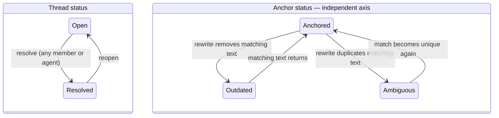
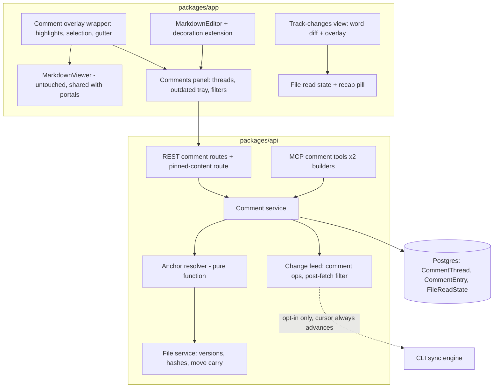
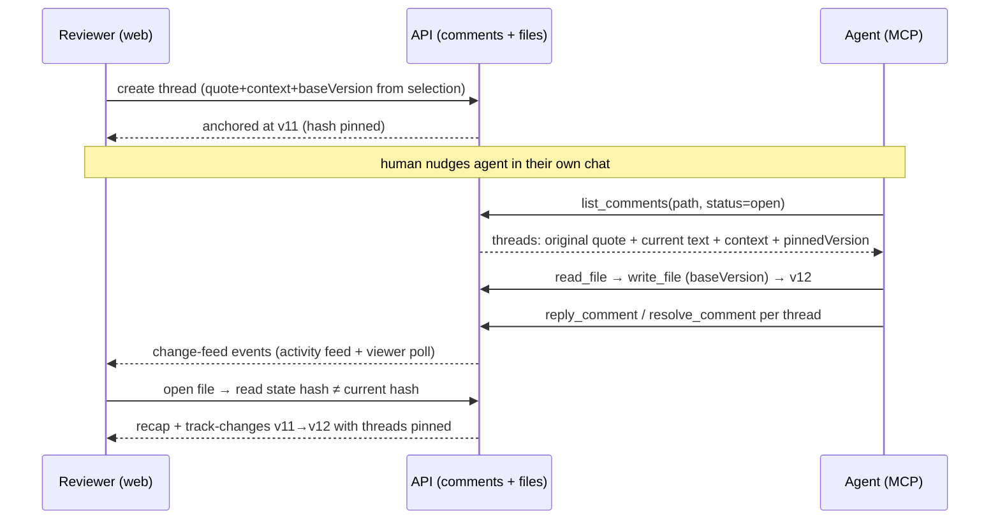

# Markdown File Comments - Plan

## Goal Capsule

- **Objective:** Reviewing an agent-written document happens on the document itself — a workspace member anchors feedback to specific text, the agent reads it, revises, replies, and the member can verify every thread was handled — replacing today's copy-paste-into-chat loop.
- **Means:** Server-side comment threads with quote+context anchors resolved by a matching cascade (KTD1), exposed to agents through four text-first MCP tools (KTD6).
- **Product authority:** this plan; `STRATEGY.md` for boundaries (notably: no CRDT/real-time co-editing).
- **Stop conditions:** stop and surface if the anchor cascade cannot reach reliable behavior on real documents (silent mis-anchoring is worse than outdated), or if comment change-feed emission cannot be kept off the CLI sync cursor safely.
- **Open blockers:** none.

---

## Product Contract

### Summary

Threaded, text-anchored comments on markdown files in the workspace web app, with agents as first-class participants via MCP and REST. A comment pins to the file version it was written on; after a rewrite, threads whose text no longer exists move to an "outdated" tray with a jump back to their original version, and a returning reader gets a track-changes-style "changes since you last looked" view with threads pinned to the text they discuss.

### Problem Frame

Today, reviewing an agent-authored doc means reading it in Treehouse, then switching to wherever the agent lives and copy-pasting passages to say "change this." The feedback loses its position in the document, nothing records which points were addressed, and the loop repeats every revision. This is the exact interaction the strategy's multi-principal-workspace metric depends on — humans and agents working on the same document — and it currently happens outside the product. Every's Proof editor (proofeditor.ai) validates demand for anchored human-agent document review as a product category.

### Key Decisions

- KD1. **Comments only in v1 — no suggestions, no authorship provenance.** (session-settled: user-approved — chosen over Proof's full comment/suggestion/provenance trio: the smallest build that kills the copy-paste loop; the other two layers are natural fast-follows.)
- KD2. **Comments are server-side data exposed via MCP and REST, not plain files in the workspace.** (session-settled: user-approved — chosen over sidecar comment files: clean anchoring, threading, and resolution beat folder visibility; no sync clutter or DIY conventions.) Governs R4, R5, R15, R16.
- KD3. **The v1 loop is human-nudged.** The reviewer tells their agent to address comments; Treehouse does not push or wake agents. (session-settled: user-approved — chosen over notification/webhook infra: matches how agents are actually run; change-feed events keep the door open for automation.) Governs R5, R13.
- KD4. **Any member or agent can resolve a thread.** (session-settled: user-directed — chosen over human-only resolution: a faster loop is worth more; safety comes from attribution, reopenability, and never deleting anything.) Governs R3.
- KD5. **Anchors are version-pinned: a comment records the exact version it was written against plus the quoted text and context, and re-attaches to newer versions by matching — never by trusting offsets against changed bytes.** Chosen over line-based anchors (prose reflows; the rendered view has no lines) and live position tracking (CRDT is out per `STRATEGY.md`). Follows the W3C Web Annotation selector model. Governs R6, R7, R8, R9, R17.
- KD6. **Change review is presented as track changes, never as a source diff.** (session-settled: user-directed — the user proposed a diff-based return view; the track-changes framing was chosen so non-technical readers get a familiar shape. A true source diff is a deferred power feature.) Governs R12.
- KD7. **Commenting is for workspace members and their agents only; share links neither display nor accept comments in v1.** (session-settled: user-approved — keeps internal review chatter off client-facing portals and avoids an anonymous-identity problem.)
- KD8. **The agent surface is text-first: threads are exchanged as quoted text plus surrounding context, never as line numbers or character positions.** (session-settled: user-directed — chosen over positional payloads so an agent can verify a comment's intent against its own copy of the file even when the document has drifted.) Governs R15, R16.

### Actors

- A1. **Reviewer** — a workspace member in the web app; comments, replies, resolves, reviews changes.
- A2. **Agent** — holder of a workspace-scoped API key, acting through MCP tools or REST; reads, replies, resolves, and revises the file with normal versioned writes.
- A3. **Other members** — see and join threads with near-live freshness via the app's polling.

### Requirements

**Commenting**

- R1. A member can select a text range, or use a deliberate point-comment affordance without a selection, in a markdown file's rendered view and start a comment thread there.
- R2. Threads support replies from members and agents; every entry carries the existing actor attribution (human vs agent, actor label).
- R3. Any member or agent can resolve or reopen a thread; both actions are attributed and stamped with the file version they happened at, and resolved threads remain viewable — no comment is ever deleted.
- R4. Agents have parity: everything a human can do with comments (list, read, create, reply, resolve, reopen) is available through MCP tools and REST endpoints scoped by the workspace API key.
- R5. The MCP server instructions teach the commenting conventions, so a nudge like "address my comments on X" needs no bespoke prompting.
- R15. A thread is created — by any client, human app or agent — by supplying quoted text, optional surrounding context, an occurrence disambiguator, and the version the quote was taken from; the server resolves the anchor and reports matched, ambiguous, or not-found — it never creates a silently mispositioned thread, and a failed create never loses the drafted comment.
- R16. Thread payloads returned to agents carry the original quoted text, the matching text as it exists in the current version (when the anchor resolves), the surrounding context, and the pinned version number (so an outdated thread can be recovered via a version read); cursor-point threads carry the context snippet around the point. Numeric character positions never appear in the agent surface.

**Anchoring and versions**

- R6. A comment records the file version it was written against, the quoted text (empty for cursor points), and enough surrounding context to re-locate it.
- R7. In the current version, threads re-attach by matching their quote and context; a confidently matched thread renders at that text.
- R8. A thread that cannot confidently re-attach is outdated: it leaves the document margin and appears in an outdated tray showing its original quote.
- R17. A thread whose quote now matches several locations equally well is ambiguous: it is presented with the outdated tray rather than guessed into a location.
- R9. From any thread, one action opens the version it was written on, read-only, with the thread rendered in place; when that version's content is no longer retrievable, the thread states so plainly and never renders its highlight over different bytes.
- R10. Threads follow the file through rename and move.

**Catching up**

- R11. A returning reader is shown what happened since their last visit to the file: new versions, new replies, resolutions, and newly outdated threads. A first-ever visit shows no recap, and a page refresh never discards a pending recap.
- R12. A "changes since you last looked" view renders the document with insertions and deletions in track-changes style and threads pinned to the text they were written on, with a single toggle back to the clean current view.
- R13. Comment activity (created, replied, resolved, reopened) emits change-feed events, appearing in the workspace activity feed with comment-specific icons and labels; sync-oriented feed consumers receive comment events only when they ask for them.

**File scope**

- R14. v1 covers markdown files in the rendered view only.

The two axes are independent: a resolved thread can be outdated or ambiguous, and an outdated thread can still be replied to and resolved.

### Key Flows

- F1. **The review loop**
  - **Trigger:** An agent has written or revised a doc; the reviewer reads it in the web app.
  - **Actors:** A1, A2.
  - **Steps:** Reviewer highlights passages (or uses the point-comment affordance) and comments. In their own agent surface, they say "address my comments on launch-plan.md." The agent lists open threads via MCP, revises the file with a normal versioned write, replies to each thread, and resolves the ones it believes are fixed. The reviewer returns, sees the since-last-visit recap, opens the track-changes view, verifies each change against its thread, and reopens or adds comments where needed.
  - **Covers:** R1–R5, R11–R13, R16.
- F2. **A rewrite orphans a thread**
  - **Trigger:** A write replaces text that an open thread was anchored to.
  - **Steps:** The thread stops rendering inline and appears in the outdated tray with its original quote. The reviewer (or agent) opens it in its original version to recover full context, and can still reply, resolve, or reopen it.
  - **Covers:** R6–R9, R17.
- F3. **A second member joins**
  - **Trigger:** Another member opens the same file while a thread is active.
  - **Steps:** They see existing threads, and new activity appears within the polling cadence; they reply or resolve like any member. A thread whose state changes while they have it focused updates in place — it never relocates under them, and an unsent reply draft survives.
  - **Covers:** R2, R3, R13.

### Acceptance Examples

- AE1. **Covers R6, R7, R8.** Given a thread anchored to "September 12th" in v11, when v12 replaces that phrase, then the thread no longer renders inline and sits in the outdated tray showing the quote "September 12th".
- AE2. **Covers R9.** Given the AE1 thread, when the reviewer opens its original version, then v11 renders read-only with the highlight on "September 12th" and the thread beside it.
- AE3. **Covers R2, R3, R4, R16.** Given an agent holding the workspace's API key, when it lists open threads, then each payload carries the original quote, the current-version matching text, context, and the pinned version number; when it replies "reworded in v12" and resolves one, both actions succeed via MCP and each is attributed as the agent with its key label.
- AE4. **Covers R11, R12.** Given a reviewer whose file read state predates v12, when they reopen the file after the agent's pass, then they are told what changed since their last visit, and the track-changes view shows the v11→v12 edits with threads pinned to the text they discussed.
- AE5. **Covers R1, R6, R16.** Given a point comment created without a selection, then the thread anchors to that position via surrounding context, renders as a point marker, and its agent payload carries the text around the point.
- AE6. **Covers R13.** Given a member creates a comment, then a change-feed event appears in the workspace activity feed attributed to that member — and a sync client polling the change cursor without opting in never receives it, while its cursor still advances past the event.
- AE7. **Covers KD7.** Given a public share link to a commented file, when a viewer opens it, then no comments and no comment UI are present — structurally: the shared viewer component contains no comment code.
- AE8. **Covers R15, R17.** Given a client submits a new comment quoting text that appears three times in the file without disambiguating context, then no thread is created at a guessed location; the response reports the ambiguity so the client can retry with an occurrence index or more context, and in the web app the drafted comment text is retained through the failure.

### Success Criteria

- The team's own agent-doc review loops move from copy-paste-into-chat to comments — the dogfood signal this feature exists for.
- Comment events flow through the change feed, making human-agent collaboration visible in the activity feed and the multi-principal workspace metric.
- A stock agent connected only to the MCP server — with no bespoke prompt beyond a nudge — can find, address, reply to, and resolve comments.

### Scope Boundaries

**Deferred for later**

- Track-changes suggestions (agent proposes, human accepts before the write lands) and per-character authorship provenance — Proof's other two layers.
- Viewer/portal comment visibility and client commenting on share links.
- Comment visibility for agents working only on a synced local folder (no sidecar files in v1).
- Non-markdown files and source-mode commenting (the source toggle hides highlights; the panel stays).
- Push/webhook notification of agents when comments arrive.
- A true source-diff view as a power-user complement to track changes.
- Workspace-wide comment search, mentions, assignment, per-thread unread indicators, and editing of comment bodies (v1 bodies are plain text and immutable).
- Comment affordances on folder default pages (a commented README viewed as a folder front page shows no comment UI in v1).

**Deferred to Follow-Up Work**

- `NodeMeta` and `Share` rows are orphaned by a file move today (`NodeAcl` is already carried in the move transaction). This plan adds path-carry for comment threads only; retrofitting the other two is a separate fix.
- Comment events on the sync cursor for sync-aware clients (new CLI versions could surface comments locally) — excluded in v1 per KTD5.
- Aligning the History tab's raw-text version sheet with the rendered original-version view U7 introduces.

**Outside this product's identity**

- CRDT/operational-transform real-time co-editing (per `STRATEGY.md`).

### Dependencies / Assumptions

Verified against source:

- Change feed with monotonic `seq` cursor and actor attribution: `packages/db/prisma/schema.prisma` (ChangeEvent), `packages/api/server/routes/api/workspaces/[workspaceId]/changes.get.ts`. Two cursor modes (`sinceSeq` for sync, time-windowed for the activity panel); ACL filtering is applied **post-fetch** and `nextSeq` is the last _scanned_ seq, so filtered-out events still advance the cursor.
- App polling reality: `useChangeFeedPoll` (~5s) runs **only while editing** (instantiated in `useFileEditor`); the always-on poller is `useActivityFeed` at 15s, workspace-wide, using a windowed descending query with no cursor. The reading view does no polling today and caches file bytes with infinite staleness.
- Per-user workspace watermark: WorkspaceReadState plus `read-state.get.ts` / `read-state.put.ts` (PUT is session-only via `requireCookieUser`; advance is a monotonic CAS).
- Immutable, content-addressed versions: FileNode `contentHash`/`blobKey`, `blobKeyFor(workspaceId, hash)` (blobs are shared per content across a workspace, unreference-counted; no GC or blob deletion exists today). `readVersion` resolves a version _number_ via the change feed; `readByHash` exists but performs **no ACL gate** (its only caller is the token-gated share route).
- `move()` runs in a single `$transaction` covering node create/delete, the `NodeAcl` delete+upsert carry, and both change events; it recreates the destination at `version: 1`, and its unique-violation catch reports any P2002 as `dest_exists`. Folder moves are N independent per-file moves.
- Rendered markdown views: reading uses `viewers/MarkdownViewer.vue` (marked + DOMPurify into `v-html`, front matter peeled into a separate card, left-clicks intercepted for internal navigation) — also used by the share/portal page with no workspace props; editing uses tiptap 3.26 (`addProseMirrorPlugins` decorations only; `editable: false` still renders decorations; markdown round-trips are not byte-stable).
- Share routes are read-only; API keys carry `workspaceId` + `actorType`; every MCP tool is registered twice (workspace-scoped and user-scoped builders); no MCP change-feed tool exists (the REST route is reachable with an API key).
- Migrations ship via `prisma migrate deploy` as the Railway pre-deploy step.

Constraints and assumptions:

- Old CLI binaries interpret a change event with a null version as a remote deletion (`packages/cli/src/engine.ts` drain loop), and the CLI busy-loops without sleeping while `nextSeq < head` — both constrain KTD5's mechanism and rollout.
- The Treehouse Prisma models are hand-maintained below the auth boundary in `schema.prisma`; `auth:generate` must never be re-run, and no relation field may be added to the auth-owned models (`User` etc.) — actor/user columns stay loose like `ChangeEvent.actorId`.
- Blob retention: the GC root set for a workspace's blobs becomes `FileNode.contentHash ∪ Share.pinnedContentHash ∪ CommentThread.pinnedContentHash ∪ FileReadState.lastSeenContentHash` — recorded so a future GC cannot silently break comment permalinks. Pinned bytes are invisible to the storage quota; accepted v1 cost.
- Assumption: polling cadences (5s while a file is open, 15s workspace-wide) are fresh enough "multiplayer" for v1; no new realtime transport.

### Open Questions

**Deferred to implementation** (non-blocking; defaults stated)

- Fuzzy-match confidence thresholds and context-window sizes are tuned during U2 against real documents; defaults start stricter than library defaults per KTD1.
- Whether agents ever need a hash-addressed version read; default: no — R16's pinned version number plus the existing version-read tool suffices (KTD6).

### Sources / Research

- Proof by Every — the interaction model this borrows from: https://proofeditor.ai/ and https://every.to/on-every/introducing-proof (comments + suggestions + provenance; v1 takes comments only).
- W3C Web Annotation Data Model (TextQuoteSelector + TextPositionSelector, `refinedBy`): https://www.w3.org/TR/annotation-model/
- Hypothesis fuzzy anchoring — the four-tier cascade and its production pitfalls (short/generic quotes froze pages; bound the search window): https://web.hypothes.is/blog/fuzzy-anchoring/ and hypothesis/client issue #3919.
- diff-match-patch `match_main` semantics (`Match_Threshold`, `Match_Distance`); maintained TS forks: `@sanity/diff-match-patch`, `diff-match-patch-ts`, `diff-match-patch-es`. Word-level diffing: the `diff` npm package (kpdecker/jsdiff — not the stale npm package literally named `jsdiff`).
- `docs/solutions/architecture-patterns/public-share-trust-boundary.md` — structural template: hand-maintained schema section, workspace-scoped route shape, server-derived version/hash resolution (never trust client-supplied), session-vs-key gating, and the 410-on-missing-pinned-content precedent.
- `STRATEGY.md` — multi-principal metric, agent design test, CRDT exclusion. `docs/plans/2026-06-13-001-feat-activity-feed-plan.md` — clustering/unread patterns. `docs/plans/2026-06-08-001-feat-web-file-editing-and-ops-plan.md` — the editor surface.

---

## Planning Contract

Product Contract preservation: extended, session-confirmed — added R15–R17 and KD8; R15 extended to cover the web client (base version + draft retention) after flow analysis; R9, R11, R13, R16 gained qualifiers from deepening findings (pinned-content unavailability, recap timing, feed rendering, pinned version in payloads); added AE8 draft-retention and AE6/AE7 sharpenings. No existing R-ID changed meaning.

### Key Technical Decisions

- KTD1. **Server-side anchor resolution with a Hypothesis-style cascade, as a pure function.** One resolver module owns all anchor matching for every client (web and agent submissions both go through it — the mechanism instantiating KD8/R15). Anchors store the quote and ~64 chars of context each side as raw-markdown substrings, plus a normalized form (whitespace-collapsed, NFC) for matching, plus source offsets recorded at creation. Resolution cascade against a target version's raw markdown: (1) offset verify (exact bytes at the originally recorded range), (2) context-assisted exact search, (3) context-first fuzzy — locate prefix and suffix independently near the hinted position, score the span between, (4) quote-only fuzzy, window-bounded. Below the confidence floor → outdated; multiple equal matches → ambiguous (R17). Quotes under a minimum length skip fuzzy stages entirely; point anchors are context-only with a wider window and stricter acceptance. Fuzzy matching uses a maintained diff-match-patch TS fork with a stricter-than-default threshold; never an unbounded full-document scan. **Purity invariant: `resolve(anchor, content)` is deterministic given the anchor's original recorded fields and the content alone — previously resolved ranges are never fed back as hints and never bias fuzzy scoring** (prevents silent anchor drift by accumulation). The resolver is handed `(anchor, markdown, hashOfThatMarkdown)` as one unit and results are stamped with that hash. Cites KD5; governs the mechanism behind R6–R9, R15, R17.
- KTD2. **Durable pin is the content hash; the version number is display and recovery metadata.** (session-settled: user-approved — surfaced against `(path, version)` pinning: move resets versions to 1 and numbers are reused after delete/resurrect, so version-pinned anchors can open the wrong bytes.) Threads store `pinnedContentHash` + `pinnedVersion`; R9 resolves content by hash through a **thread-scoped route** that reads the hash from the thread row and ACL-gates on the thread's current path before calling the hash read (the raw hash read has no gate of its own; no route ever accepts a content hash from a client). Pinned content that is gone returns a terminal Gone response — mirroring the share version-permalink precedent, never a retryable error and **never a fallback to current-version bytes**. Version/hash are always resolved server-side from the file service.
- KTD3. **Two thin display adapters over one matcher; the default reader is not swapped and not touched.** (session-settled: user-approved — chosen over converting the reading view to a read-only tiptap instance.) The comment overlay (highlight painting via DOM-Range + CSS Custom Highlight, selection capture, click hit-testing) lives in a **wrapper component at the authenticated call site** — `MarkdownViewer.vue` itself imports nothing from the comments module, so portal/share safety is structural (AE7), not a prop gate. The editor gets a tiptap Extension using `addProseMirrorPlugins` + `DecorationSet` (inline decorations for ranges, widgets for points; `spec` carries the thread id; updates via meta transactions; `DecorationSet.map` across keystrokes). Server state is shared through one query key per (workspace, path); **interaction state (active thread, pending draft, tray selection) is lifted to the workspace view level** — the viewer, editor, panel, and track-changes view are sibling components and edit-toggling destroys the viewer, so per-call-site composable state would diverge.
- KTD4. **Data model: anchor on the thread, flat replies, independent state axes.** `CommentThread` carries the anchor (kind range|point, quote, contexts, pinned hash/version, original source offsets), `resolvedAt`/resolver-actor/`resolvedAtVersion` (R3's stamp — the UI marks a resolution whose version equals the thread's creation version as "resolved without changes"), and a per-hash resolution cache (`lastResolvedHash`, resolved range, `anchorStatus`). Cache invariants: valid only for exactly `lastResolvedHash`, compared by hash and never by version number; written best-effort on read paths as a compare-and-set guarded on the hash it was computed from, outside any mutation transaction, emitting no event; **nulling every cache column changes no API output, only latency** — that is the rollback lever for bad resolver tuning. `CommentEntry` rows are flat replies with actor attribution and an optional `dedupeKey` enforced by a database unique constraint on `(threadId, dedupeKey)` (nullable; a unique-violation retry returns the existing entry as success and emits no second event — the check-then-insert race is documented in this schema's own Member model). One committed state change ⟺ exactly one change event, for create/reply/resolve/reopen alike. A conflicted copy is a new path with zero threads. No delete surface exists anywhere (R3). Models live below the hand-maintained boundary, keyed `(workspaceId, path)`.
- KTD5. **Comment events ride the change feed but never the sync cursor uninvited — filtered post-fetch, shipped ahead.** (session-settled: user-approved — old CLIs read null-version events as remote deletions; a comment must never delete a local file.) New ops `comment_created`/`comment_replied`/`comment_resolved`/`comment_reopened` are written in the same transaction as the mutation (the `recordChange` pattern), with full actor attribution and null version. The exclusion in `changes.get.ts` is a **post-fetch filter alongside the existing ACL filter — never a SQL where-clause** — so `nextSeq` still advances over scanned comment events; a where-clause would strand non-opted clients below `head` and the CLI poll loop, which does not sleep while behind, would spin at full speed. **Rollout sequencing: the exclusion filter deploys before any code that emits comment events** (an API rollback past the filter commit would re-expose null-version events to fielded CLIs; record "no rollback past that commit" in the deploy notes). Opt-in is an explicit request parameter used only by new/opted client methods with distinct query cache keys — the History tab and share-dialog queries share today's key and must not opt in. Governs the mechanism behind R13.
- KTD6. **Four MCP tools, text-first, registered in both server builders.** `list_comments` (path, optional thread id, status/anchor-status/author filters, paging — doubles as read-thread), `add_comment` (quote + contexts + occurrence + base version → anchored create per R15), `reply_comment` (separate from create because anchor failure modes only exist on create; dedupe key documented as expected, not optional), `resolve_comment` (boolean resolved covers resolve and reopen, idempotent — precedent: `set_private`). Payloads follow KD8/R16 including `pinnedVersion`, so an agent's recovery move for an outdated thread is the existing version-read tool — no hash-addressed agent read in v1. Anchor mismatches and stale-state conflicts return structured data with `ok: false` (the `write_file` conflict pattern); tool errors are reserved for not-found/forbidden. Listings are capped and paged like `list_files`, with per-thread reply caps ("N more" marker) that also bound unbounded reply growth. `SERVER_INSTRUCTIONS` gains a short review-loop paragraph (list → read noting version → write with baseVersion → reply → resolve only what you addressed; "don't resolve what you didn't fix — reply instead") and its "everything is a plain-file operation" closing line is corrected.
- KTD7. **Per-file read state is a new small model with hash-keyed semantics.** (session-settled: user-approved — the workspace-wide watermark cannot say which version of this file the user last saw.) `FileReadState` per (user, workspace, path) stores `lastSeenSeq` + `lastSeenVersion` + `lastSeenContentHash`, written together in one statement (the version/hash are the snapshot observed at that seq). Advance is monotonic **on seq only** — never on version, which legitimately resets on move/resurrect. The recap trigger compares content hashes, never version numbers; the track-changes base is fetched **by `lastSeenContentHash`** through an ACL-gated read, and when that hash is not in the current path's history the view degrades to first-visit rather than diffing (a stale row plus version-number reuse would otherwise diff an unrelated document). First-ever visit (no row): seed silently at current, show no recap. The write fires on navigate-away or recap dismissal — never on mount, so a refresh preserves a pending recap (precedent: the activity glance "never advances the watermark"). Session-only PUT; agents get no read state — their catch-up is `list_comments` filters. Rows are not carried on move (accepted staleness; the hash-keyed base makes it safe).
- KTD8. **Track-changes view is plain Vue over a word-level diff, not a tiptap document.** (Mechanism for KD6/R12.) Base = last-seen content fetched by hash per KTD7; target = current version. Compute with the `diff` package's word-level diff on the markdown body (front matter split off; front-matter-only or identical-hash cases render as "no visible changes"), render insertions/deletions as styled spans in a read-only Vue view, overlay comment markers with the same KTD3 adapter. New dependency `diff` in `packages/app` (pure JS, Workers-bundle safe); the diff-match-patch fork lands in `packages/api` only.
- KTD9. **`move()` carries comment threads inline in its existing transaction.** The carry is a direct thread-path update executed inside `move()`'s current `$transaction` — plain data access, no import from the comments module (the repo has already extracted `paths.ts` to break exactly this class of cycle), mirroring the `NodeAcl` delete+upsert carry that already lives there. Constraints: `CommentThread` carries **no unique constraint that includes `path`** (the move's unique-violation catch reports any violation as destination-exists and would silently roll back a legitimate move), and lock ordering is fixed — transactions touch `file_node` before `comment_thread`, and comment transactions never take locks on `file_node`. Folder moves remain N per-file moves; the thread-follows-file invariant is guaranteed per file, not per folder. On file delete, threads persist untouched (reachable via API; the app has no screen for them — accepted) and reappear if the path is recreated; R9 keeps working throughout via the hash pin (KTD2).
- KTD10. **Web comment creation is version-stated and draft-preserving.** The reading view knows which version its rendered DOM came from and sends that base version + hash with every create (the same contract R15 gives agents — the server anchors against the stated version, then re-anchors forward to current; meaning-changing drift returns a conflict shape, never a guess). Because the reading view never refreshes today, the comment wrapper adds viewer-scoped change polling (opted into comment events) with a non-blocking "this file changed — reload" banner, reusing the editor's collision-banner posture. Anchor failure (ambiguous/not-found — common when a selection crosses bold/link syntax that doesn't exist contiguously in raw markdown) keeps the drafted comment in an inline banner with retry and a select-again hint; the draft is never discarded (the repo's never-lose-user-bytes invariant). Point comments use a deliberate per-block gutter affordance, not bare collapsed clicks (which collide with link navigation and don't exist on touch).

### High-Level Technical Design

Component shape — one resolver, two display adapters, two protocol surfaces:

The review loop as a sequence (directional):

### Sequencing

The `changes.get.ts` post-fetch exclusion (KTD5) ships in a deploy **before** any event-emitting code. Then U1 → U2 → U3 → U4 (server complete) while U5 can start against U3; U6 and U7 follow U5. KTD2's hash-pin decision precedes U1 (it shapes columns).

---

## Implementation Units

### U1. Comment and read-state schema

- **Goal:** `CommentThread`, `CommentEntry`, and `FileReadState` models exist with a deployable migration.
- **Requirements:** R2, R3, R6, R10, R11; KTD2, KTD4, KTD7, KTD9.
- **Dependencies:** none.
- **Files:** `packages/db/prisma/schema.prisma`, new migration under `packages/db/prisma/migrations/`.
- **Approach:**
  - Add models below the hand-maintained boundary comment (never run `auth:generate`); `@default(uuid())` ids, `@@map` snake_case tables, keyed `(workspaceId, path)` with `@@index([workspaceId, path])` — the index is load-bearing for move-carry latency inside `move()`'s interactive transaction, not just listing.
  - Add the required back-relation array fields to the `Workspace` model (hand-maintained section) with `onDelete: Cascade`; `CommentEntry` cascades from its thread so workspace deletion succeeds. **No relation fields on auth-owned models** — `FileReadState.userId` and all actor columns stay loose like `ChangeEvent.actorId`.
  - `CommentThread`: no unique constraint including `path` (KTD9); GC-root comments beside `pinnedContentHash` (and beside `FileReadState.lastSeenContentHash`) naming the blob-retention invariant.
  - `CommentEntry`: `@@unique([threadId, dedupeKey])` with nullable `dedupeKey` (KTD4).
  - Actor attribution columns mirror `ChangeEvent` on thread, entry, and resolution; `FileReadState` mirrors `WorkspaceReadState` with `@@unique([userId, workspaceId, path])`.
  - Migration is additive-only (three CREATE TABLEs; `ChangeEvent.op` is a free string — new ops need no migration). Create with the create-only script for review, apply with `prisma:migrate`.
- **Patterns to follow:** `Share` and `WorkspaceReadState` models; the `Member` model's comment documenting why uniqueness must live in the database.
- **Test scenarios:** Test expectation: none — schema-only; constraints are exercised by U3 service tests (including the workspace-delete cascade and concurrent-dedupe scenarios there).
- **Verification:** migration applies cleanly to a fresh dev database; `vp check` passes with the regenerated Prisma client.

### U2. Anchor resolution engine

- **Goal:** A pure, fully unit-tested module resolves anchors against any version's raw markdown per KTD1.
- **Requirements:** R6, R7, R8, R15, R17; KTD1.
- **Dependencies:** none (parallel with U1).
- **Files:** `packages/api/server/utils/anchoring.ts`, `packages/api/test/anchoring.test.ts`; add the chosen diff-match-patch TS fork to `packages/api/package.json`.
- **Approach:**
  - Implement normalization (whitespace collapse, NFC) and the four-stage cascade with confidence scoring, window-bounded fuzzy search, minimum-quote-length gate, occurrence disambiguation, and point-anchor context-only matching, per KTD1.
  - Signature takes the anchor's original recorded fields plus `(markdown, contentHash)`; returns `{status: anchored|ambiguous|outdated, range?, currentText?, confidence, resolvedForHash}`. No database or file-service coupling.
- **Execution note:** Implement test-first — the cascade is judgment-heavy and the scenario list below is the specification.
- **Test scenarios:**
  - Covers AE1. Quote removed in new version → outdated.
  - Exact offset verify on the pinned version returns anchored with confidence 1.
  - Text moved wholesale to another part of the doc → context-assisted match finds it.
  - Small in-quote edit (typo fix inside the quoted span) → context-first fuzzy matches with reduced confidence.
  - Covers AE8. Quote duplicated (3×, no distinguishing context) → ambiguous with candidate ranges.
  - Duplicate quote but unique context → anchored at the correct occurrence; occurrence index selects among true duplicates.
  - Short quote (< minimum) with intact context → resolved via context; with changed context → outdated, and no fuzzy scan runs.
  - Whitespace-only reflow and unicode normalization differences still match exactly after normalization.
  - Quote spanning markdown syntax (`**bold**` boundary) matches when the raw source contains syntax characters the normalized quote omits.
  - Point anchor: unchanged context → anchored; context duplicated across list items → ambiguous, never first-match.
  - **Determinism property:** resolving the same anchor against the same content repeatedly, and regardless of any prior resolution results, yields identical output (purity invariant).
  - **Drift property:** across 20 sequential small edits, the final resolved range still contains the original quote, or the thread is outdated — never confidently attached elsewhere.
  - Empty document / empty quote / quote longer than document → outdated without throwing.
- **Verification:** `vp test` green on the new suite; scenario names map to the list above.

### U3. Comment service, REST routes, and feed safety

- **Goal:** Full comment CRUD (minus delete — none exists) over REST with ACL parity, change-feed emission, cursor safety, pinned-content reads, and move carry.
- **Requirements:** R1–R4, R9, R10, R13, R15, R16; KTD2, KTD4, KTD5, KTD9, KTD10 (server side).
- **Dependencies:** U1, U2.
- **Files:** `packages/api/server/utils/comments.ts`; new routes under `packages/api/server/routes/api/workspaces/[workspaceId]/` (`comments.get.ts`, `comments.post.ts`, `comments/[threadId]/replies.post.ts`, `comments/[threadId]/resolved.put.ts`, `comments/[threadId]/pinned-content.get.ts`); edits to `changes.get.ts`, `files.ts` (`move()`); tests `packages/api/test/comments-routes.test.ts`, extend `packages/api/test/cli-sync.test.ts`.
- **Approach:**
  1. Service owns create/list/reply/resolve with anchor resolution via U2, server-derived version/hash (KTD2), and same-transaction event emission (KTD5). Create accepts the client-stated base version (R15/KTD10): anchor against that version, re-anchor forward to current, return conflict data on meaning-changing drift.
  2. Resolution cache per KTD4: best-effort hash-guarded compare-and-set on read paths, outside mutation transactions (precedent: `advanceReadState` and the write CAS); comment transactions never lock `file_node` (KTD9 lock order).
  3. `changes.get.ts`: comment ops filtered **post-fetch alongside the ACL filter** (KTD5) behind the include param; `nextSeq` semantics untouched.
  4. `pinned-content.get.ts`: reads the hash from the thread row, gates on the thread's current path via the ACL helpers, then hash-reads; missing blob → terminal Gone (KTD2).
  5. `move()` carries thread paths inline via a direct update in the existing transaction, next to the `NodeAcl` carry (KTD9).
  - Routes follow `fileRoute` + `requireWorkspaceFromRoute` + `actorFor`; fail-as-404 ACL convention; structured `{error}` discriminator shapes; BigInt seq → `Number` at the boundary.
- **Patterns to follow:** `shares.ts` service seam (consumed by REST and both MCP builders); `shares.post.ts` route shape; `recordChange` in `files.ts`; the share route's 410 for missing pinned content.
- **Test scenarios:**
  - Covers AE1/AE2. Create at v11, rewrite to v12 → list shows outdated with original quote; pinned content readable by hash after a later move (version reset does not break R9).
  - Covers AE8. Ambiguous create returns the structured ambiguity payload; no row created. Create with a stale base version whose text moved meaningfully → conflict shape, no guess.
  - Covers AE6. Thread create emits an attributed event visible to the activity query; a sync-cursor poll without the include param returns no comment events **and a poll whose window contains only comment events still returns `nextSeq === head`**; seed several hundred comment events and assert a non-opted client reaches head in bounded polls.
  - Reply and resolve stamp actor + version; double-resolve is idempotent (single event per state change); reopen works; **concurrent** duplicate replies with the same dedupe key insert once and emit one event (sequential passes on broken check-then-insert — run them racing).
  - Concurrent `move(A)` and `reply(thread on A)` → no deadlock, thread ends at exactly one path (KTD9 lock order).
  - Move a commented file → threads follow with anchors intact; delete → threads listable; recreate → re-anchor against new content; delete a seeded workspace with threads/entries → cascade succeeds.
  - Pinned blob absent from the store → thread still lists, accepts replies/resolve; pinned-content route returns Gone; no highlight painted from current content.
  - Resolution-cache: responses with a cold, stale, and nulled cache are byte-identical (rollback lever); cache never serves a range for a hash other than the current one.
  - A conflicted-copy save leaves zero threads on the copy path; the original path's threads are untouched.
  - ACL: a thread on a private path is 404 for a non-reader — including its pinned-content route — and its events are filtered from that user's feed.
  - Session vs key: all four operations succeed with both auth modes, correctly attributed.
- **Verification:** integration suite green against a running dev API (`pnpm dev:api`); CLI regression asserts a comment event never yields a delete hint and never stalls the cursor.

### U4. MCP tools and server instructions

- **Goal:** Agents have full text-first comment parity via MCP, taught by the server instructions.
- **Requirements:** R4, R5, R15, R16; KTD6.
- **Dependencies:** U3.
- **Files:** `packages/api/server/utils/mcp.ts` (both builders + `SERVER_INSTRUCTIONS`), `packages/api/test/mcp.test.ts`.
- **Approach:** register the four KTD6 tools in `buildMcpServer` and `buildUserMcpServer` (workspaceId closed-over vs explicit, matching every existing tool pair), reusing the U3 service; `guard`/`ok`/`okData` conventions; paging like `list_files` plus per-thread reply caps; conflicts as `okData` with `ok: false`; payloads include `pinnedVersion` (R16); instruction edits per KTD6, kept to a few sentences.
- **Test scenarios:**
  - Covers AE3. E2E MCP client session: human-created thread via REST → agent lists (payload has original quote + current text + context + pinned version, no numeric positions), replies, resolves; attribution asserts `principal: "agent"` + key label.
  - Covers AE5. Point-thread payload carries the surrounding context snippet.
  - Outdated-thread recovery: agent reads the pinned version via the existing version-read tool using the payload's `pinnedVersion`.
  - `add_comment` with stale base version or unmatched quote returns structured non-error data.
  - Parity matrix: comment MCP tools correspond to REST comment operations, in both builders.
  - Listing caps: a thread with many replies returns capped entries plus a "more" marker.
- **Verification:** `mcp.test.ts` e2e green against the dev server; a cold-agent scripted session driven only by `SERVER_INSTRUCTIONS` performs list → read → write → reply → resolve in order.

### U5. Reading-view commenting UI

- **Goal:** A member can highlight or point-comment in the rendered view, see threads in a panel with an outdated tray, and get near-live updates — without touching the portal-shared viewer.
- **Requirements:** R1, R2, R3, R7, R8, R17, R14; KD7; KTD3, KTD10.
- **Dependencies:** U3.
- **Files:** new `packages/app/app/components/CommentedMarkdownViewer.vue` (wrapper), `CommentsPanel.vue`, `composables/useComments.ts`, `utils/commentHighlights.ts`; edits to `FileViewer.vue` (mount the wrapper at the authenticated call site), `FileInfoPanel.vue` (comments tab), `WorkspaceView.vue` (lifted interaction state), `useTreehouseApi.ts` (new endpoints + opted feed methods with distinct query keys), `utils/activity.ts` + `OpGlyph.vue` + `ChangeEventRow.vue` (icons/labels/colors for the four comment ops); test `packages/app/test/commentHighlights.test.ts`.
- **Approach:**
  1. Overlay lives in the wrapper per KTD3 — `MarkdownViewer.vue` is not edited and imports nothing from the comments module.
  2. Create flow per KTD10: selection capture derives text + context + the viewed version; failure keeps the draft in an inline banner with retry; point comments via a per-block gutter affordance.
  3. Viewer-scoped change polling (comment events included) with a "file changed — reload" banner; note `useChangeFeedPoll` seeds its head at start and is editor-scoped today — the viewer instance is a documented second call site.
  4. Thread server state under one query key per (workspace, path); interaction state (active thread, draft, tray selection) provided from `WorkspaceView` so viewer/editor/panel/track-changes share it.
  5. Panel: comments tab beside info/history/share following the segmented-tab pattern; open list, resolved filter, outdated/ambiguous tray with original quotes; reply/resolve/reopen inline; a resolution stamped at the thread's creation version renders a "resolved without changes" hint (KTD4). A focused thread never relocates mid-interaction; state changes render in place and drafts survive (F3).
  6. Activity feed rendering: icons, labels, and colors for the four ops so R13's "appearing in the activity feed" is real, not a fallback glyph.
- **Patterns to follow:** `FileInfoPanel.vue` tab markup and badge counts; `useWorkspaceMembers` query-key sharing; `ConflictBanner`'s non-blocking posture; `--th-*` theme tokens.
- **Test scenarios:**
  - Pure-util tests: rendered-DOM text location for a known quote (including across inline formatting), context extraction around a selection, point-marker placement.
  - Panel state: open/resolved/outdated bucketing; "resolved without changes" hint condition.
  - Covers AE7 structurally: `MarkdownViewer.vue` has no import from the comments module (assert via a static check), and the share page renders a commented file without comment UI.
  - Interaction state: toggle edit mode with a thread open → the same thread stays selected.
  - Thread state change while its composer holds text → in-place update, draft intact.
- **Verification:** drive the flow in a real browser (agent-browser): create range + point comments, trigger an anchor failure (selection across bold) and confirm the draft survives with a helpful message, reply, resolve, watch a second session pick changes up within a poll cycle; screenshot the panel, tray, and activity feed rows.

### U6. Edit-mode decorations

- **Goal:** Threads stay visible and clickable while editing in tiptap, tracking positions across keystrokes, without pretending the dirty buffer is anchorable.
- **Requirements:** R1 (display side), R7; KTD3.
- **Dependencies:** U5.
- **Files:** new `packages/app/app/components/editors/commentAnchors.ts`; edits to `editors/MarkdownEditor.vue`, `FileEditor.vue`.
- **Approach:** tiptap `Extension.create` + `addProseMirrorPlugins` plugin holding a `DecorationSet` (inline decorations for ranges mapped from resolved anchors via the doc's text content, widgets for points), `spec.threadId` for identity, `props.handleClick` to open the panel thread, meta-transaction updates, `DecorationSet.map` across edits. Comment **creation is disabled while the buffer is dirty** (hint: "save to comment on this text"); reply/resolve stay enabled; decorations de-emphasize once dirty with a "positions are from the last saved version" note. A save that loses the CAS race puts bytes in a conflict copy — comments stay on the original path (KTD4); no banner copy change. Anchors re-resolve on save through the normal server path.
- **Test scenarios:**
  - Text-content offset → ProseMirror position mapping across block boundaries and inline marks (pure util test).
  - Decoration survives typing before/inside the highlighted range.
  - Create affordance disabled when dirty; enabled after save.
- **Verification:** in the browser: highlights persist in edit mode, click opens the thread, dirty-state de-emphasis appears, saving re-anchors.

### U7. Catch-up: read state, recap, and track-changes view

- **Goal:** Returning to a changed file shows what happened and a familiar track-changes rendering with threads pinned — correct on first visits, refreshes, moves, and recreated paths.
- **Requirements:** R9, R11, R12; KTD7, KTD8.
- **Dependencies:** U3, U5.
- **Files:** new routes `packages/api/server/routes/api/workspaces/[workspaceId]/file-read-state.get.ts` / `.put.ts`; new `packages/app/app/components/TrackChangesView.vue`, `utils/trackChanges.ts`; edits to `WorkspaceView.vue` (recap pill + view toggle), `FileInfoPanel.vue` (thread "view on original version" action via the pinned-content route); add `diff` to `packages/app/package.json`; test `packages/app/test/trackChanges.test.ts`.
- **Approach:**
  1. Read-state routes mirror `read-state` conventions (session-only PUT; monotonic on seq; version+hash written in the same statement per KTD7).
  2. Recap fires on content-hash mismatch only; first visit seeds silently with no recap; the watermark writes on navigate-away or recap dismissal, never on mount.
  3. Track-changes base fetched by `lastSeenContentHash` (ACL-gated); hash absent from the path's history → first-visit degrade; identical hash across differing version numbers or front-matter-only change → "no visible changes".
  4. Word-diff + render per KTD8, comment overlay via the U5 util against whichever side each anchor resolves on.
  5. "View on original version" renders the pinned content (thread-scoped route) through the standard viewer with the stored range highlighted; unavailable content shows "This version is no longer available" with the quote still visible (R9).
- **Test scenarios:**
  - Covers AE4. Stored read state at v11-hash, current v12 → recap summarizes the delta; track-changes marks edits with threads pinned.
  - First visit (no row) → no recap, row seeded; refresh before dismissal → recap still present.
  - Delete a commented file, recreate different content at the same path with a stale read-state row → "first visit", no diff of the stranger document; same for move-then-recreate.
  - Revert case: differing version numbers, identical hash → "no visible changes".
  - Word-diff util: replacement, insertion-only, deletion-only, front-matter-only; large rewrite renders without hang.
  - Covers AE2. Original-version rendering highlights the stored range; unavailable pinned content → the R9 message, never current bytes.
  - Read-state routes: PUT requires a session; monotonic-on-seq (a lower seq never regresses the row; a moved file's v1 does not suppress the recap).
- **Verification:** in the browser, run the full F1 loop end-to-end with a real agent pass (nudge Claude Code via MCP against the dev workspace), return as the reviewer, and screenshot the recap and track-changes view — this is the plan's overall acceptance walkthrough.

---

## Verification Contract

| Check                    | Command / method                                   | Proves                                                                                                                                         |
| ------------------------ | -------------------------------------------------- | ---------------------------------------------------------------------------------------------------------------------------------------------- |
| Types, lint, build       | `vp check`                                         | whole-monorepo consistency incl. new Prisma client                                                                                             |
| Unit suites              | `vp test`                                          | U2 cascade spec (incl. determinism + drift properties), U5/U6/U7 pure utils                                                                    |
| Server-gated integration | `pnpm dev:api` running, then `vp test`             | U3 routes incl. concurrency races, U4 MCP e2e, CLI-sync regression (suites self-skip without the server — do not report them green without it) |
| Migration                | `prisma:migrate` against the worktree database     | U1 applies cleanly; prod ships via the Railway pre-deploy step                                                                                 |
| Visual acceptance        | agent-browser through the dev app (`pnpm dev`)     | U5/U6/U7 flows, per the repo rule that green tests are not "verified"                                                                          |
| Cold-agent check         | scripted MCP session with only server instructions | Success Criterion 3 and the R5 contract                                                                                                        |

---

## Definition of Done

- All seven units implemented with their test scenarios passing, including the server-gated suites actually run against a live dev API and the concurrency scenarios run as real races.
- The AE1–AE8 acceptance examples each demonstrably hold (test or recorded walkthrough).
- The full F1 review loop verified visually in the running app with a real agent on the other end, screenshots captured.
- Feed safety proven both ways: a sync-cursor poll without the include parameter returns no comment events, **and** a poll window containing only comment events still advances `nextSeq` to `head`. The exclusion filter is deployed before any emitting code, and the deploy notes record the no-rollback boundary.
- `SERVER_INSTRUCTIONS` updated and its plain-file claim corrected; `CONCEPTS.md` comment entries still accurate.
- No abandoned experimental code in the diff; new dependencies limited to one diff-match-patch TS fork (api) and `diff` (app); `MarkdownViewer.vue` untouched.
- Migration merged with the pre-deploy path unchanged; `auth:generate` untouched; no relation fields added to auth-owned models.