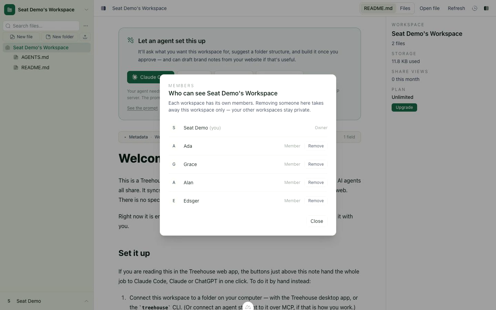
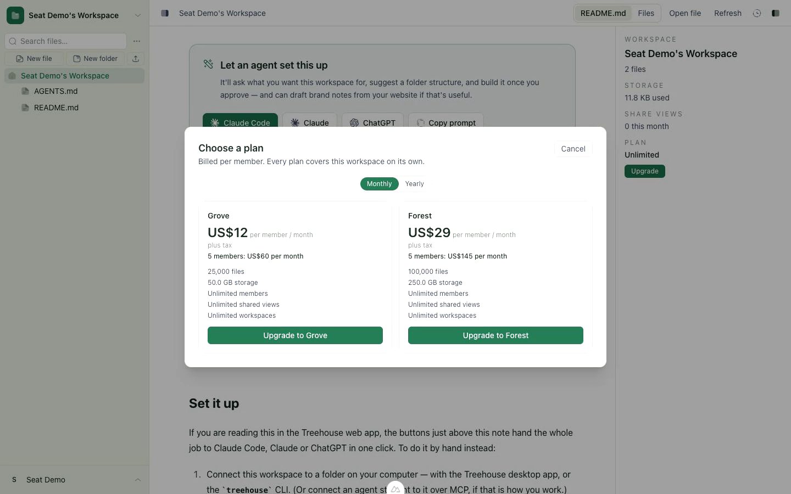
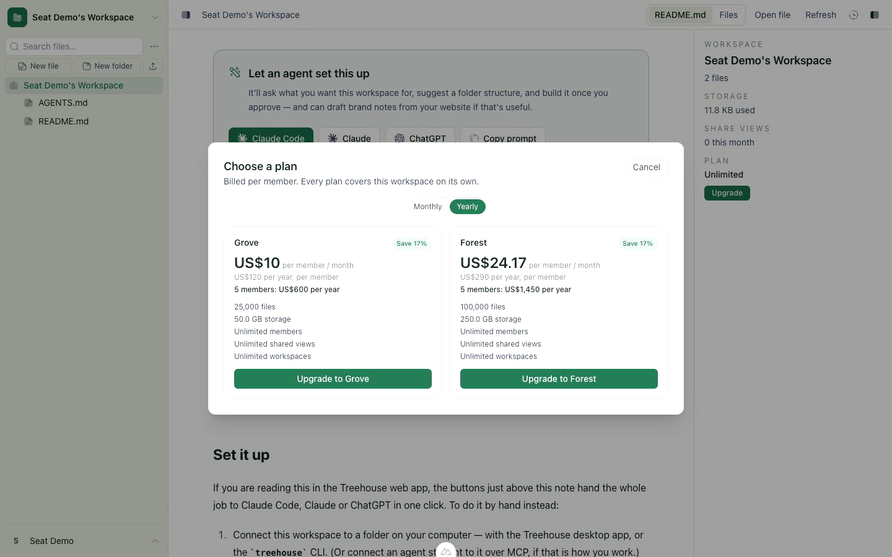
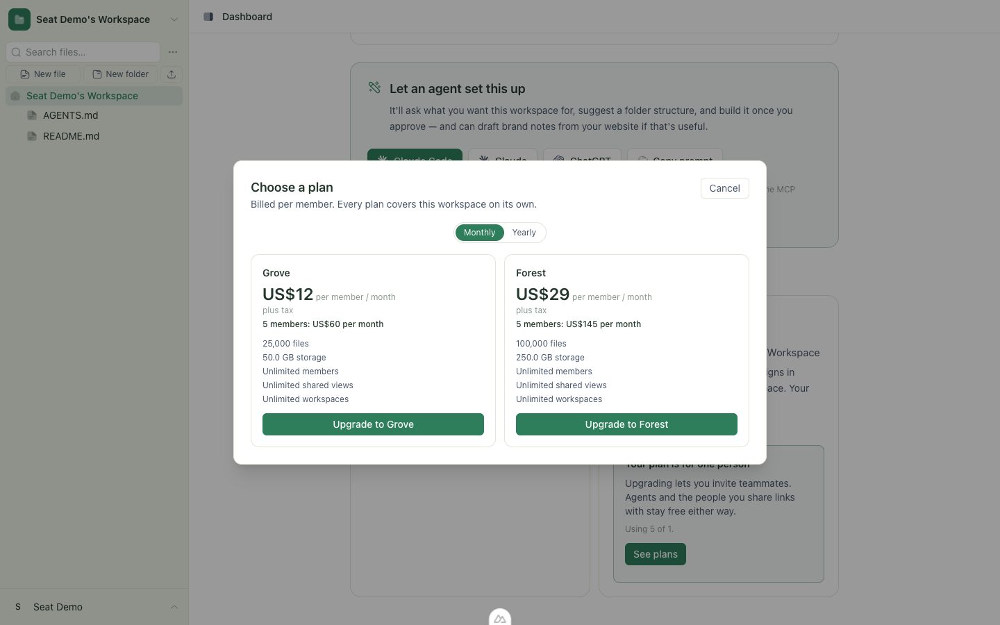

# Test evidence — checkout buys a seat for everyone already in the workspace

Captured 2026-08-28 on branch `t3code/fix-workspace-upgrade-pricing`.

Walkthrough: https://files.catbox.moe/da8890.webm

## The workspace under test

A grandfathered **Unlimited** workspace with five members — the shape that
exposed the bug, since it has people but has never bought anything, so there are
no `seats` to read and the picker previously fell back to a per-member figure.



## What the picker now quotes

Monthly, and the same total on the yearly interval:




**The amounts in these stills are stubbed.** There are no Stripe keys in any
local env, so `/api/plans` was temporarily served fixed prices ($12 and $29 per
member per month) to make the picker render at all. What the stills prove is the
arithmetic and the wiring — `5 × $12 = $60 per month`, `5 × $120 = $600 per
year` — not the prices themselves, which come from Stripe in every real
environment.

## The other way in

Greptile pointed out on the PR that the 402 plan-limit notice opens the same
dialog with only a workspace id, so it would still have quoted a one-person
price. The dialog now resolves the member count itself rather than relying on
its caller to pass one. Driven from the dashboard, on a workspace put on
Seedling so that creating an invite hits the member limit:



"Your plan is for one person — using 5 of 1" → **See plans** → the same
`5 members: US$60 per month`.

## What the checkout route sends

With the same five-member workspace, the route was driven with a temporary log
in place of the (unreachable) Stripe call:

```
checkout for 40dbccd7-4d84-4a3c-8d4c-2df71ab55b71 asking Stripe for 5 seat(s)
```

The quantity on a real Stripe checkout session could not be verified here for
the same reason. `packages/api/test/billing-checkout.test.ts` asserts it in an
environment that has test-mode keys: the plugin writes the local `subscription`
row when checkout OPENS, carrying the seats it asked Stripe for.

## Tests

```
$ vp test packages/api/test/billing-surface.test.ts
  Test Files  1 passed (1)
       Tests  21 passed (21)

$ vp test packages/api/test/billing.test.ts packages/api/test/plan-pricing.test.ts \
      packages/api/test/billing-checkout.test.ts
  Test Files  2 passed | 1 skipped (3)
       Tests  22 passed | 7 skipped (29)
```

`billing-checkout` self-skips without a reachable server on `SMOKE_BASE`; it is
the file carrying the new seat-quantity assertion.